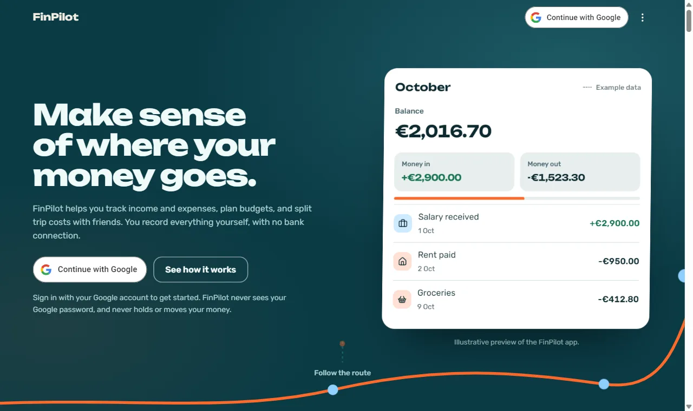
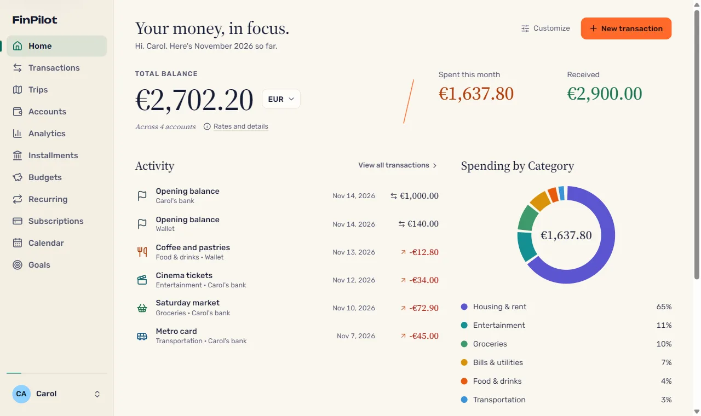
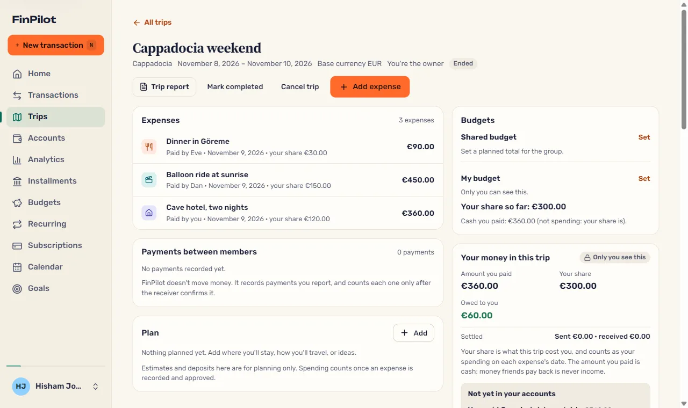
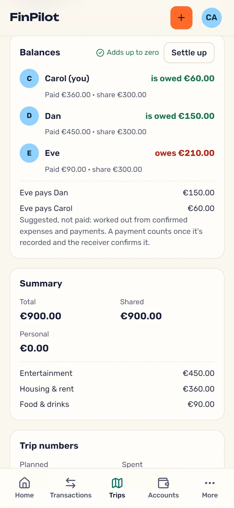

# FinPilot

Personal finance and shared trip expenses in one web app: track your accounts, spending, and budgets, and on a trip see who paid for what, how each cost is split, and who owes whom.

**Live: [finpilot.hishamjouda.com](https://finpilot.hishamjouda.com)**, in English, Arabic, and Turkish.

> The live site is the real product, not a sandbox. Signing in with Google creates a real account, and what you enter is saved. FinPilot is not a bank or payment service, and it never holds or moves money. The privacy notice is still a draft that hasn't been legally reviewed.

<picture>
  <source media="(prefers-color-scheme: dark)" srcset="docs/screenshots/landing-dark.webp">
  
</picture>

## What it does

**Personal finance**

- Accounts, transfers, and transactions on a double-entry ledger, with categories, quick templates, and several currencies
- Monthly budgets with early warnings, recurring payments and subscriptions, installment plans, debts, savings goals, and a calendar
- Insights and reports filtered by period, account, category, currency, and type, with CSV and PDF export and a print layout

**Trip Mode**

- Shared expenses split equally, by fixed amounts, or by percentages, confirmed by the person who paid
- Balances and suggested payments that show who owes whom; a payment counts once the person who received it confirms it
- Multiple currencies, with each expense keeping the exchange rate it was recorded with
- Disputes, trip planning, and trip budgets

**Account and privacy**

- Google sign-in (the only way in), a list of signed-in devices, a personal data download, and account deletion requests
- Light and dark themes, and Arabic shown right to left

<table>
  <tr>
    <td width="62%">
      <picture>
        <source media="(prefers-color-scheme: dark)" srcset="docs/screenshots/home-dark.webp">
        
      </picture>
      <picture>
        <source media="(prefers-color-scheme: dark)" srcset="docs/screenshots/trip-dark.webp">
        
      </picture>
    </td>
    <td width="38%">
      <picture>
        <source media="(prefers-color-scheme: dark)" srcset="docs/screenshots/balances-mobile-dark.webp">
        
      </picture>
    </td>
  </tr>
</table>

<sub>Screenshots of the app with sample data.</sub>

## How it's built

| Area           | Stack                                                                                       |
| -------------- | ------------------------------------------------------------------------------------------- |
| Web            | Next.js, React, TypeScript (strict), Tailwind CSS, next-intl                                |
| API            | Python, FastAPI, Pydantic, SQLAlchemy, Alembic                                              |
| Database       | PostgreSQL, with row-level security                                                         |
| Sign-in        | Google OpenID Connect with PKCE                                                             |
| Reports        | CSV, and PDF rendered with headless Chromium (Playwright)                                   |
| Testing        | pytest, Vitest, Testing Library, Playwright browser tests, Ruff, mypy, ESLint               |
| Infrastructure | Docker Compose, Caddy, Cloudflare Tunnel, GitHub Actions, GitHub Container Registry, restic |

A few decisions worth knowing about:

- **Money is never a float.** Amounts are stored as integers in each currency's smallest unit. The API takes decimal strings and rejects an amount with more decimals than its currency allows, rather than rounding it.
- **History doesn't move.** A foreign-currency expense references the exchange rate it was recorded with, so later market changes never alter past totals.
- **Suggested payments, not optimal ones.** Settlements come from a deterministic greedy algorithm that needs at most one payment fewer than the number of people with a balance. It doesn't always find the true minimum, so the app doesn't claim to.
- **Access is checked twice.** The API checks ownership and trip membership on every request, and PostgreSQL row-level security applies the same rules in the database: personal records are tied to their owner, and a trip's shared records are readable by its members, who never see each other's accounts. A test sweep tries other people's IDs against every API route.
- **Releases are tested as containers.** After CI passes, GitHub Actions runs the full production stack in containers, then publishes the images. The server pulls only those, backs up the database before each deployment, and waits for approval before any migration that could delete data.

The financial rules, with worked examples, are in [docs/FINANCIAL_RULES.md](docs/FINANCIAL_RULES.md).

## Project structure

```
apps/web/           Next.js app; translations are in messages/
backend/app/
  api/v1/           HTTP routes, under /api/v1
  services/         Application logic
  db/               Persistence: engine, sessions, models, role and RLS hardening
  core/             Configuration, logging, errors, request middleware
backend/migrations/ Alembic migrations
backend/tests/      Backend tests
backend/tests_e2e/  Browser tests (Playwright)
backend/tests_stack/ Tests of the running production stack, through the proxy
backend/scripts/    Database provisioning, hardening and maintenance
deploy/             Production packaging: compose, proxy, deployment scripts (see deploy/README.md)
docs/               Product, architecture, financial, security, and roadmap documents
.github/workflows/  CI and releases on GitHub-hosted runners
```

## Running it locally

### Prerequisites

- Node.js 24 or newer, with npm
- [uv](https://docs.astral.sh/uv/) for Python; it uses the version in `backend/.python-version`
- PostgreSQL 15 or newer. Without a database, the app still starts, `/api/v1/readyz` reports 503, and database tests are skipped
- For signing in: a Google OAuth client of your own (see below)

### Setup

```bash
npm install
cd backend
uv sync
```

**Database.** Create dedicated local databases and roles. Review the SQL first; it only creates, and stops if a name already exists. psql asks for your PostgreSQL administrator password itself, and the script writes `backend/.env` without printing any secret.

```bash
uv run python -m scripts.provision_local_db --print-sql   # review; connects to nothing
uv run python -m scripts.provision_local_db               # apply, in your own terminal
```

Or copy `backend/.env.example` to `backend/.env`, and point it at databases you created yourself. Never commit `.env`.

**Sign-in.** Google is the only way in. Create an OAuth client (type Web application) in Google Cloud with the redirect URI `http://localhost:8000/api/v1/auth/google/callback`, and set `GOOGLE_CLIENT_ID`, `GOOGLE_CLIENT_SECRET`, and `GOOGLE_REDIRECT_URI` in `backend/.env`, as shown in `backend/.env.example`. Never reuse the production client.

Optionally, copy `apps/web/.env.example` to `apps/web/.env.local`.

### Start

```bash
# Terminal 1, from backend/
uv run uvicorn app.main:create_app --factory --port 8000

# Terminal 2, from the repository root
npm run dev
```

Open <http://localhost:3000>. It redirects to your language. Use `localhost`, not `127.0.0.1`: sign-in cookies belong to the host in the Google redirect URI, so in development the web app sends `127.0.0.1` to `localhost`.

| URL                                      | Purpose                                                   |
| ---------------------------------------- | --------------------------------------------------------- |
| `http://localhost:3000/en`, `/ar`, `/tr` | Web app                                                   |
| `http://localhost:8000/api/v1/healthz`   | Liveness                                                  |
| `http://localhost:8000/api/v1/readyz`    | Readiness: database reachable, and migrations are current |
| `http://localhost:8000/api/v1/docs`      | Generated API documentation (development only)            |

## Commands

From the repository root:

| Command                                  | Does              |
| ---------------------------------------- | ----------------- |
| `npm run dev`                            | Start the web app |
| `npm run build`                          | Production build  |
| `npm run lint`                           | ESLint            |
| `npm run typecheck`                      | TypeScript        |
| `npm test`                               | Web tests         |
| `npm run format`, `npm run format:check` | Prettier          |

From `backend/`:

| Command                   | Does                                                                                   |
| ------------------------- | -------------------------------------------------------------------------------------- |
| `uv run pytest`           | Backend tests                                                                          |
| `uv run pytest tests_e2e` | Browser tests in Chrome (needs the web app running; see `backend/tests_e2e/README.md`) |
| `uv run ruff check .`     | Lint                                                                                   |
| `uv run ruff format .`    | Format                                                                                 |
| `uv run mypy`             | Type check                                                                             |
| `uv run lint-imports`     | Check that layers depend downward                                                      |
| `uv run alembic history`  | List migrations                                                                        |

### Testing with a database

Database tests run when `TEST_DATABASE_URL` is set in the environment or in `backend/.env`, and otherwise show as skipped. They refuse to run unless the database name ends in `_test` and the host is local, and they check the name again with the server after connecting. Never point them at a database you care about.

## Deployment

Production runs as containers on a single self-hosted server: Caddy in front, the API on a restricted database role with row-level security, and Cloudflare Tunnel for incoming traffic, so no port is open. Releases are built and tested on GitHub-hosted runners and pulled by the server. [deploy/README.md](deploy/README.md) covers packaging and rollback, and [deploy/server/README.md](deploy/server/README.md) covers the server.

## What's next

- **A mobile app**, built on the same API
- **A better phone experience**, possibly as an installable PWA first
- **Spreadsheet (XLSX) export and scheduled monthly reports**, alongside today's CSV, PDF, and print
- **Changes based on feedback** from the people using it

Still open before FinPilot can call itself fully launched: a legally reviewed privacy notice and terms, completing account erasure in production, and a daily cap on new sign-ups. The full plan is in [docs/ROADMAP.md](docs/ROADMAP.md).

## Contributing and security

This is a personal project. Please don't put real financial data in issues, tests, or demos. Pull requests run on GitHub-hosted runners only.

## License

Not yet chosen. Until one is added, all rights are reserved.
