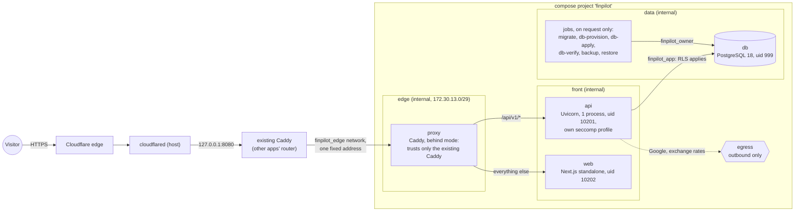

# Deploying FinPilot

The production packaging: two images, one compose project, a reverse proxy with two modes, and scripts that do nothing without an explicit flag. The design and its reasons are in [`docs/PRODUCTION_READINESS.md`](../docs/PRODUCTION_READINESS.md). The home server's facts are in [`docs/SERVER_READINESS.md`](../docs/SERVER_READINESS.md).

**Status (2026-11-13):** production deployment and automatic CI/CD are built (P5). The home server uses **tunnel mode**, and the exact procedure is in [`server/README.md`](server/README.md). Nothing is live until that runbook's verification checklist passes. The integration test below now also runs on GitHub-hosted runners for every release.

## What runs



This is behind mode, the planned production topology on the home server (SERVER_READINESS §15). In **direct mode** the proxy instead terminates TLS itself and publishes loopback ports (`compose.direct.yaml`). The stack test uses direct mode first and then behind mode.

| Container | Networks | Internet | Secrets it can read | User |
|---|---|---|---|---|
| `proxy` | front, edge, egress | Yes (certificates, direct mode) | None | Caddy's (root, no capabilities) |
| `web` | front | **No** | None | 10202 |
| `api` | front, data, egress | Yes (Google, Frankfurter, Coinbase) | `database_url`, `google_client_secret` | 10201 |
| `db` | data | **No** | `postgres_password` | 999 |
| `migrate`, `db-apply`, `backup`, `restore` | data | No | `owner_database_url` | 10201 (backup and restore: 999:10201) |
| `db-provision` | data | No | `admin_database_url`, both role passwords | 10201 |
| `db-verify` | data | No | `database_url` | 10201 |

**Hardening for every container:**
- a read-only filesystem, `no-new-privileges` and no capabilities;
- memory, CPU and process limits, and rotated logs.

**User IDs** are unused on the home server. There, 1000 is the administrator, 999 a service account, and 10001 the AI app's containers. The database keeps the image's 999, because it owns its data directory.

**The API's seccomp profile** is Docker's default plus `clone`, `unshare` and `chroot`, so Chromium's own sandbox can run without `CAP_SYS_ADMIN` ([`seccomp/README.md`](seccomp/README.md)). Every other container keeps Docker's default.

**Every network has a fixed subnet**, so nothing depends on Docker's address pool.

## Files

| File | Role |
|---|---|
| `compose.yaml` | The production project. Publishes nothing |
| `compose.direct.yaml` | Direct mode only: the proxy's two loopback ports |
| `compose.tunnel.yaml` | Tunnel mode (the home server): one loopback port for cloudflared, trusting only the egress gateway for `Cf-Connecting-Ip` |
| `compose.stacktest.yaml` | The stack test only: the test runners and a stand-in for the existing proxy |
| `caddy/site.caddy` | The site, shared by both modes: routing, 1 MB limit, log filter, one `X-Forwarded-For` |
| `caddy/Caddyfile.direct`, `caddy/Caddyfile.behind` | The two modes |
| `testing/edge.Caddyfile` | The stand-in for Cloudflare plus the existing Caddy |
| `seccomp/` | The API's profile, Docker's original, and the generator |
| `scripts/` | Provision, deploy, back up, restore, roll back, stack test, emergency stop, host snapshot |
| `inspection/` | Read-only server inspection and the stack-test preflight |
| `tools/make_bundle.py` | Packs the minimum source for the server test |
| `server/` | Production on the home server: installer, pull-based deployer, nightly restic backup, systemd units, and the runbook ([`server/README.md`](server/README.md)) |

## Production configuration

| Setting | Where | Required value |
|---|---|---|
| `FINPILOT_PROXY_MODE` | `finpilot.env` | `behind` on the home server, `direct` elsewhere |
| `FINPILOT_HOST`, `FINPILOT_ORIGIN` | `finpilot.env` | A dedicated subdomain and its `https://` origin |
| `FINPILOT_EDGE_IP` | `finpilot.env` | Behind mode: the existing Caddy's fixed address on `finpilot_edge`. The FinPilot proxy believes `X-Forwarded-For` from this one address only |
| `FINPILOT_TLS`, `FINPILOT_BIND_ADDRESS`, `FINPILOT_HTTPS_PORT`, `FINPILOT_HTTP_PORT` | `finpilot.env` | Direct mode only. Loopback by default; the HTTP port's default is 8085, because 8080 is taken on the server |
| `FINPILOT_GOOGLE_CLIENT_ID` | `finpilot.env` | The **production** OAuth client, with exactly `${FINPILOT_ORIGIN}/api/v1/auth/google/callback` registered |
| `FINPILOT_*_SUBNET`, `FINPILOT_PROXY_IP`, `FINPILOT_EDGE_PROXY_IP` | `finpilot.env` | Subnets unused on the host. The API trusts `X-Forwarded-For` from `FINPILOT_PROXY_IP` only |
| `FINPILOT_POSTGRES_IMAGE`, `FINPILOT_CADDY_IMAGE` | `finpilot.env` | Pinned by digest at release time |
| `FINPILOT_API_IMAGE`, `FINPILOT_WEB_IMAGE` | `release.env` | **By digest only.** The scripts refuse tags |
| Secrets | `secrets/` | Created by `init-secrets.sh`, plus the Google client secret, which you add |
| Backup repository and password | root-only files | restic: a local repository on a different disk, plus an off-site one |

**How the client address travels (behind mode).** Each hop believes exactly one address:
1. Cloudflare sets `Cf-Connecting-Ip`.
2. The existing Caddy trusts only cloudflared's address for that header, and forwards `X-Forwarded-For: {client_ip}`.
3. The FinPilot proxy trusts only the existing Caddy (`FINPILOT_EDGE_IP`), reads the header right to left, and forwards one address.
4. The API trusts only the FinPilot proxy.

A visitor can't add an address anywhere in this chain.

The API refuses to start in production with:
- http origins;
- a web origin and API origin that differ;
- a redirect URI that isn't the callback on the same host;
- partial or missing Google settings, or a client ID that isn't a Google one;
- no `TRUSTED_PROXIES`, or a catch-all one.

Migrations refuse to run without the separate `MIGRATION_DATABASE_URL`.

`/api/v1/readyz` fails, which keeps the proxy from starting, if:
- the database is behind or ahead of the image's migrations;
- the app's role owns tables or can bypass RLS;
- RLS is missing.

## Isolated integration test on the server

This runs the real images on the home server, in a throwaway project that touches nothing else.

**Isolation:**
- compose project `finpilot-stacktest`, with ports `127.0.0.1:18443` and `:18080` only;
- subnets `172.30.250.0/24` to `172.30.253.0/29`, and its own volumes;
- generated secrets, synthetic people under `example.test`, and a fake Google client;
- no connection to the existing Caddy, PostgreSQL or Redis.

**Safeguards:**
- A watchdog stops the run if any other container changes, memory available drops below 3 GiB, free disk falls under 8 GiB, or the run exceeds 90 minutes.
- Cleanup removes only resources labelled as the test's own.
- A before/after snapshot proves the rest of the host is unchanged.

Run these from the FinPilot folder in **PowerShell on Windows**, after replacing `SERVER_USER` and `SERVER_TAILSCALE_IP` with your SSH user and the server's Tailscale address (they are kept out of the repository). Each `ssh` asks for your key's passphrase.

**1. Preflight (read-only, nothing is copied or started).**

```powershell
cmd /c "ssh -o ConnectTimeout=10 SERVER_USER@SERVER_TAILSCALE_IP bash -s < deploy\inspection\stack-test-preflight.sh > %USERPROFILE%\Documents\finpilot-p4-preflight.txt 2>&1"
```

It must end with `PREFLIGHT PASSED`. On any `FAIL`, stop.

**2. Bundle and copy** (the bundle holds no `.env`, key or secret; `make_bundle.py` refuses otherwise).

```powershell
python deploy\tools\make_bundle.py "$env:USERPROFILE\Documents\finpilot-stacktest.tar.gz"
scp "$env:USERPROFILE\Documents\finpilot-stacktest.tar.gz" SERVER_USER@SERVER_TAILSCALE_IP:finpilot-stacktest.tar.gz
ssh SERVER_USER@SERVER_TAILSCALE_IP "set -e; test ! -e ~/finpilot-stacktest; mkdir -m 700 ~/finpilot-stacktest; tar -xzf ~/finpilot-stacktest.tar.gz -C ~/finpilot-stacktest; rm ~/finpilot-stacktest.tar.gz; echo extracted"
```

**3. Run.** It takes an estimated 30 to 60 minutes, mostly image builds, and survives the SSH session closing. It runs the preflight again first.

```powershell
ssh SERVER_USER@SERVER_TAILSCALE_IP "cd ~/finpilot-stacktest && nohup setsid bash deploy/scripts/stack-test.sh --run > stack-test.out 2>&1 < /dev/null & echo started"
ssh SERVER_USER@SERVER_TAILSCALE_IP "tail -n 25 ~/finpilot-stacktest/stack-test.out"
```

Repeat the second command to follow progress. The run is finished when `stacktest-report/summary.txt` exists.

**4. Fetch the report.**

```powershell
cmd /c "ssh SERVER_USER@SERVER_TAILSCALE_IP tar -czf - -C finpilot-stacktest stacktest-report stack-test.out > %USERPROFILE%\Documents\finpilot-p4-report.tar.gz"
```

**Emergency stop**, at any time. It stops the run and removes only `finpilot-stacktest` resources:

```powershell
ssh SERVER_USER@SERVER_TAILSCALE_IP "bash ~/finpilot-stacktest/deploy/scripts/stack-test-stop.sh --confirm"
```

**Afterwards:** delete the copy with `ssh SERVER_USER@SERVER_TAILSCALE_IP "rm -rf ~/finpilot-stacktest"`, once the report is saved. The images the test built are already removed. Docker's build cache keeps the build layers; the report shows its size before and after.

## Instructions (production, each step needs the owner's approval)

Commands run from the repository's `deploy/` folder on the server, as root, unless noted.

**0. The isolated integration test above must pass first.**

**1. Build and record a release (from a recorded source revision).**

```bash
docker build -t REGISTRY/finpilot-api:REVISION backend
docker build -f apps/web/Dockerfile -t REGISTRY/finpilot-web:REVISION .
docker push REGISTRY/finpilot-api:REVISION && docker push REGISTRY/finpilot-web:REVISION
```

Write the pushed digests into a release file (`release.env.example`).

**2. Prepare the server folder (once):**
1. Copy `deploy/` to `/srv/docker/finpilot/`.
2. Copy `finpilot.env.example` to `finpilot.env`; set `FINPILOT_PROXY_MODE=behind`.
3. Run `scripts/init-secrets.sh --generate`.
4. Put the Google client secret into `secrets/google_client_secret`.
5. Create the restic password file, root-only, and keep a copy off the server.

**3. Connect the existing Caddy (a change to an existing service).** In `/srv/docker/caddy/compose.yaml`, join the existing `caddy` service to the external network `finpilot_edge`, at the fixed address `FINPILOT_EDGE_IP`. Then add to `/srv/docker/caddy/Caddyfile`:

```caddyfile
{
	servers {
		# cloudflared reaches Caddy through Docker's loopback port: this is the address Caddy sees.
		# Confirm it in Caddy's log first; it's the "proxy" network's gateway, expected 172.20.0.1.
		trusted_proxies static 172.20.0.1/32
		trusted_proxies_strict
		client_ip_headers Cf-Connecting-Ip
	}
}

@finpilot host finpilot.example.com
handle @finpilot {
	reverse_proxy 172.30.13.2:8080 {
		header_up X-Forwarded-For {client_ip}
	}
}
```

Recreating the existing Caddy briefly interrupts the other sites. The Cloudflare tunnel also needs a public hostname for FinPilot, unless it has a catch-all rule.

**4. Provision the new database (once).** `scripts/provision.sh --release /path/to/release.env --confirm-new-database`. It:
1. creates the owner and its database;
2. creates the runtime role;
3. runs the migrations as the owner;
4. applies grants and RLS;
5. checks, as the runtime role, that every forbidden action is refused.

Any failure stops it.

**5. Deploy.** `scripts/deploy.sh --release /path/to/release.env --confirm --backup-option --restic-repo --backup-option REPO --backup-option --restic-password-file --backup-option FILE`. It:
1. backs up, except on the very first deployment;
2. runs migrations as the owner;
3. re-applies RLS and verifies it;
4. replaces the API and waits for `/readyz`;
5. replaces the web server and the proxy.

If a step fails, the previous images are put back.

**6. Back up nightly, and off-site.**

```bash
scripts/backup.sh --confirm --restic-repo /srv/storage/backups/finpilot/restic --restic-password-file /root/finpilot-restic.pass [--restic-init]
```

The dump streams straight into restic, encrypted on the client. If the dump fails part-way, no snapshot is kept. The off-site repository (restic on B2 or another S3-compatible store, with object lock) and the nightly timer are still to be chosen and approved (SERVER_READINESS §12).

## Rollback

| Situation | Do this | Database |
|---|---|---|
| A new release is unhealthy | `deploy.sh` already put the previous images back. Otherwise run `scripts/rollback.sh --confirm`, which first shows what it would swap | Unchanged |
| A migration failed | It rolled back in its own transaction, and the old release kept running. Fix it and deploy again | Unchanged |
| **A migration succeeded but is wrong** | 1. Restore with `scripts/restore.sh --from-restic SNAPSHOT --restic-repo REPO --restic-password-file FILE --into finpilot_restore_YYYYMMDD --confirm`. It never writes into an existing database, re-applies RLS, and compares row counts. 2. Check the restored data. 3. To switch, stop `api`, change the database name in `secrets/database_url` and `secrets/owner_database_url`, set `FINPILOT_DATABASE`, and run `scripts/deploy.sh` with the previous release. 4. Keep the old database until you decide | Back to the backup that `deploy.sh` takes before every migration |
| Ingress problem or suspected attack | Behind mode: remove the `@finpilot` block from the existing Caddy, or detach it from `finpilot_edge`. Direct mode: set `FINPILOT_BIND_ADDRESS` back to loopback | Unchanged |
| Stop everything | `docker compose --project-name finpilot stop`. This never uses `down -v`, so data volumes stay | Unchanged |
| A secret was exposed | Replace that file, restart the service that reads it, and rotate it where it lives too: Google Cloud, or `ALTER ROLE` through a SCRAM verifier, as `scripts/rotate_dev_password.py` does | Unchanged |
| The stack test misbehaves | `scripts/stack-test-stop.sh --confirm`: only `finpilot-stacktest` resources | Its own throwaway database only |

`alembic downgrade` is never part of a rollback on real data: most downgrades drop tables.

## What this doesn't do yet

These are launch blockers or pre-beta work (PRODUCTION_READINESS.md, SERVER_READINESS.md §16):
- **The server integration test's results**, until its report is in.
- **The existing Caddy's client-address settings and the `finpilot_edge` connection** (S-B1). These are changes to an existing service, made only after approval.
- **Off-site backups:** the repository, the nightly timer, restore drills, and alerting.
- **Beta access control** (PB-1), legal pages (PB-2), production erasure with `erasure_log` (PB-3).
- Proxy-level per-IP rate limits (PB-8). Cloudflare rate-limiting rules are the simplest second layer.
- Monitoring and an external availability check (PB-6).
