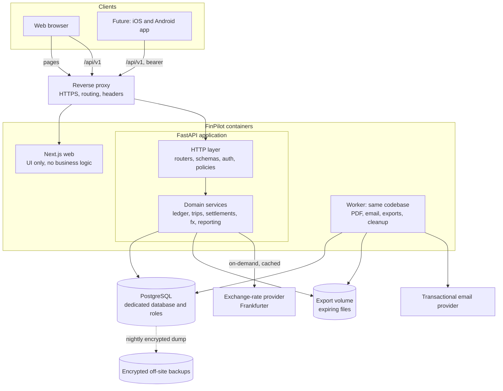
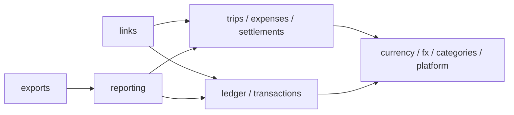
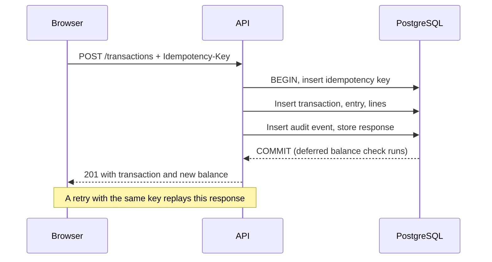
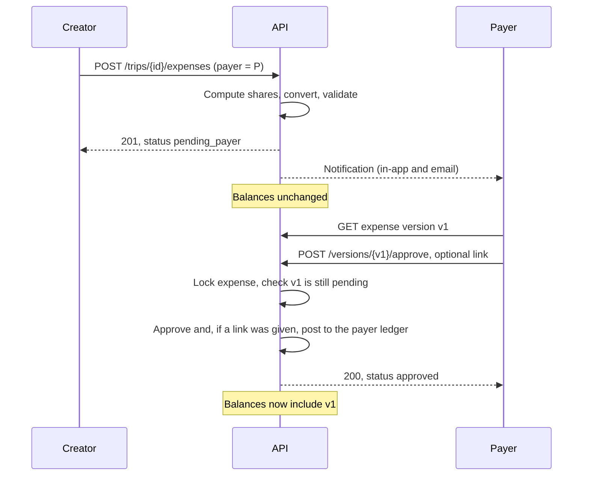
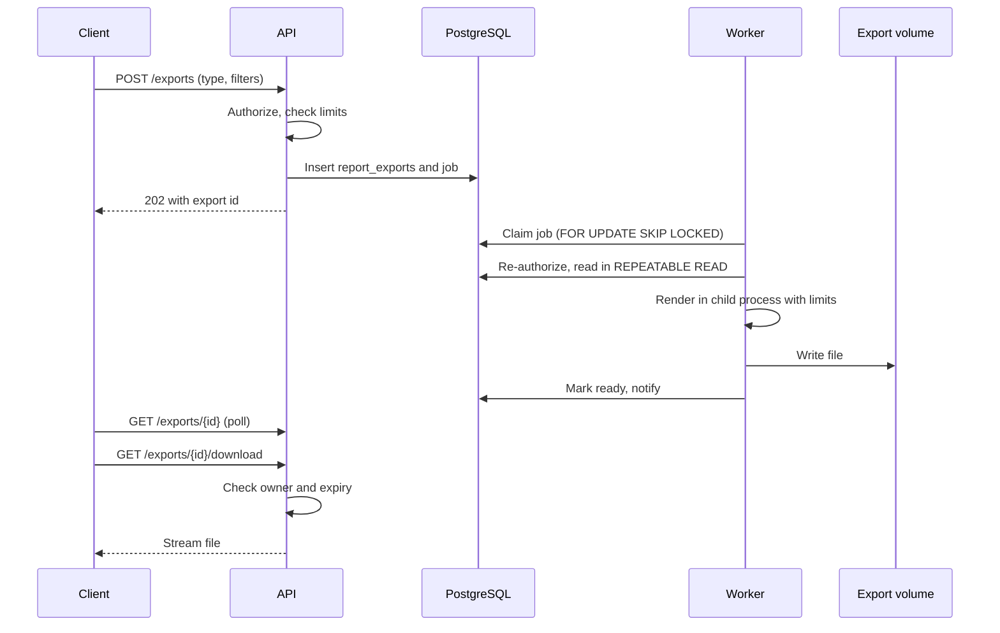
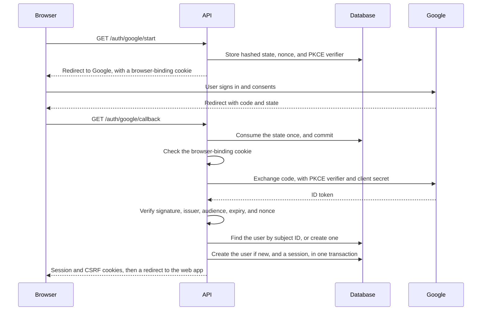
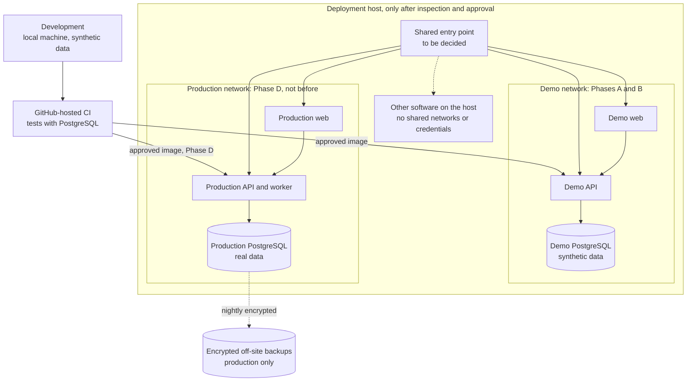
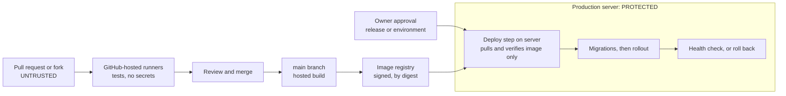

# FinPilot — System Architecture

**Status:** Planning document, updated as the project develops · **Date:** 2026-11-05 · **Incorporates:** OD-1 to OD-5, OD-16, OD-17, OD-21, OD-24, and the language decision
**Role:** How the system is structured and why. Financial rules are in `FINANCIAL_RULES.md`; schema in `DATABASE.md`; endpoints in `API_SPEC.md`; security in `SECURITY.md`.

---

## 1. Summary

FinPilot is a **modular monolith**: one FastAPI application, one worker process from the same codebase, one Next.js web client, and one PostgreSQL database.

| Decision | Choice | Main reason |
|---|---|---|
| Backend shape | Modular monolith | Trip + ledger operations commit in one database transaction; solo developer |
| Database access | Sync SQLAlchemy 2.x with psycopg 3 | Simpler to test and reason about; the workload is database-bound, so async gains little here |
| Background work | One worker using a PostgreSQL job table | Isolates PDF memory and CPU from the API, with no Redis or Celery |
| Web auth | Opaque server-side session in an `HttpOnly` cookie | Revocable sessions are a requirement; no tokens exposed to JavaScript |
| Mobile auth (future) | Same sessions, sent as a bearer token | One session model, one revocation path |
| Sign-in method | **[Approved]** Google OAuth only, for web and future mobile (§5.3) | No passwords to store, reset, or leak; one identity system |
| Web and API origin | **Same origin**: `/api/v1/*` proxied to FastAPI | Removes CORS from the web app; allows `__Host-` cookies |
| Frontend data | Client-side via TanStack Query, with typed client from OpenAPI | No BFF to duplicate logic; mobile uses the same API |
| PDF | Backend WeasyPrint in the worker, subject to a benchmark **and Arabic rendering** spike (§14.11) | Same output on every client; designed for complex scripts, though unproven here |
| Languages | English, Arabic (RTL), and Turkish, with `next-intl` recommended on the web (§14) | Confirmed requirement |
| Trip accounting | **[OD-16 approved]** Cash in the ledger; allocation derived from trip shares (`FINANCIAL_RULES.md` §11, §20) | Implements OD-1 without coupling trips to private ledgers |
| Delivery | **Portfolio-first:** a demo with synthetic data, then the full Web MVP, then public production (`ROADMAP.md`) | Early value without weakening the financial model |
| Hosting | **[OD-21]** A single self-hosted server, conditional on inspection, isolation, and security review (§11) | Conditional, and not assumed suitable |

### What was deliberately left out

Microservices, Redis, Celery, Kafka, event sourcing, CQRS, a repository layer over SQLAlchemy, GraphQL, a BFF, materialized views, WebSockets. Each one solves a problem this project doesn't have at its scale.

---

## 2. System Diagram



---

## 3. Backend Structure

### 3.1 Layers

| Layer | Responsibility | Must not |
|---|---|---|
| **Routers** | Parse request, call auth and policy, call one service function, shape response | Contain business rules or SQL |
| **Services** | Business rules and transaction boundaries | Know about HTTP |
| **Models and queries** | SQLAlchemy models and reusable queries | Decide policy |
| **Pure functions** | Allocation, conversion, simplification, netting | Touch I/O |

**There's no repository layer.** SQLAlchemy's session already provides a unit of work, and another layer would mostly forward calls. Services use the ORM for writes and explicit SQL expressions for reports.

**Pure financial functions have no I/O**, so Hypothesis can run thousands of cases per second against them. This is the most valuable structural decision for financial correctness.

### 3.2 Modules

| Module | Owns | Public interface used by |
|---|---|---|
| `platform` | DB session, settings, logging, errors, idempotency, rate limits, jobs | All |
| `identity` | Users, Google identities, sign-in flows, sessions | All, for the current user |
| `audit` | Audit events | All, for writing |
| `notifications` | Inbox, email queueing | Trips, settlements, links |
| `currency` | Currency table, `Money`, conversion, allocation | Ledger, trips, reports |
| `fx` | Rate lookup, provider adapter, manual rates | Trips, transactions |
| `ledger` | Accounts, ledger accounts, journal posting, balances | Transactions, links, reporting |
| `transactions` | Transaction documents, corrections, Quick Add | Links, reporting |
| `categories` | System and custom categories | Transactions, budgets, trips |
| `budgets` | Budget limits, progress | Dashboard |
| `analytics` | Dashboard aggregates | Web |
| `trips` | Trips, members, invitations, policies | Expenses, settlements |
| `expenses` | Versions, approvals, shares, disputes | Reporting, links |
| `settlements` | Settlements, netting, suggestions | Reporting, links |
| `links` | Personal links and duplicate detection: **the only module allowed to write across both worlds** | Web |
| `privacy` | Deletion eligibility, erasure, `data_requests` | Web |
| `i18n` | Backend catalogs and locale-aware formatting for email, PDF, and CSV | Notifications, exports |
| `demo` | Sandbox creation, persona switching. **Mounted only in the demo environment** | Web, demo only |
| `reporting` | Report view models | Exports, web |
| `exports` | CSV streaming, PDF rendering, files | Web |

### 3.3 Dependency rules



- **`trips`, `expenses`, and `settlements` must never import `ledger` or `transactions`, or the reverse.** This one rule enforces the separation that prevents double-counting and privacy leaks (INV-18). Events reach `links` through a direct function call: when an expense is corrected, `expenses` calls a registered hook, and `links` marks affected links `needs_review` within the same transaction.
- `analytics`, `budgets`, and `reporting` are read-only composers and may read from both sides, through one shared allocation query. That's how personal spending combines non-trip ledger spending with allocated shares (OD-17), and how budgets count allocations (OD-10). They never write to either side, and they keep cash and outstanding balances out of each other's totals.
- Dependencies are checked in CI with **import-linter**, so the boundary can't erode unnoticed.

### 3.4 Why a monolith, specifically

Linking must atomically touch trip state and a ledger. In a monolith, that's `BEGIN … COMMIT`. In services, it would require sagas, compensation logic, and handling of partial failure, for a system with one developer and one server. Module boundaries deliver the organizational benefit without the distributed-systems cost.

### 3.5 Sync over async

FastAPI supports both. Sync `def` endpoints run in a thread pool, and that is the recommendation here because:

- **Almost all request time is database work,** and with a small pool on a small server, async doesn't add usable concurrency.
- **Row locks and transactions are easier to follow** in sequential code.
- **The test suite stays simpler.**
- **It's easy to reason about under failure.**

The FX provider call is the only external call in a request. It has a 3-second timeout and falls back cleanly. As built in M5 (`app/services/fx_providers.py`, `fx.py`): Frankfurter v2 for currencies and gold, Coinbase's public spot price for Bitcoin equivalents only. Provider calls happen only in previews and equivalents, never while a financial write holds locks: saving references a rate already stored.

---

## 4. Key Data Flows

### 4.1 Quick Add expense



### 4.2 Proposing and approving an expense for another payer



### 4.3 PDF export

**As built in M6 (for approval):** WeasyPrint could not load on the Windows development machine (GTK/Pango libraries missing), so PDF uses the §14.11 fallback: the Jinja template is rendered by headless Chromium through Playwright (`pdf_browser_channel=chrome`, or `pdf_browser_path`), with JavaScript disabled and every network request blocked. Output: A4, repeated table headers, page X of Y footer, embedded subset fonts (Arabic shaped and RTL, Turkish characters verified). It runs synchronously in the request, bounded by `pdf_timeout_seconds` and `pdf_max_rows`, instead of the planned job table; moving it to the worker keeps the same shape. Production needs Chromium in the image.




---

## 5. Web Application

### 5.1 Boundaries

Next.js is **the presentation layer only**.

- **Marketing and auth pages** use server rendering or static generation.
- **The authenticated app** is primarily client-rendered, using TanStack Query against `/api/v1`.
- **No Next.js route handlers or server actions touch financial data.** This keeps one API for web and mobile.
- **A lightweight redirect** based on the session cookie's presence can avoid a flash of the wrong page, but it isn't security. The API authorizes everything.

### 5.2 Frontend rules

| Rule | Reason |
|---|---|
| Never calculate money | One source of truth; preview endpoints provide live results |
| Types generated from OpenAPI | Contract drift becomes a compile error |
| Forms: `react-hook-form` and Zod for shape only | Business validation stays on the server |
| Charts: Recharts | Fits the stack; v3 supports React 19. Numbers used for geometry only |
| Print: dedicated route and CSS | See §6.5 |
| Mutations: pessimistic for money | Show a confirmed result, not an optimistic guess |
| All text from catalogs; all amounts through one `<Money>` component | §14 |
| Logical CSS properties only | RTL works by construction, and lint enforces it |

Optimistic UI is deliberately not used for financial writes. Showing a balance that may not end up being true is the wrong trade-off for this product.

### 5.3 Authentication architecture [Approved: Google only]

**Status:**
| Part | State |
|---|---|
| Identity schema, and `oauth_states` (migrations 0001, 0002) | Built, applied to development |
| Removing password-era tables, and the sign-in return path (migrations 0003, 0004) | **Built, applied to development** |
| Google flow up to a verified user, with tests against a fake Google | **Built (A2.2)** |
| Sessions, logout, `/auth/me`, profile, session management, authorization dependencies, CSRF, rate limits | **Built (A2.3)** |
| Tested against real Google | **Verified in development (A2.4):** a real sign-in, account creation, session cookies, `/auth/me`, a repeat sign-in to the same user, logout, and refusal of the revoked token. Automated tests still use a local fake |
| Frontend sign-in, protected app shell, profile, sessions, logout, CSP | **Built (A2.5).** Tested in the browser against a mocked API. A real Google sign-in through the new pages needs the owner (§5.4) |

**Google is the only identity provider.** There's one `users` table for profile data, and `user_identities` links each user to a Google `sub`. **Google only proves who someone is, at sign-in.** After that, FinPilot issues its own session, and authorization never depends on Google.

**Is the server-side session approach still suitable? Yes.** Revocation is a stated requirement, Google outages mustn't log anyone out, and the same session works for web cookies and mobile bearer tokens.

**Code layout:**
| Module | Role |
|---|---|
| `app/services/google_oidc.py` | The only code that talks to Google: discovery, code exchange, and ID token verification with PyJWT |
| `app/services/google_signin.py` | Starting a flow, consuming state, and finding or creating the user |
| `app/api/v1/auth.py` | The routes, cookies, and error mapping |

The provider is an interface. **The application only ever builds the real client.** Tests swap in a fake Google through dependency overrides, and nowhere else.

| Client | Sign-in | Session |
|---|---|---|
| **Web** | Backend-driven authorization code flow with state, nonce, and PKCE. The client secret stays on the server | Opaque token in a `__Host-` cookie |
| **React Native (future)** | System browser or native Google sign-in with PKCE, no client secret on the device. The app sends the ID token and nonce to the API | The same opaque session, returned as a bearer token, kept in secure storage |



**Libraries:** PyJWT with `cryptography` for token verification, and httpx2 for HTTP. **Nothing verifies signatures by hand.**

#### Sessions [Built in A2.3]

| Stage | What happens |
|---|---|
| **Issue** | At the end of a successful callback, in the same transaction as the user and identity. A new 256-bit token every time; any session the browser already presented is revoked (rotation). Committed **before** any cookie is set |
| **Store** | Only `SHA-256(token)`, and for web, `SHA-256(csrf_token)`. The raw tokens exist only in cookies |
| **Check** | Every request looks up the hash, and requires it to be unrevoked, within its idle and absolute expiry, and to belong to an account that may sign in. Never calls Google |
| **Slide** | Use extends the idle expiry, at most once a minute, and never past the absolute expiry |
| **End** | Logout, revoking one session, revoking all others, suspension (on the next request), or expiry. Dead rows are deleted in batches 30 days later, whenever a session is issued |

**Dependencies** (`app/api/deps.py`), for every future route:

| Dependency | Gives | Refuses with |
|---|---|---|
| `get_optional_session` | The session, or nothing | — |
| `require_session` / `require_user` | A valid session and its user | 401 `not_authenticated` |
| `require_active_session` / `require_active_user` | The same, for an account that may sign in | 403 `account_unavailable`, ending that session |
| `require_csrf` / `require_writable_user` | The same, for a change | 403 `csrf_failed` |

**The user always comes from the session.** Ownership is enforced by scoping each query to that user, so another user's records aren't found (404), rather than found and refused. A test fails if any state-changing route lacks the CSRF dependency, or any non-public route lacks a session.

**Transactions:** the request's session commits at the end, and routes that set cookies commit explicitly first. Audit events are written in the same transaction as what they describe, so **if an audit write fails, the change fails too**.

#### Future mobile clients [Not built]

| Concern | Plan |
|---|---|
| Google client | A separate OAuth client per platform (Android, iOS). **No client secret ever ships in an app** |
| Sign-in | System browser or the native Google sign-in SDK, with PKCE. The app receives an ID token |
| Exchange | `POST /auth/google/mobile` with the ID token and a nonce the API issued. The API verifies it against an allowlist of the mobile client IDs |
| Session | The same `sessions` table, `client_type = mobile`, with no CSRF hash. The token is returned once, in the response body |
| Transport | `Authorization: Bearer`. A request may use a cookie or a bearer token, never both. CSRF checks don't apply to bearer requests, because browsers never send them automatically |
| Storage | `expo-secure-store` (Keychain or Keystore). Never AsyncStorage |
| Today | **Bearer tokens are deliberately refused.** Only the web cookie path exists |


### 5.4 Web client [Built in A2.5]

**Routes** (every one under the locale: `/en`, `/ar`, `/tr`):

| Route | What it is |
|---|---|
| `/{locale}` | Public landing page and the only way in: Continue with Google, the translated sign-in errors, and the "session ended" notice. `/{locale}/sign-in` is gone; the proxy redirects old links here |
| `/{locale}/app` | Home: a greeting, setup from the real profile, and what's coming. **No financial figures** |
| `/{locale}/app/settings` | Profile and preferences: `PATCH /auth/me` fields only. Email is read-only |
| `/{locale}/app/settings/sessions` | Signed-in devices: list, revoke one, revoke all others |
| `/{locale}/app/{accounts,transactions,budgets,insights,reports,trips}` | Honest placeholders: each says it isn't built and which milestone delivers it, and holds no data or working controls. Any other section is a 404 |

**Talking to the API.** The browser calls only `/api/v1` on its own origin, through the Next.js rewrite to the API, so cookies are first-party and there's no CORS. One client (`src/lib/api.ts`) sends `credentials: same-origin` and `cache: no-store`, and adds `X-CSRF-Token` (copied from the readable `fp_csrf` cookie) to every unsafe method. It classifies failures: **401 is a confirmed sign-out. No answer, a timeout, or a 5xx from the proxy is "unavailable", never a sign-out.** Nothing goes in `localStorage` or `sessionStorage` except the theme.

**Route protection** has two layers:
1. `src/proxy.ts` sends `/{locale}/app/...` without a session cookie to the landing page, with `next` set to that page. This only avoids a flash; it isn't security.
2. In the browser, nothing under `/app` renders until `GET /auth/me` answers. The server-rendered HTML holds no account data.

| `/auth/me` answer | What the app does |
|---|---|
| 200 | Shows the app |
| 401 | Clears the stale cookies (`POST /auth/logout`, which needs no CSRF without a live session), then sign-in with `notice=expired` and `next` |
| 403 `account_unavailable` | Clears the cookies, then sign-in with `error=account_unavailable` |
| No answer, or 5xx | "FinPilot can't be reached", with Try again. The session is kept |

**Return paths.** `next` must match `^/(en|ar|tr)/app(/[A-Za-z0-9._~-]+)*/?$`, with no `.` or `..` segments; anything else is dropped. It becomes the API's `return_to`, which the API checks again. Signing in with another language keeps the page and swaps its language prefix.

**Sign-in page.** `error` and `notice` are checked against fixed lists before rendering, and removed from the address bar once shown. Unknown errors show the generic message. If the readable CSRF cookie exists, the page asks `/auth/me` and, when signed in, goes straight to the app. That decision is the API's, never the cookie's, so there's no redirect loop. Before leaving for Google, the button checks `/api/v1/healthz`, so a stopped API shows a message instead of an error page.

**Logout** is `POST /auth/logout` with CSRF. The server revokes the session and clears the cookies; the app then forgets the profile and replaces the page with the landing page, in the same language. If the API can't be reached, the person stays signed in and is told so. Back after sign-out can't show account data:
- app pages are `Cache-Control: private, no-store`;
- the proxy redirects requests without a cookie;
- a page restored from the back-forward cache hides itself and asks the API again.

**Language and theme.** Changing language in the app saves `locale` to the profile, then loads the same page under the new prefix. The URL decides the page's language (§14.3). The theme is next-themes, kept in `localStorage` (`fp_theme`) and applied before paint by a nonced script.

**Content Security Policy** (`src/lib/csp.ts`, applied per response in `src/proxy.ts`). Production:

```
default-src 'self'; script-src 'self' 'nonce-…' 'strict-dynamic'; style-src 'self' 'nonce-…';
style-src-attr 'unsafe-inline'; img-src 'self' data: blob:; font-src 'self'; connect-src 'self';
object-src 'none'; base-uri 'self'; form-action 'self'; frame-src 'none'; frame-ancestors 'none';
manifest-src 'self'; worker-src 'self' blob:; upgrade-insecure-requests
```

- **Nonce:** a new 128-bit nonce per response. Next.js puts it on its own scripts and styles; next-themes receives it as a prop. Every page is therefore rendered per request, since a static page would share one nonce, and no page can be cached by shared caches.
- **Documented exception:** `style-src-attr 'unsafe-inline'`. React renders style props as attributes, and positioning libraries rely on them. An attribute can't run script.
- **Development only:** `'unsafe-eval'` (React's error stacks), inline styles (the Next.js error overlay), and `ws:` (live reload). None of these is in production builds.
- **Tested** in Chrome against `next build` and `next start`: landing, sign-in, home, settings, sessions, and a placeholder, in three languages, with theme switching. **No violations.**
- **Other headers:** `X-Content-Type-Options: nosniff`, `X-Frame-Options: DENY`, a restrictive `Permissions-Policy`, and `Referrer-Policy: no-referrer` on sign-in and app pages (`strict-origin-when-cross-origin` elsewhere).

**Development host.** Sign-in cookies belong to the host in `GOOGLE_REDIRECT_URI` (`localhost`), so in development the proxy redirects `127.0.0.1:3000` to `localhost:3000`.

**Deliberately not yet:**
- TanStack Query and generated OpenAPI types (§5.1, §5.2) arrive with A3, when there are lists to cache. A2.5 has five endpoints and a small typed client.
- No profile picture: the API returns none, so the avatar is initials.
- Terms acceptance after the first sign-in isn't built: no terms text exists yet (`RISKS_AND_OPEN_QUESTIONS.md`).


---

## 6. Reporting and Export

### 6.1 Service boundaries

```
reporting.queries      Shared SQL: totals, balances, trip nets (also used by dashboard)
reporting.personal     Builds PersonalReport view model
reporting.trip         Builds TripReport and ParticipantReport view models
exports.csv            Streams rows
exports.pdf            Template + view model → PDF bytes
```

A **view model** is a plain, typed structure holding only preformatted values. JSON responses, PDF, and print all render from the same view model. That's what makes "print and PDF match the screen" a structural property, not a testing aspiration.

### 6.2 PDF approach evaluation

| Option | Maintainability | Consistency | Server cost | Mobile | Long tables | Complex scripts |
|---|---|---|---|---|---|---|
| **WeasyPrint** (HTML/CSS → PDF, no browser) | High: Jinja templates and CSS | Same everywhere | Moderate, with spikes on long tables | Works: just a file | `thead` repeats; **documented slow path for multi-page tables** | Good: uses Pango |
| ReportLab (programmatic) | Medium: layout written in code | Same everywhere | Low | Works | Strong: built for this | Weaker without extra work; **needs verification** |
| Headless Chromium (Playwright) | High: real CSS | Same everywhere | **High**: heavy image and memory per render | Works | Good | Excellent |
| Browser-generated PDF | Low: varies by browser | **Poor** | None server-side | **No path on mobile** | Varies | Excellent |
| Screenshot | — | — | — | — | — | Forbidden by the brief |

**Recommendation: WeasyPrint in the worker, conditional on a spike that now includes Arabic.**

The reasons:
- Arabic and Turkish are launch languages, and Pango is designed to shape these scripts. **This hasn't been tested here** (§14.11).
- HTML and CSS templates are far easier to brand and maintain than code-defined layouts, and mirroring for RTL is largely one attribute.
- There's no browser to run.

**The known weakness is real.** WeasyPrint's own documentation says multi-page tables are slow, and older GitHub issues describe very high memory use on huge documents (one report: nearly 3 GB for 1,500 pages, from an old version, so it says little about current performance). So:

1. **Spike at the start of Phase C, before reporting begins:** render 5,000-row A4 tables in English and Arabic, in a container **on the target hardware**, measuring time and peak memory, and have a person review the Arabic output. The test list is in §14.11. One day.
2. **Use `table-layout: fixed`,** explicit column widths, and a small stylesheet.
3. **Cap detail rows** based on the measured result (initially 5,000 rows).
4. **Fallback:** `exports.pdf` takes a view model and returns bytes, so the renderer can be replaced without touching anything else. Fallbacks and their costs are in §14.11.

### 6.3 Synchronous vs background

| Export | Mode | Reason |
|---|---|---|
| **PDF** | **Always background** | CPU-heavy and memory-spiking; a shared server can't let it run inside API workers. One code path; small reports finish in moments, and the UI barely notices |
| **CSV** | **Synchronous stream** | Low memory using a server-side cursor; no need for a file |
| **Personal data export** | Background | Larger bundle, rare |
| **Print** | Client-side | Browser print dialog on fetched data |

**Why no Redis or Celery:** the workload is rare, low-volume jobs from a handful of users. A PostgreSQL table with `FOR UPDATE SKIP LOCKED` gives durable queuing, transactional enqueue with the request, and no new service.

### 6.4 Limits

All are initial values to be tuned after the spike.

| Limit | Value |
|---|---|
| Concurrent PDF renders, server-wide | 1 |
| Active exports per user | 1 |
| Exports per user per hour | 10; 30 PDFs per day |
| Queued PDFs, server-wide | 20; above that, 429 with a "busy" message |
| PDF detail rows | 5,000 |
| PDF render timeout | 120 s |
| Worker memory limit | 1 GB container; 768 MB address-space limit on the child |
| CSV rows per request | 100,000 |
| Concurrent CSV streams per user | 1 |
| Print view rows | 2,000; above that, the UI recommends PDF |
| File retention | 24 hours |

When a limit is exceeded, the API returns a clear error telling the user how to narrow the filters. Rows are never silently dropped.

Rendering happens in a **child process**, so a runaway render or memory failure kills only that child, and the job is marked failed.

### 6.5 Printing

A dedicated route (such as `/reports/print?…`) fetches the same report response with a row limit, then calls `window.print()`.

- CSS `@media print` hides navigation and controls.
- `@page { size: A4 }` sets the page.
- `thead { display: table-header-group }` repeats headers.
- `break-inside: avoid` protects rows and summaries.
- The report's metadata block matches the PDF's.

Totals come from the API, so they match by construction. Browsers vary in print fidelity, so the UI offers PDF as the reliable option for formal documents.

### 6.6 Temporary files

Files live on a dedicated volume under random, non-derivable names. They're only ever served through an authorized API endpoint, never by a static path. The worker deletes them when they expire, and marks the row `expired`.

---

## 7. Background Worker

One container, same image, different command:

- **Polling:** every few seconds, it claims a queued job.
- **Job types:** `render_pdf`, `send_email`, `data_export`, `purge_expired`, `erase_account`.
- **Schedules:** a small built-in clock inserts daily jobs with a `dedupe_key` such as `purge:2026-11-05`, so restarts can't double-run them.
- **Failure:** retries with backoff up to `max_attempts`. A crashed job is detected through a stale `started_at` and requeued.

**Exchange rates are not fetched on a schedule.** They're fetched on demand and cached forever. Rates nobody asks for needn't exist.

---

## 8. Future Mobile

### 8.1 What's prepared now

| Requirement | How the current design meets it |
|---|---|
| Shared business logic | All of it is behind the REST API |
| Authentication | Google sign-in only. `POST /auth/google/mobile` returns a bearer token; store it in `expo-secure-store` |
| Google sign-in | Native flow with PKCE, no client secret on the device (§5.3) |
| PDF sharing | Backend file; download, then use the native share sheet |
| Flaky networks | Idempotency keys make retries safe |
| Stable contracts | `/api/v1`, additive-change policy, OpenAPI |
| CORS | Native apps aren't subject to it, so same-origin web doesn't block mobile |

### 8.2 Shared contracts

**Recommendation: generate from OpenAPI, using a small shared package.**

```
packages/api-client   openapi-typescript types + openapi-fetch client + TanStack Query helpers (added with the first real endpoints)
apps/web              Next.js UI
apps/mobile           Expo UI (future)
backend               FastAPI (source of the OpenAPI document)
```

- CI generates the OpenAPI document and fails if the committed client is out of date.
- `openapi-typescript` is at a stable major version, unlike `@hey-api/openapi-ts`, which is still pre-1.0 and whose API may change. It generates more, but `openapi-typescript` has less risk for a long-lived project.
- **UI components are not shared.** Web and native have different interaction models. Formatting helpers and design tokens can be shared.

### 8.3 Scope

Android and iOS share one Expo codebase using Expo Router and development builds. Core screens: authentication, dashboard, Quick Add, transaction history, budgets, Trip Mode, settlements, and reports (viewing and PDF sharing). Web-only at first: complex report building.

**Quick Add is the feature that most justifies a mobile app.** It needs minimal fields, recent accounts and categories, and deep links, and it can use the existing endpoints.

Mobile localization, including RTL, is planned in §14.10. All three languages are expected from the first mobile release.

---

## 9. Native Widgets (Future)

Researched on 2026-11-05. **Re-verify at the start of this phase**, since this area changes quickly.

| Finding | Source |
|---|---|
| `expo-widgets` supports home-screen widgets on iOS and Android; **needs a development build**, not Expo Go | Expo docs (SDK 58) |
| Android support is **opt-in** with a subset of Jetpack Compose; standard RN views aren't available | Expo docs |
| Timelines, configurable widgets, and Live Activities are **iOS only** | Expo docs |
| Interactive buttons need **iOS 17+** | Expo docs |
| Widget code **can't use hooks, state, context, or async work** | Expo docs |
| The docs mention **no text input** | Expo docs (absence, so confirm) |
| iOS needs an App Group to share data with the app | Expo docs |
| Stability labels conflict: Expo's blog and third-party articles disagree on whether it's still alpha | Not settled; check first |
| Alternatives: `@bacons/apple-targets` (SwiftUI), `react-native-android-widget`, or native Glance | Community docs |

**Consequence: a widget can't be a form.** A "Quick Expense widget" means preset buttons or a deep link.

| Widget | Realistic design |
|---|---|
| **Quick Expense** | Button deep-links to `finpilot://quick-add`. A later version could add preset category buttons |
| **Budget Overview** | Read-only snapshot refreshed by the app |
| **Account Balance** | Read-only, **hidden by default** with a privacy toggle |
| **Active Trip** | Your net balance and pending approvals; deep link to the trip |
| **Quick Trip Expense** | Deep link: `finpilot://trips/{id}/expenses/new` |

**Privacy and security:**
- Widgets show cached summaries only, never the auth token.
- The token stays in secure storage. Widgets don't call the API.
- Amounts are hidden unless the user opts in, since home screens are visible to others.
- Data is cleared on logout.

**Update strategy:** the app writes a snapshot after sync, then asks for a reload. Widget refresh isn't real-time on either platform, so the widget displays "as of" text.

**Shortcuts:** App Intents (iOS) and Android App Shortcuts are the better route to real one-tap entry. They need native code, so they come after the base widgets.

---

## 10. Technology Versions

Latest versions **observed on 2026-11-05** from PyPI, the npm registry, and postgresql.org. Exact pins go in lockfiles at scaffolding, after compatibility is confirmed together. This is an observation, not a tested combination.

| Package | Observed | Requires | Notes |
|---|---|---|---|
| FastAPI | 0.162.0 | Python ≥ 3.10 | |
| Pydantic | 2.14.3 | Python ≥ 3.10 (inferred from its release notes) | |
| SQLAlchemy | 2.1.8 | Python ≥ 3.11 | Sets the minimum Python |
| Alembic | 1.20.1 | SQLAlchemy ≥ 2.0 | |
| psycopg | 3.3.8 | Python ≥ 3.10 | |
| PyJWT, with `cryptography` | 2.15.1, 50.0.2 | Python ≥ 3.9 | Google ID token verification. Installed in A2.2 |
| httpx2 | 2.16.0 | Python ≥ 3.11 | Pydantic's maintained httpx fork. Calls to Google |
| WeasyPrint | 70.0 | Python ≥ 3.10, Pango ≥ 1.44 | Pango must be in the image. BSD licensed |
| ReportLab | 5.1.0 | Python ≥ 3.9 | Fallback only |
| Hypothesis | 6.170.14 | Python ≥ 3.11 | |
| Next.js | 16.4.5 | Node ≥ 20.9; React 18.2 or 19 | |
| TanStack Query | 5.106.1 | React 18 or 19 | |
| Recharts | 3.10.1 | React 16.8–19 | |
| openapi-typescript | 7.13.0 | | |
| next-intl | 4.14.9 | Next 12–16; React 16.8–19 | Peers checked; not run on this stack |
| PostgreSQL | 18.6 current | | 14 reaches end of life on 2026-11-12; 15 on 2027-11-11; 16 on 2028-11-09 |

**Python:** use the newest release for which every dependency has wheels, confirmed at scaffolding. The minimum is 3.11.

**PostgreSQL:** target 16 or newer. The schema doesn't require anything newer, so the server's existing version can be used if it's supported. **If the server runs 14, it reaches end of life within days of this document's date.** Check in the inspection below.

**Not checked:** Tailwind, shadcn/ui, Playwright, pytest, and Expo package versions weren't looked up individually. They need the same check at scaffolding.

---

## 11. Deployment

**Nothing here has been checked against the real server, and no access was attempted.** All of it depends on the checklist in §12.

**Hosting [OD-21]: a single self-hosted server, subject to inspection, isolation, security review, and explicit approval before any deployment.** Conditions are in `SECURITY.md` §14.4 for the demo, and §13.6 for production.

### 11.0 Logical environments



| | **Development** | **Portfolio Demo** | **Public Production** |
|---|---|---|---|
| Phase | A onward | A8 onward | D |
| Data | Synthetic | **Synthetic only** | **Real** |
| Users | The developer | Visitors, in sandboxes | The public |
| Sign-in | Google, with development credentials | **No Google.** A sandbox session per visitor | Google. Open to the public only after the launch gate |
| Email | Not needed until notifications | None | Real provider |
| Backups | Not needed | Not needed; reset nightly | Encrypted, off-site, tested |
| Worker | From C1 | None | Yes |
| Gate | None | `SECURITY.md` §14.4 | `SECURITY.md` §13.1 and §13.6 |

**The demo's database and credentials are separate from production's, permanently.**

### 11.1 Containers

| Service | Image | Initial memory limit (estimate) | Notes |
|---|---|---|---|
| `finpilot-web` | Next.js standalone | 384 MB | Non-root |
| `finpilot-api` | FastAPI, Uvicorn, **1 process** (the rate limiter is per process; see `PRODUCTION_READINESS.md` LB-5) | 1 GB with Chromium | Non-root, read-only filesystem |
| `finpilot-worker` | Same image as API, plus Pango | 1 GB | Non-root; concurrency 1 |
| Migration job | Same image | One-off | Runs before API start, using the migrator role |
| `finpilot-demo-web`, `finpilot-demo-api`, `finpilot-demo-db` | Same images, plus PostgreSQL | 256 MB each | One API worker. No worker service in Phases A and B |
| Demo reset job | Same image | One-off, nightly | Truncates and reseeds, using the demo's migrator role only |

These limits are **estimates to be replaced by measurement** at A8 for the demo and PD3 for production.

### 11.2 Storage

Exports and backups live on persistent volumes outside the containers, with paths set by deployment configuration. The demo needs no host storage beyond its database volume.

### 11.3 Database placement [OD-14]

**The demo uses its own small PostgreSQL container** on an internal network, so that it can't reach any other database on the host. Production gets a dedicated database with least-privilege roles, in its own container unless measurement rules that out. The build should include ICU collations, which are needed for Turkish and Arabic sorting.

### 11.4 Networking

- The public entry point is a deployment decision (OD-20).
- The reverse proxy terminates HTTPS and routes `/api/v1/*` to the API and everything else to the web container.
- App containers join a dedicated internal Docker network, and publish no ports to the host.
- Proxy access logs must not record tokens or query strings on sensitive routes.
- Invitation tokens are carried in the URL fragment, which isn't sent to the server.

### 11.5 Observability

| Need | Approach |
|---|---|
| Liveness | `GET /api/v1/healthz` (process only) |
| Readiness | `GET /api/v1/readyz` (database reachable, migrations current) |
| Uptime and resources | Monitoring on the host, plus one external check |
| Logs | Structured JSON to stdout, with request ID, route, status, and duration. **No amounts, descriptions, tokens, or emails** |
| Job health | Queue depth and failures exposed in logs; alert on failed backups |
| Errors | Log-based at first |

### 11.6 Backups

| Item | Plan |
|---|---|
| Method | Nightly `pg_dump -Fc` of the FinPilot database only |
| Targets | RPO 24 h, RTO 4 h for a service restart or restore on the same machine **[Assumption]**. Rebuilding after a whole-machine loss could take days; state that honestly |

**A backup on the same external SSD isn't a backup.** Encryption, off-site storage, append-only credentials, key custody, and restore drills are in `SECURITY.md` §10.4, and are mandatory for launch. **Nothing is configured in this phase.**

### 11.7 CI/CD

**No code from a pull request ever runs on the server**. Full reasoning and safeguards are in `SECURITY.md` §10.1.



| Stage | Where | What |
|---|---|---|
| Pull request | **GitHub-hosted runners**, without secrets | Lint, types, unit, property, integration tests with PostgreSQL service, boundary check, OpenAPI drift, translation completeness, image build |
| Main branch | Hosted | Above, then Playwright in three languages, then sign and push images to a registry |
| Deploy | **Pull-based on the server (recommended), or a restricted runner (OD-25)**, only for an approved release | Verify and pull image by digest, run migrations, roll out, check `/readyz`, roll back the app on failure |

### 11.8 Safe updates

1. Back up first.
2. Migrations use expand-then-contract: new code works with old and new schema during the rollout.
3. A failed health check redeploys the previous digest.
4. Application rollback doesn't reverse the database. A bad migration restores from backup, which is why destructive changes ship separately and later.

---

## 12. Pre-Deployment Inspection

Before any deployment, the target host is inspected against a private checklist covering capacity, container runtime, ports and proxy, network and DNS, database, security, resilience, and email. The checklist and its results aren't part of this repository, because they describe a specific machine. Nothing is assumed about a host until that inspection has been done.

The generic, read-only commands for that inspection, and the deployment design they feed, are in `PRODUCTION_READINESS.md` (§3 and §5). Their output stays private.

---

## 13. Performance Expectations

The design targets a modest user base, with occasional reports. This assumption matters: nearly every "no Redis, no cache, derive on read" choice depends on it.

**Open registration (OD-5) removes the guarantee that usage stays small.** The response is a measured capacity limit and a global cap (`SECURITY.md` §13.5), not premature scaling. If usage grew past it, the first changes would be moving to larger hosting and caching balances, and neither would require a redesign.

---

## 14. Localization Architecture [confirmed: en, ar, tr]

**All three languages must be complete for the initial production release.** Nothing in this section has been implemented or tested in an application. Findings marked "tested" come from a small script on Node 24 (ICU 77).

### 14.1 Library evaluation

| Library | For | Against | Fit |
|---|---|---|---|
| **next-intl** | Built for Next.js. App Router and server components. Locale routing. ICU messages, including Arabic's six plural categories. Version 4.14.9 declares Next 12–16 and React 16.8–19 as peers (checked in the npm registry) | Tied to Next.js, though its core has a separate package | **Recommended** |
| i18next + react-i18next | Very mature, with the widest ecosystem. A natural fit for React Native | App Router integration is manual, so more to build and maintain | Strong alternative |
| Lingui | Compile-time messages; small bundles | Extra build step and tooling | Viable |
| FormatJS / react-intl | ICU standard | More manual Next.js wiring | Viable |

**Not verified:** next-intl hasn't been run with this exact stack, and its mobile-compatible core hasn't been confirmed on React Native. Confirm at step A1 with a small spike. **Phase A ships only English, but it uses this structure from day one:** a catalog, locale-prefixed routes, logical CSS, and the `<Money>` component, because retrofitting RTL costs far more than starting with it.

### 14.2 Translation resources

```
Currently: apps/web/messages/{en,ar,tr}.json. Moves to packages/i18n when the app outgrows one file per language, or when mobile starts.

packages/i18n/
  messages/
    en/  common.json  finance.json  trips.json  reports.json  errors.json  legal-labels.json
    ar/  (same files)
    tr/  (same files)
  glossary.csv       Agreed financial terms in all three languages
backend/locales/
    en|ar|tr/        Emails, PDF labels, CSV headers, notification fallbacks
```

| Rule | Reason |
|---|---|
| **English is the source; keys are semantic** (`trips.balance.you_are_owed`) | Stable, and readable in code |
| **ICU MessageFormat for plurals and parameters** | Tested: Arabic uses `zero, one, two, few, many, other`, and Turkish uses `one, other`. String concatenation can't produce these |
| **No hardcoded UI text** | ESLint rule in CI |
| **CI fails on any missing key, or placeholder mismatch, in any language** | Prevents a partly translated release, and stops a bad translation dropping `{amount}` |
| **Every API error code and notification type has all three translations** | Checked against the backend's code list |
| **Backend uses its own catalog, with gettext `.po` via Babel** | Only for server-rendered output. Shared terms are checked against the glossary |
| **Translation tools receive UI strings only, never user data** | Privacy |
| **Machine drafts are allowed, but native-speaker review is mandatory** | Financial and legal terms carry meaning |

**Financial glossary comes first.** Terms like "settlement", "allocated share", "reimbursement", "net balance", and "payer" must be chosen once and used everywhere. A wrong word here is a product bug.

### 14.3 Routing, selection, and persistence

**Prefix every route with its locale:** `/en/transactions`, `/ar/transactions`, `/tr/transactions`.

| Reason | |
|---|---|
| Correct `lang` and `dir` server-rendered | No flash of the wrong direction |
| Public pages are indexable per language | |
| A shared report link keeps its language | |

**Unknown paths:** `/ar/nope` is an unmatched route, handled by `app/global-not-found.tsx`, which is server-rendered with the correct `lang`, `dir`, and a 404 status. An unknown locale like `/xx/nope` redirects to the visitor's language and then reaches that same page. In testing, throwing `notFound()` always made Next.js send a bare `<html id="__next_error__">` shell, whatever the layout structure, so a catch-all page isn't used. Pages that later call `notFound()` for a missing record will take that framework path, and render correctly once client code runs. `globalNotFound` is an experimental Next.js flag, so re-check it on upgrades.

**Which language applies, in order:** URL → `users.locale` for logged-in users → `fp_locale` cookie → `Accept-Language` → `en`. A bare `/` redirects accordingly.

**The language selector** is in Settings, the public header, and onboarding. Each language is written in its own name (English, العربية, Türkçe), never as a flag, because languages aren't countries. Changing it updates the profile and cookie, then navigates to the same page in the new locale.

**Backend-rendered output:**

| Output | Language |
|---|---|
| Email | The recipient's `users.locale` |
| PDF | Request `locale`, defaulting to the user's language; stored on `report_exports` |
| CSV | Request `locale` for headers and labels; values are never localized (§14.8) |
| In-app notification | Rendered on the client from `type` and `params`, in the reader's current language |
| API errors | Client translates `code` and `params` |

### 14.4 RTL and LTR layout

| Area | Rule |
|---|---|
| **Direction** | `<html lang dir>` set from the locale. Everything flows from there |
| **CSS** | **Logical properties only:** `ms-`, `me-`, `ps-`, `pe-`, `start-`, `end-`, `text-start`, in Tailwind. Physical `ml-`, `pl-`, `left-`, `text-left` are banned by lint, with a small documented exception list |
| **Components** | shadcn/ui added RTL support in January 2026: its CLI converts classes at install time (`--rtl`), and popovers have `inline-start` and `inline-end` sides, per its changelog. **Not yet tried on this stack** |
| **Navigation** | The sidebar moves to the right side. Breadcrumb order, and back and forward arrows, mirror. Bottom tabs reverse order |
| **Icons** | Mirror only if directional: arrows, "next", send. **Never mirror** checkmarks, clocks, currency symbols, logos, or play icons |
| **Forms** | Labels and text align to the start. **Amount, email, and URL fields stay LTR**, aligned to the end in Arabic |
| **Animations** | Slide directions flip with the layout |
| **Accessible labels** | Every `aria-label` is translated. `lang` is set on any embedded text in another language. Amounts have labels that read correctly with a screen reader |
| **Fonts** | Self-hosted through `next/font`. Latin subset **must include Turkish** (`ğ ş ı İ`). A separate Arabic face with adequate line height and tabular digits. Candidates: Noto Sans Arabic, IBM Plex Sans Arabic |

### 14.5 Bidirectional text and money

**A number or currency code must never be reordered by surrounding text** (`FINANCIAL_RULES.md` M8).

- Every amount renders through **one** `<Money>` component that uses an isolated LTR run (`<bdi dir="ltr">`).
- Every piece of user text renders in an isolated `dir="auto"` run, since a description can be Arabic in an English UI, or the reverse.
- IDs, IBAN-like strings, and codes are also isolated LTR.
- Never build sentences by concatenating an amount to text. Use ICU parameters, and let the translation place them.

**Tested on ICU 77 (Node 24):**

| Locale | `-1234.5 EUR` | `1234.5 TRY` | Digits |
|---|---|---|---|
| `en` | `-€1,234.50` | `TRY 1,234.50` | Western |
| `tr` | `-€1.234,50` | `₺1.234,50` | Western |
| `ar` | `‎-1,234.50 €` with `U+200F`, `U+200E` marks | `1,234.50 TRY` with `U+200F` | Western |
| `ar-EG`, `ar-SA` | Arabic-Indic digits, with `U+061C` marks | Arabic-Indic digits | **Arabic-Indic** |

**What follows from this:**

1. **Use the exact tag `ar`, never a regional one,** and add `-u-nu-latn` for financial values so that it stays explicit (OD-23). Otherwise the same user could see different digits depending on browser or tag.
2. **Use `currencyDisplay: "code"` in tables and reports.** Tested: `ar` renders KWD as `د.ك.‏` and JPY as `JP¥`, while `tr` uses `₺`. In a financial table with several currencies, the unambiguous ISO code is clearer, and matches "explicit currency details" in the brief. Symbols are fine on summary cards.
3. **Formatted strings contain invisible marks.** Never parse them, and never write them to CSV.
4. **Pass amount strings to `Intl.NumberFormat`.** Tested: `"90071992547409.93"` formats without losing precision on Node 24. Confirm in target browsers. It avoids turning money into a JavaScript number.
5. **Browser ICU versions differ,** and Python's Babel uses its own CLDR data. Web and PDF can differ in minor punctuation. Golden tests catch meaningful differences. Figures can't differ, because they're the same strings.
6. **Input parsing** follows M7: locale-aware, canonical on send, always echoed back.

### 14.6 Dates and time zones

**Language and time zone are independent.** A Turkish speaker in Dubai is valid.

| Rule | Detail |
|---|---|
| Calendar | **Always Gregorian.** Tested: `ar`, `ar-EG`, `ar-SA`, and `ar-AE` all resolved to Gregorian on ICU 77. Set `ca-gregory` explicitly anyway, since browsers and ICU versions can differ |
| Display | Localized month names through `Intl`: `5 Kasım 2026`, `5 نوفمبر 2026` |
| Arabic month names | Modern Standard forms from CLDR. Levantine names like "تشرين الثاني" are out of scope |
| Business dates | Stored and transferred as ISO; never parsed from localized text |
| Time zone | The user's setting, from IANA; labeled on reports |
| Week start | Locale default; not financially relevant, since budgets are monthly |

### 14.7 Tables and charts

**Financial tables:**

- Column order follows reading direction, so description comes first on the right in Arabic.
- Amount cells stay LTR internally, and numeric columns align on the end edge with tabular digits.
- A minus sign stays attached to its number.
- Sort arrows and pagination chevrons mirror.

**Charts (Recharts):**

| Element | Rule |
|---|---|
| Horizontal category bars | Labels on the start side; bars grow from the start edge |
| **Time axes** | **Proposed:** time runs right to left in Arabic, matching reading direction. **Needs testing with Arabic readers**, since finance charts vary on this |
| Trip net bars | Positive and negative are shown with text and color, not direction alone |
| Numbers and legends | Translated and isolated, in the same formatting as tables |

**Recharts has no documented RTL guarantee that I confirmed.** Time axes likely need its `reversed` axis option, and tooltips need checking. This gets a half-day spike at step C7, though dashboard charts in A6 should avoid hardcoded direction. Every chart has an accessible table alternative, which also serves as a fallback.

### 14.8 CSV conventions

| Item | Rule |
|---|---|
| Numbers | `.` decimal, no thousands separators, Western digits, in every language |
| Dates | ISO 8601 |
| Currency | ISO code in its own column |
| Headers and labels | The export's language by default; `profile=machine` gives stable English keys |
| Column order | Never reversed for RTL. Spreadsheet apps handle display |
| User text | Exactly as entered, after sanitizing (`SECURITY.md` §7.3) |
| Bidi marks | None added |
| Turkish spreadsheets | `profile=excel`: semicolon and comma decimal (R-26) |

### 14.9 Printing

The print route uses the same `lang`, `dir`, and fonts, and the browser's shaping handles Arabic properly. Test `thead` repetition, page margins, and mirrored layouts in Chrome, Firefox, and Safari. Page-number direction depends on the browser, and PDF is the reliable format for formal documents.

### 14.10 Mobile compatibility

- JSON ICU catalogs in `packages/i18n` can be reused by Expo.
- Device language comes from `expo-localization`, with the account's `locale` taking priority.
- React Native handles direction with `I18nManager`, and **switching between RTL and LTR generally requires an app reload**, which is prior knowledge to verify. Plan the setting's UX around this.
- Native logical styling (`marginStart`) replaces CSS, so layouts are written separately. Only messages, glossary, and format rules are shared.
- Widgets need their own strings, and their text-direction support needs checking on each platform.

### 14.11 PDF localization: can WeasyPrint render this reliably?

**Unknown until tested. It's plausible, not proven.**

| Evidence | Finding |
|---|---|
| Architecture | WeasyPrint uses Pango for text layout, and Pango handles complex scripts and bidirectional text. That's why it was preferred |
| Documented CSS | `direction` and `dir` are standard, but no WeasyPrint page specifically confirming RTL tables was found |
| **Known risk** | Pull request #2056 in WeasyPrint's repository addresses drawing of RTL tables and collapsed borders. **Its status wasn't confirmed.** It shows RTL tables have had at least cosmetic bugs |
| Long tables | Separately documented as slow (§6.2) |
| Search | No WeasyPrint issue about repeated `thead` in RTL was found. **Absence of results isn't evidence that it works** |

**Requirements on the PDF templates:**

| Requirement | Detail |
|---|---|
| Direction | `<html lang dir>` set per report |
| **Font embedding** | Fonts bundled in the image and subset into each PDF, loaded through `@font-face` from the allowlisted local path. **Never rely on system fonts.** The custom URL fetcher blocks everything else |
| Font coverage | Latin with Turkish; Arabic with shaping tables. Proposed: Noto Sans and Noto Sans Arabic, or Noto Naskh Arabic, under the SIL Open Font License (prior knowledge; verify the license and coverage) |
| Other scripts | User text can hold anything. CJK fonts are large, so the MVP may show a missing-glyph box for those in PDFs. This is **a documented limit, though not in the web UI**. Decide after measuring image size |
| Amounts | The same LTR isolation as the web: `<bdi dir="ltr">`, `unicode-bidi: isolate` |
| Tables | `table-layout: fixed`, tested with `dir="rtl"`, repeated `thead`, and collapsed borders |
| Page numbers | Generated through CSS counters, with translated label text |
| Metadata | PDF title and language set per locale |

**The PDF spike, at the start of Phase C, has a language gate.** Render on the target hardware, then a human checks the output. **A passing spike doesn't complete the Phase D requirement** for production Arabic PDF verification at real report scale.

| # | Test | Pass condition |
|---|---|---|
| 1 | 5,000-row English table | Time and memory recorded |
| 2 | 5,000-row Arabic RTL table | Time and memory within limits |
| 3 | Arabic shaping and ligatures | Letters joined correctly; reviewed by an Arabic reader |
| 4 | Mixed cells: Arabic text, Latin name, `EUR`, `-1,234.50` | No reordering of amounts or codes |
| 5 | Turkish `ı İ ğ ş ç ö ü` | Correct glyphs, no fallback boxes |
| 6 | Repeated header and page breaks in RTL | Correct on every sampled page |
| 7 | Collapsed borders in RTL | No visible defects |
| 8 | Text extraction | Figures extract cleanly. Arabic word order in extraction may be unreliable in any tool, so tests compare figures, and humans review Arabic layout |
| 9 | File size with embedded fonts | Recorded |

**If it fails:**

| Failure | Fallback | Cost |
|---|---|---|
| Performance only | ReportLab for very large tables. **Its own notes record a bug in Arabic table cells**, so check first | More code |
| Arabic layout, fixable | CSS workaround, or a patched version | Small |
| Arabic layout, not fixable | **Headless Chromium** in the worker, with excellent shaping | Much more memory; must fit the limits in §6.4 |

**This is a launch blocker:** all three languages are required, so an Arabic PDF that isn't correct can't ship.

## M6.1: PDF rendering review and Linux deployment notes (2026-11-07)

**Review of the Chromium renderer** (`app/services/exports.py`):

| Control | State |
|---|---|
| JavaScript | Disabled (`java_script_enabled=False`) |
| Network | Context offline, and every request (`**/*`) aborted; the HTML is set from a string |
| Remote assets | None: no external fonts, images or stylesheets; system fonts only |
| Escaping | Jinja autoescape for the page; footer values are HTML-escaped (fixed in M6.1) |
| Timeouts | Launch, `set_content` and every page step use `pdf_timeout_seconds` (default timeout added in M6.1) |
| Concurrency | At most `pdf_max_concurrent` (default 2) browsers per API process; others get 503 `pdf_busy` after 2 s (added in M6.1) |
| Cleanup | `browser.close()` in `finally`, inside the Playwright context manager; tested on a simulated crash |
| Temporary files | None: `page.pdf()` returns bytes; nothing is written to disk |
| Access | Same session and filters as `GET /reports`; every query is scoped to the user |
| Size | `pdf_max_rows` (2,000) transaction rows; beyond that the PDF says PARTIAL on page 1 and above the table |
| Cancellation | A closed browser tab doesn't stop a render in progress; it ends at the timeout at most (accepted) |

**Complete exports at scale (deferred, design only):** a PDF of more than 2,000 rows would move to the planned job table (one worker, `report_jobs` row per request, status polled by the web app, the file stored briefly and deleted after download). Not built in M6.1: CSV already exports up to 50,000 rows completely, and the PDF is never presented as complete when it isn't.

**Linux deployment (later; nothing installed on the home server):**

- Python dependency `playwright` (already in `pyproject.toml`), then `playwright install --with-deps chromium` in the image build (installs Chromium and its libraries: libnss3, libatk1.0-0, libatk-bridge2.0-0, libcups2, libdrm2, libxkbcommon0, libxcomposite1, libxdamage1, libxrandr2, libgbm1, libpango-1.0-0, libcairo2, libasound2).
- Fonts for Arabic and Turkish: `fonts-noto-core` (includes Noto Sans Arabic), `fonts-noto-ui-core`, `fonts-dejavu-core`. The template's font stack already falls back to Noto.
- Settings: `PDF_BROWSER_CHANNEL` empty (use the bundled Chromium, not system Chrome), or `PDF_BROWSER_PATH` to a specific binary.
- Run the API as a non-root user so Chromium's sandbox stays on; don't use `--no-sandbox`. Give the container at least 1 GB of memory per two concurrent PDFs.

## Everyday milestone (2026-11-12)

New services: `templates`, `goals`, `category_groups`, `calendar` (also subscription costs); refunds live in `transactions` (same posting and conversion code); cross-currency payments reuse `conversion.apply` inside `settlements`. New API module `api/v1/everyday.py`; one-step linking is in `api/v1/links.py`. Subscriptions reuse the recurring engine (no second scheduler). All figures still come from `reporting`.

## Expansion milestone (2026-11-14)

- **Backend services:** `installments` (plans, payments, schedule states, analytics) builds on
  `debts` and `transactions`; `wealth` builds on `ledger`, `debts` and the FX gateway;
  `trip_planning` builds on `trip_expenses` and is inside the "trip modules never import personal
  finance" contract, as are its routes.
- **Web app:** one Analytics page with tabs (`?tab=`): Overview, Spending (the former Insights),
  Reports & exports (the former Reports, unchanged), Accounts, Budgets, Installments, Trips.
  `/app/insights` and `/app/reports` permanently redirect to their tabs. New pages:
  `/app/installments` and `/app/installments/{id}`.
- **Shell:** no top bar from tablet width up; the global Add (N) sits at the top of the sidebar;
  phones keep a slim top bar. Trips is right below Transactions.
- **Shared UI:** `useLoad` (data per key, refetched on writes), `ConfirmDialog` (one confirmation;
  stays open with the reason if the server refuses), `SearchSelect` (Base UI Combobox with the
  search box in the popup) beside `Select`, `WealthSummary`, and `lib/decimal.ts` for exact
  display-only sums.
- **Quick Add:** compact; searchable currency and account; favourites and recent categories first,
  with a search for all; quick dates. An amount in another currency picks the default (or first)
  account in that currency unless the person chose an account; a chosen account is never changed,
  and the explicit conversion step appears instead.

## Database access model (2026-11-09)

The app and migrations are meant to connect as different roles: a schema owner for migrations and maintenance, and a runtime role that owns nothing. `app/db/hardening.py` holds the grants and row-level security policies, and `app/db/rls.py` tells PostgreSQL who each request acts for, in a transaction-local setting applied at the start of every transaction. This is built and tested on isolated databases, and isn't yet applied to a real one (`SECURITY.md`, last section). With no policies applied, those settings do nothing, so the code behaves the same either way.

## Production packaging (2026-11-12)

§11.1's containers now exist as files: `backend/Dockerfile` (API, with Chromium and Arabic and Turkish fonts), `apps/web/Dockerfile` (Next.js standalone, built with `FINPILOT_STANDALONE=1`), and `deploy/compose.yaml` with Caddy in front. The proxy routes `/api/v1/*` straight to the API, so the web server's own rewrite is only a fallback. Migrations, provisioning, backup and restore are one-off jobs that run only when a script calls them. Not yet run in containers: see `deploy/README.md`.
