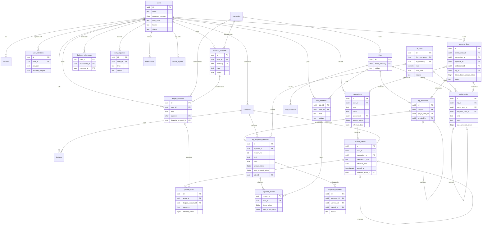

# FinPilot — Database Design

**Status:** Planning document, updated as the project develops · **Date:** 2026-11-05 · **Incorporates:** OD-1 to OD-5, OD-7, OD-8, OD-10, OD-16, OD-17, and the language decision. Parts marked **[proposed]** depend on OD-18. **Implemented so far:** the identity tables in §3.2 and a subset of `audit_events` (migrations `0001` and `0002`). Migration `0003`, which removes password-era tables, is **proposed and not applied**. **Everything else is still design, and no SQL has been run against it.**
**Role:** Proposed PostgreSQL schema. Rules live in `FINANCIAL_RULES.md`; this document shows how the database enforces them.

---

## 1. Principles

1. **The database is the last line of defense.** If a rule can be a constraint, it is one. A bug in Python should produce an error, not bad money.
2. **Append for financial facts; mutate only workflow state.** Ledger lines and expense versions are never rewritten.
3. **Derive, don't store.** Balances, expense status, and trip nets are computed. The few deliberate exceptions are justified where they appear.
4. **User isolation is structural.** Composite foreign keys make cross-user references impossible.

### Conventions

| Item | Choice | Reason |
|---|---|---|
| Primary keys | `uuid`, `gen_random_uuid()` | Safe in URLs; not enumerable; no extension needed on PostgreSQL 13+ |
| Money | `BIGINT` `*_minor`, with a check of at most 10¹⁵ on every record amount | Exact; exponent from `currencies`; no overflow in intermediate arithmetic |
| Rates | `NUMERIC(28,12)` | Exact |
| Timestamps | `timestamptz` | Unambiguous |
| Business dates | `date` | Stable across time zones (`FINANCIAL_RULES.md` §3) |
| Enums | `TEXT` + `CHECK` | Adding a value is a simple migration; native enum changes are more awkward |
| Mutable rows | `created_at`, `updated_at`, `version int` | Optimistic concurrency |
| Email | A copy of Google's verified address. **Not an identifier, and not unique** | Google says addresses change and can be reassigned |
| Foreign keys to `users` | `ON DELETE RESTRICT` | Users are never hard-deleted. Cascades could later destroy audit or financial records |

**Portability:** nothing here requires a specific recent major version or a superuser-only extension. Details on versions are in `ARCHITECTURE.md` §10.

---

## 2. ERD

Attributes are limited to keys and the fields that matter most. Section 3 has the detail.

Supporting tables without financial relationships (`audit_events`, `idempotency_keys`, `jobs`, `rate_limit_counters`, `erasure_log`) are left out of the diagram for readability.

---

## 3. Tables

Abbreviations: **PK** primary key · **FK** foreign key · **UQ** unique · **CK** check · **IX** index. A "partial" constraint applies only to rows matching its `WHERE` clause.

### 3.1 Reference

#### `currencies`
**Purpose:** Supported currencies and their exponents.

| Column | Type | Notes |
|---|---|---|
| `code` | `char(3)` | PK; ISO 4217 |
| `exponent` | `smallint` | CK 0–4 |
| `name` | `text` | |
| `is_active` | `boolean` | Allowed for new records |

Seeded by migration. An exponent is never changed in place, because that would alter the meaning of stored minor units.

### 3.2 Identity

**Google is the only sign-in method** (`SECURITY.md` §2). Every foreign key to `users` is `ON DELETE RESTRICT`, because erasure keeps a tombstone row, and its full design is still open (`SECURITY.md` §11).

| Table | State |
|---|---|
| `users`, `user_identities`, `sessions`, `audit_events` (§3.7) | **Kept.** Built in 0001 |
| `oauth_states` | **Built in 0002,** and applied to development |
| `password_credentials`, `identity_conflicts`, `auth_tokens`, `users.email_normalized`, `users.email_verified_at`, the unique email index, and the `quarantined` status | **Removed by 0003**, applied to development after checks confirmed they were empty |
| `oauth_states.return_path` | **Added by 0004** |

#### `users`
**Purpose:** One person's profile. Holds no credentials.

| Column | Type | Notes |
|---|---|---|
| `id` | `uuid` | PK, `gen_random_uuid()` |
| `email` | `text` | Google's verified address, refreshed at sign-in. Null only when `status = 'deleted'`. **Not an identifier** |
| `display_name` | `text` | From Google once, sanitized, then the user's to edit. 1–100 characters |
| `status` | `text` | CK `active`, `suspended`, `deletion_pending`, `deleted`. Sign-in is allowed for `active` and `deletion_pending` |
| `locale` | `text` | Preferred language. CK `en`, `ar`, `tr`. A new account takes the language its sign-in started in |
| `preferred_currency` | `char(3)` | Null until chosen. **Becomes an FK when `currencies` arrives in A3** |
| `time_zone` | `text` | IANA name, default `UTC` |
| `terms_version`, `terms_accepted_at` | | Both or neither. **Accepting terms happens after the first sign-in** (open question) |
| `deletion_requested_at` | `timestamptz` | Required when `status = 'deletion_pending'` |
| `last_active_at`, `created_at`, `updated_at` | `timestamptz` | `updated_at` is set by a trigger |
| `version` | `int` | Optimistic concurrency |

**Two users may share an address, and non-ASCII addresses are allowed,** because nothing relies on email for identity.

#### `user_identities`
**Purpose:** The Google account behind a user. **Google's `sub` is the identity, never the email address.**

| Column | Type | Notes |
|---|---|---|
| `id` | `uuid` | PK |
| `user_id` | `uuid` | FK `users` |
| `provider` | `text` | CK `google` |
| `provider_subject` | `text` | The `sub` claim; 1–255 printable ASCII characters |
| `provider_email`, `provider_email_verified` | `text`, `boolean` | What Google last reported. For display and audit only |
| `linked_at`, `last_used_at` | `timestamptz` | |

**UQ:** `(provider, provider_subject)`, which also makes concurrent first sign-ins produce one user; `(user_id, provider)`.

#### `oauth_states` [built in 0002]
**Purpose:** Single-use records of web sign-ins in progress. Expired and used rows are deleted whenever a new sign-in starts.

| Column | Type | Notes |
|---|---|---|
| `id` | `uuid` | PK |
| `state_hash` | `bytea` | UQ; CK 32 bytes. The raw state is never stored |
| `browser_binding_hash` | `bytea` | CK 32 bytes. Hash of the `HttpOnly` cookie set at the start |
| `nonce`, `pkce_verifier` | `text` | Needed in clear to finish the flow; CK lengths. Useless after expiry |
| `locale` | `text` | CK `en`, `ar`, `tr` |
| `return_path` | `text` | Where to land afterwards. CK a local path only, such as `/en/dashboard`: no scheme, host, query, `//`, or backslash. Checked by the application too |
| `created_at`, `expires_at`, `consumed_at` | `timestamptz` | CK expiry after creation. Consumed atomically with a guarded `UPDATE … RETURNING` |

**IX:** `(expires_at)`.

#### `sessions`
**Purpose:** Server-side sessions, for web and future mobile. A user can hold several. **In use from A2.3.**

| Column | Type | Notes |
|---|---|---|
| `id` | `uuid` | PK; the public ID shown in the session list |
| `user_id` | `uuid` | FK `users` |
| `token_hash` | `bytea` | UQ; CK exactly 32 bytes. The raw token is never stored |
| `csrf_secret` | `bytea` | **The SHA-256 of the CSRF token**, not the token. CK present for web sessions, and absent for mobile |
| `client_type` | `text` | CK `web`, `mobile` |
| `device_label` | `text` | |
| `created_at`, `last_seen_at` | `timestamptz` | |
| `idle_expires_at`, `absolute_expires_at`, `revoked_at` | `timestamptz` | CK ordering |

**IX:** `(user_id) WHERE revoked_at IS NULL`; `(absolute_expires_at)`.

#### `rate_limit_counters` [not created yet]
**Purpose:** Fixed-window rate limits without Redis. Used for auth and export endpoints, updated with an atomic upsert.

| Column | Type | Notes |
|---|---|---|
| `bucket_key` | `text` | PK part, such as `login:ip:<hash>` |
| `window_start` | `timestamptz` | PK part |
| `count` | `int` | |

Old rows are purged by the worker.

### 3.3 Personal finance

#### `financial_accounts`
**Purpose:** User-visible, manually tracked accounts.

| Column | Type | Notes |
|---|---|---|
| `id`, `user_id` | `uuid` | PK; FK `users` |
| `name`, `description` | `text` | |
| `type` | `text` | CK `cash`, `bank`, `savings`, `wallet`, `other` |
| `currency` | `char(3)` | FK `currencies`; immutable (trigger) |
| `status` | `text` | CK `active`, `archived` |
| `opened_on` | `date` | |
| `version` | `int` | |

**UQ:** `(id, user_id)` as a composite-FK target; partial `(user_id, lower(name)) WHERE status = 'active'`.
**IX:** `(user_id, status)`.
**Note:** there is deliberately **no balance column**.

#### `ledger_accounts`
**Purpose:** Internal chart of accounts, one per user (`FINANCIAL_RULES.md` §4.2).

| Column | Type | Notes |
|---|---|---|
| `id`, `user_id` | `uuid` | PK; FK |
| `kind` | `text` | CK `asset`, `income`, `expense`, `equity_opening`, `equity_adjustment`, `fx_clearing`, `trip_clearing` |
| `currency` | `char(3)` | FK |
| `financial_account_id` | `uuid` | Composite FK `(financial_account_id, user_id)` |

**CK:** `(kind = 'asset') = (financial_account_id IS NOT NULL)`.
**UQ:** `(id, user_id, currency)` as a composite-FK target; partial `(financial_account_id) WHERE financial_account_id IS NOT NULL`; partial `(user_id, kind, currency) WHERE financial_account_id IS NULL`.

#### `categories`
**Purpose:** System and custom categories.

| Column | Type | Notes |
|---|---|---|
| `id` | `uuid` | PK |
| `user_id` | `uuid` | Null means system |
| `kind` | `text` | CK `income`, `expense`; immutable |
| `name`, `icon` | `text` | |
| `system_key` | `text` | Stable code such as `food_and_drinks`, and the translation key. The system row's `name` is only a fallback |
| `status` | `text` | CK `active`, `archived` |

**UQ:** partial `(user_id, kind, lower(name)) WHERE user_id IS NOT NULL AND status = 'active'`; partial `(system_key) WHERE user_id IS NULL`.
**CK:** `(user_id IS NULL) = (system_key IS NOT NULL)`.

**As built in A4 (migration `0007`), per user rather than shared:** `user_id` is required. Defaults are seeded into each user's own rows, once, and keep their `system_key`; `name` is null until the person renames one (the apps translate `system_key`). Columns: `id`, `user_id`, `kind`, `system_key`, `name` (1 to 40 clean characters), `icon` and `color` (keys from an app-controlled set), `status`, `sort_order`, timestamps, `version`. **CK:** named, or a seeded default. **UQ:** `(id, user_id)` and `(id, user_id, kind)` as composite-FK targets; partial `(user_id, system_key) WHERE system_key IS NOT NULL`, which makes seeding idempotent; partial `(user_id, kind, lower(name)) WHERE status = 'active' AND name IS NOT NULL`. No delete path.

**Also in `0007`:** `financial_accounts.system_key` (`cash` or `bank`, unique per user) with `name` now nullable for those two; `users.default_account_id` (composite FK to the user's own account) and `users.setup_completed_at`; `transactions.type` widened to `income` and `expense`, with `category_id` required exactly for them and a composite FK `(category_id, user_id, type)` to `categories (id, user_id, kind)`, so an income can't carry an expense category; `journal_entries.category_id` with FK `(category_id, user_id)` and an index for category totals.

#### `transactions`
**Purpose:** The user-facing document for a financial event. It holds what the user sees, while its journal entries hold the financial effect.

| Column | Type | Notes |
|---|---|---|
| `id`, `user_id` | `uuid` | PK; FK |
| `type` | `text` | CK `income`, `expense`, `refund`, `transfer`, `adjustment`, `opening_balance`, `trip_expense_payment`, `trip_settlement_paid`, `trip_settlement_received`; immutable |
| `status` | `text` | CK `posted`, `reversed` |
| `account_id` | `uuid` | Composite FK `(account_id, user_id)`; the source for transfers |
| `amount_minor` | `bigint` | CK `> 0` and `<= 10^15`; in the account's currency |
| `direction` | `text` | CK `increase`, `decrease`; adjustments and opening balances only |
| `currency` | `char(3)` | FK |
| `counter_account_id` | `uuid` | Composite FK; transfers only |
| `counter_amount_minor`, `counter_currency` | | Transfers only |
| `category_id` | `uuid` | FK `categories`; required for income, expense, refund |
| `occurred_at` | `timestamptz` | |
| `effective_date` | `date` | |
| `description`, `notes` | `text` | |
| `original_amount_minor`, `original_currency`, `original_rate_id` | | Optional memo; never used in calculations |
| `refunds_transaction_id` | `uuid` | Optional self-FK |
| `replaces_transaction_id` | `uuid` | Optional self-FK. Set when attaching or unlinking voids one transaction and creates another (`FINANCIAL_RULES.md` §11.7) |
| `created_via` | `text` | `form`, `quick_add`, `link` |
| `version` | `int` | |

**CK:** `(type = 'transfer') = (counter_account_id IS NOT NULL)`; `counter_account_id <> account_id`; `(type IN ('income','expense','refund')) = (category_id IS NOT NULL)`; `(type IN ('adjustment','opening_balance')) = (direction IS NOT NULL)`.

A zero opening balance posts no transaction at all, since a journal line can't be zero.
**UQ:** `(id, user_id)`.
**IX:** `(user_id, effective_date DESC, id DESC)` for history; `(user_id, category_id, effective_date)`; `(account_id, effective_date)`; `(counter_account_id) WHERE counter_account_id IS NOT NULL`.

**The one deliberate duplication.** Amount and account appear here and in journal lines. They're kept because this document needs them for listing, searching, and detecting changes on correction. Financial totals never read them, and INV-06 asserts agreement.

**Search:** `ILIKE` on `description` within a user's rows. Row counts per user are small, so `pg_trgm` is not needed, which also avoids needing an extension on a shared server.

**Language limits on search and sorting (R-54):** `ILIKE` and `lower()` don't handle Turkish `I/ı` and `İ/i` by locale, or Arabic letter variants and diacritics. **Proposed:** a stored `description_search` column, normalized by a single application function (case folding plus Turkish and Arabic normalization), and search against that. Sorting by text uses an explicit ICU collation per locale if the server's PostgreSQL build includes ICU, which the inspection checklist verifies. Uniqueness on `lower(name)` is treated as a convenience, not a guarantee.

#### `journal_entries`
**Purpose:** Immutable financial events.

| Column | Type | Notes |
|---|---|---|
| `id`, `user_id` | `uuid` | PK; FK |
| `transaction_id` | `uuid` | Composite FK `(transaction_id, user_id)` |
| `transaction_type` | `text` | Copied from the immutable transaction type |
| `category_id` | `uuid` | FK; a dimension for all lines in the entry. Null for `trip_*` types, so trip cash can never be counted in a category |
| `effective_date` | `date` | |
| `posted_at` | `timestamptz` | Default `now()` |
| `reverses_entry_id` | `uuid` | Self-FK; UQ, so an entry can be reversed at most once |

**UQ:** `(id, user_id, effective_date)` as a composite-FK target.
**IX:** `(user_id, effective_date)`; `(user_id, category_id, effective_date)`; `(transaction_id)`.
**Triggers:** block UPDATE and DELETE.

#### `journal_lines`
**Purpose:** Immutable debits (+) and credits (−).

| Column | Type | Notes |
|---|---|---|
| `id` | `uuid` | PK |
| `entry_id` | `uuid` | Composite FK below |
| `user_id` | `uuid` | Composite FKs below |
| `effective_date` | `date` | Composite FK below |
| `ledger_account_id` | `uuid` | Composite FK below |
| `currency` | `char(3)` | Composite FK below |
| `amount_minor` | `bigint` | CK `<> 0` |

**FK:** `(entry_id, user_id, effective_date)` → `journal_entries`; `(ledger_account_id, user_id, currency)` → `ledger_accounts`.

These composite keys carry real weight:
- They enforce L3 and L4 from `FINANCIAL_RULES.md` declaratively.
- They make it structurally impossible to post to another user's account.
- `effective_date` is copied here so the balance index works without a join, and the FK guarantees it cannot diverge.

**IX:** `(ledger_account_id, effective_date) INCLUDE (amount_minor)`, which serves balances and opening or closing calculations; `(entry_id)`.

**Triggers:**
- Block UPDATE and DELETE (only the audited erasure function bypasses this).
- A `DEFERRABLE INITIALLY DEFERRED` constraint trigger verifies at commit that the entry has at least two lines and sums to zero per currency.

#### `budgets`
**Purpose:** Effective-dated monthly limits.

**As built in M6 (migration `0010`, additive):** `id`, `user_id`, `category_id` (nullable = overall; composite FK `(category_id, user_id)` → categories), `currency` (FK), `amount_minor` (nullable = ended from this month; otherwise `> 0` and ≤ 10^15), `effective_from_month` (check: the 1st), `alert_percent` smallint default 80 (1–100), timestamps with the `updated_at` trigger. Partial unique indexes `uq_budgets_overall_month (user_id, currency, effective_from_month) WHERE category_id IS NULL` and `uq_budgets_category_month (user_id, category_id, currency, effective_from_month) WHERE category_id IS NOT NULL`; writes are upserts on them. Applied to development with identical row counts before and after.

| Column | Type | Notes |
|---|---|---|
| `id`, `user_id` | `uuid` | PK; FK |
| `category_id` | `uuid` | FK; null means overall |
| `currency` | `char(3)` | FK |
| `amount_minor` | `bigint` | CK `> 0`, or null when the row ends a budget |
| `effective_from_month` | `date` | CK day of month = 1 |

**UQ:** partial `(user_id, currency, effective_from_month) WHERE category_id IS NULL`; partial `(user_id, category_id, currency, effective_from_month) WHERE category_id IS NOT NULL`.

Two partial indexes are used rather than `NULLS NOT DISTINCT`, so the design doesn't rely on PostgreSQL 15+ if the server's version turns out to be older.

### 3.4 Exchange rates

#### `fx_rates`
**Purpose:** Immutable rate observations and manual entries.

| Column | Type | Notes |
|---|---|---|
| `id` | `uuid` | PK |
| `from_currency`, `to_currency` | `char(3)` | FK; CK differ |
| `rate` | `numeric(28,12)` | CK `> 0` |
| `rate_date` | `date` | As returned by the source |
| `source` | `text` | CK `provider`, `manual` |
| `provider`, `upstream` | `text` | Provider rows |
| `retrieved_at` | `timestamptz` | |
| `entered_by`, `trip_id` | `uuid` | Manual rows; FK |
| `note` | `text` | |

**CK:** `(source = 'manual') = (entered_by IS NOT NULL)`; `(source = 'provider') = (provider IS NOT NULL)`.
**UQ:** partial `(provider, upstream, from_currency, to_currency, rate_date) WHERE source = 'provider'`.
**IX:** `(from_currency, to_currency, rate_date DESC)`.
**Triggers:** block UPDATE and DELETE.

**As built in M5 (migration `0008`):** `fx_rates` as above, with `base`/`quote` as three capital letters rather than a currency foreign key (gold, `XAU`, is a reference unit, not a posting currency). `entered_by` is RESTRICT, like every foreign key. A trigger refuses UPDATE and DELETE. `transactions` gains `original_amount_minor`, `original_currency`, `fx_rate` (`NUMERIC(28,12)`), `fx_method` (`reference`, `manual_rate`, `actual_amount`) and `fx_rate_id`, all or none, only for income and expense, with the original currency different from the posted one. `users.equivalent_targets` (`text[]`, at most 12) holds Amount Equivalent favourites.

### 3.5 Trips

#### `trips`
| Column | Type | Notes |
|---|---|---|
| `id` | `uuid` | PK |
| `name`, `description`, `destination` | `text` | |
| `start_date`, `end_date` | `date` | CK `end_date >= start_date` |
| `base_currency` | `char(3)` | FK; immutable once an expense exists (trigger) |
| `status` | `text` | CK `active`, `completed`, `archived` |
| `cover_image_key` | `text` | Optional (OD-13) |
| `version` | `int` | |

#### `trip_members`
| Column | Type | Notes |
|---|---|---|
| `trip_id`, `user_id` | `uuid` | Composite PK; FKs |
| `role` | `text` | CK `owner`, `admin`, `member` |
| `status` | `text` | CK `active`, `left`, `removed` |
| `joined_at`, `ended_at` | `timestamptz` | |
| `ended_by` | `uuid` | |

**UQ:** partial `(trip_id) WHERE role = 'owner' AND status = 'active'`, so a trip has at most one active owner.
**IX:** `(user_id, status)`.
**Note:** membership rows are never deleted, because historical shares reference them. Rejoining reactivates the row.

#### `trip_invitations`
| Column | Type | Notes |
|---|---|---|
| `id`, `trip_id` | `uuid` | PK; FK |
| `token_hash` | `bytea` | UQ |
| `invited_by` | `uuid` | FK |
| `invitee_label` | `text` | Optional note for the inviter |
| `status` | `text` | CK `pending`, `accepted`, `declined`, `revoked` |
| `expires_at` | `timestamptz` | "Expired" is derived |
| `decided_by`, `decided_at` | | |

**IX:** `(trip_id, status)`.

#### `trip_expenses`
**Purpose:** Stable identity of an expense.

| Column | Type | Notes |
|---|---|---|
| `id`, `trip_id` | `uuid` | PK; FK |
| `payer_user_id` | `uuid` | Composite FK `(trip_id, payer_user_id)` → `trip_members`; **immutable** |
| `created_by` | `uuid` | Composite FK to `trip_members` |
| `replaces_expense_id` | `uuid` | Self-FK, for cancel-and-recreate |
| `created_at` | `timestamptz` | |

**UQ:** `(id, trip_id)`.
**IX:** `(trip_id, created_at DESC)`.

#### `trip_expense_versions`
**Purpose:** Immutable financial content of each version.

| Column | Type | Notes |
|---|---|---|
| `id` | `uuid` | PK |
| `expense_id`, `trip_id` | `uuid` | Composite FK `(expense_id, trip_id)` |
| `version_no` | `int` | |
| `kind` | `text` | CK `initial`, `correction`, `cancellation` |
| `state` | `text` | CK `pending`, `approved`, `rejected`, `withdrawn`, `superseded` |
| `proposed_by` | `uuid` | FK |
| `description`, `notes` | `text` | |
| `category_id` | `uuid` | FK; must be a system category (trigger) |
| `expense_date` | `date` | |
| `amount_minor` | `bigint` | CK `> 0` |
| `currency` | `char(3)` | FK |
| `base_currency` | `char(3)` | FK; copied from the trip |
| `base_amount_minor` | `bigint` | CK `> 0` |
| `rate_id` | `uuid` | FK `fx_rates` |
| `split_method` | `text` | CK `equal`, `fixed`, `percentage` |
| `decided_by`, `decided_at`, `decision_reason` | | |
| `created_at` | `timestamptz` | |

**CK:** `(currency = base_currency) = (rate_id IS NULL)`; `(currency <> base_currency) OR (amount_minor = base_amount_minor)`.
**UQ:** `(expense_id, version_no)`; partial `(expense_id) WHERE state = 'pending'`; partial `(expense_id) WHERE state = 'approved'`. Those two partial indexes guarantee one pending and one effective version at most, at the database level.
**IX:** `(trip_id, state)`.
**Triggers:** only `state` and the `decided_*` columns may change. Transitions outside the state machine raise an error.

**Note:** there is no `status` column on `trip_expenses` and no "current version" pointer. Both can be derived from these partial-unique states, and leaving them out removes a whole class of drift bugs.

#### `expense_shares`
| Column | Type | Notes |
|---|---|---|
| `version_id`, `user_id` | `uuid` | Composite PK |
| `trip_id` | `uuid` | Composite FK `(trip_id, user_id)` → `trip_members` |
| `input_value` | `numeric(20,4)` | The percentage or fixed amount entered; null for equal |
| `share_minor` | `bigint` | CK `> 0` |
| `base_share_minor` | `bigint` | CK `>= 0`; may be 0 for a tiny share after conversion |

**IX:** `(trip_id, user_id)`.
**Triggers:** immutable; a deferred constraint trigger verifies that shares sum to `amount_minor` and `base_amount_minor` (INV-09). Cancellation versions have no shares, and the trigger skips them.

#### `settlements`
| Column | Type | Notes |
|---|---|---|
| `id`, `trip_id` | `uuid` | PK; FK |
| `payer_user_id`, `recipient_user_id` | `uuid` | Composite FKs to `trip_members`; CK differ |
| `kind` | `text` | CK `payment`, `reversal` |
| `reverses_settlement_id` | `uuid` | Self-FK |
| `corrects_settlement_id` | `uuid` | Self-FK; replacement payment |
| `initiated_by` | `uuid` | CK one of the two parties |
| `state` | `text` | CK `pending`, `confirmed`, `rejected`, `cancelled` |
| `amount_minor` | `bigint` | CK `> 0` |
| `currency`, `base_currency` | `char(3)` | FK |
| `base_amount_minor` | `bigint` | CK `> 0` |
| `rate_id` | `uuid` | FK; same CK as expense versions |
| `paid_on` | `date` | |
| `note` | `text` | |
| `decided_by`, `decided_at`, `decision_reason` | | |
| `version` | `int` | |

**CK:** `(kind = 'reversal') = (reverses_settlement_id IS NOT NULL)`; `kind = 'payment' → initiated_by = payer_user_id`.
**UQ:** partial `(reverses_settlement_id) WHERE state IN ('pending','confirmed')`, so one live reversal at most.
**IX:** `(trip_id, state)`; `(recipient_user_id, state)`; `(payer_user_id, state)`.
**Triggers:** financial columns are immutable; transitions are limited to the state machine.

### 3.6 Links

#### `personal_links`
**Purpose:** The auditable bridge between the trip domain and a private ledger. Readable only by its owner.

| Column | Type | Notes |
|---|---|---|
| `id` | `uuid` | PK |
| `owner_user_id` | `uuid` | FK `users` |
| `expense_id` | `uuid` | FK; null for settlements |
| `settlement_id` | `uuid` | FK; null for expenses |
| `transaction_id` | `uuid` | Composite FK `(transaction_id, owner_user_id)` → `transactions` |
| `trip_id` | `uuid` | FK `trips`. Copied for the per-trip position query (`FINANCIAL_RULES.md` §11.4) |
| `linked_version_id` | `uuid` | FK; the expense version linked against |
| `linked_base_amount_minor` | `bigint` | **[proposed]** Signed, in trip base currency: + for paid, − for received. CK `<> 0` |
| `base_currency` | `char(3)` | FK; copied from the trip |
| `status` | `text` | CK `active`, `needs_review`, `unlinked` |
| `review_reason` | `text` | |
| `created_at`, `resolved_at` | `timestamptz` | |

**CK:** exactly one of `expense_id` and `settlement_id` is non-null.
**UQ:** partials `WHERE status <> 'unlinked'`:
- `(owner_user_id, expense_id)`
- `(owner_user_id, settlement_id)`
- `(transaction_id)`

The composite FK makes it impossible for a link to point at someone else's transaction, at the schema level. The FK on `transaction_id` also means `transactions` rows with links are removed only by the erasure routine, which deletes the links first.

**IX:** `(owner_user_id, status)`; `(owner_user_id, trip_id) WHERE status <> 'unlinked'`.

#### `duplicate_dismissals`
**Purpose:** Remembers "Not a duplicate" for a transaction and expense pair, so it's never suggested again (`FINANCIAL_RULES.md` §11.7). Owner-only. Possible duplicates themselves are computed, not stored.

| Column | Type | Notes |
|---|---|---|
| `user_id` | `uuid` | Composite PK; composite FK `(transaction_id, user_id)` → `transactions` |
| `transaction_id`, `expense_id` | `uuid` | Composite PK; FKs |
| `dismissed_at` | `timestamptz` | |

**Removed:** the earlier `personal_trip_tracking` proposal. OD-17 decided that allocated shares always count, so no per-trip setting exists.

### 3.7 Cross-cutting

#### `audit_events`
**Purpose:** Append-only record of significant actions, written in the same transaction as the change.

**Implemented in A2.1, without `trip_id` and the `trip` scope,** which arrive with trips in Phase B. Scope is currently CK `user`, `system`, and `(scope = 'user') = (owner_user_id IS NOT NULL)`. `action` must be a code such as `auth.google.signed_in`, so free text can't carry personal data there. The UPDATE and DELETE block is in place, **and the erasure exception below isn't, because erasure isn't built.** Each actor and owner FK is `RESTRICT`.

| Column | Type | Notes |
|---|---|---|
| `id` | `uuid` | PK |
| `occurred_at` | `timestamptz` | |
| `actor_user_id` | `uuid` | Null after pseudonymization |
| `action` | `text` | Such as `expense.version.approved` |
| `entity_type`, `entity_id` | | |
| `scope` | `text` | CK `user`, `trip`, `system` |
| `owner_user_id` | `uuid` | For `user` scope |
| `trip_id` | `uuid` | For `trip` scope |
| `metadata` | `jsonb` | Before and after values; **no secrets** |
| `request_id` | `text` | |

**CK:** scope consistency, so a `user`-scoped event can never carry a `trip_id`. This prevents link activity from leaking into a trip's activity feed.
**IX:** `(trip_id, occurred_at DESC) WHERE scope = 'trip'`; `(owner_user_id, occurred_at DESC) WHERE scope = 'user'`; `(entity_type, entity_id)`.
**Triggers:** block UPDATE and DELETE, except the audited erasure routine. On erasure, that routine **deletes** the user's `user`-scoped events, because their metadata holds private financial values, and pseudonymizes the actor on `trip`-scoped events.

The trip "Recent activity" feed is a filtered read of this table, so no separate activity table is needed.

#### `idempotency_keys`
| Column | Type | Notes |
|---|---|---|
| `user_id`, `key` | | Composite PK |
| `request_hash` | `bytea` | Method, path, and body |
| `response_status` | `int` | |
| `response_body` | `jsonb` | |
| `created_at` | `timestamptz` | |

**IX:** `(created_at)` for purging.

#### `notifications`
**Purpose:** In-app inbox for pending approvals, confirmations, link reviews, and invitations.

| Column | Type | Notes |
|---|---|---|
| `id`, `user_id` | `uuid` | PK; FK |
| `type` | `text` | Translation key |
| `params` | `jsonb` | Message parameters. **Text isn't stored**, so a notification displays in the reader's current language |
| `entity_type`, `entity_id`, `trip_id` | | |
| `created_at`, `read_at`, `resolved_at` | `timestamptz` | |

**IX:** `(user_id, created_at DESC) WHERE read_at IS NULL`.

#### `jobs`
**Purpose:** PostgreSQL-backed background queue, polled with `FOR UPDATE SKIP LOCKED`.

| Column | Type | Notes |
|---|---|---|
| `id` | `uuid` | PK |
| `type` | `text` | `render_pdf`, `send_email`, `data_export`, `purge_expired`, `erase_account` |
| `payload` | `jsonb` | No raw tokens or email bodies with secrets; the worker fetches sensitive values by reference |
| `status` | `text` | CK `queued`, `running`, `succeeded`, `failed` |
| `run_at`, `started_at`, `finished_at` | `timestamptz` | |
| `attempts`, `max_attempts` | `int` | |
| `dedupe_key` | `text` | Partial UQ, for scheduled tasks |
| `last_error` | `text` | Sanitized |

**IX:** `(status, run_at) WHERE status = 'queued'`.

#### `report_exports`
**Purpose:** Metadata for generated PDF files and data exports.

| Column | Type | Notes |
|---|---|---|
| `id`, `user_id` | `uuid` | PK; FK |
| `job_id` | `uuid` | FK |
| `report_type` | `text` | `personal`, `trip`, `participant`, `account_data` |
| `trip_id` | `uuid` | Nullable FK |
| `format` | `text` | CK `pdf`, `zip` |
| `locale` | `text` | CK `en`, `ar`, `tr`; the language the file was generated in |
| `filters` | `jsonb` | Exactly as applied |
| `status` | `text` | CK `queued`, `running`, `ready`, `failed`, `expired` |
| `storage_key` | `text` | Random; never user-derived |
| `size_bytes`, `row_count` | | |
| `generated_at`, `expires_at` | `timestamptz` | |

**IX:** `(user_id, created_at DESC)`; `(expires_at) WHERE status = 'ready'`.

#### `erasure_log`
**Purpose:** Lets erasure be re-applied if a backup from before the erasure is ever restored (`SECURITY.md` §11.2). Holds only IDs and dates, so keeping it doesn't defeat the erasure. Added at step PD2.

| Column | Type | Notes |
|---|---|---|
| `user_id` | `uuid` | PK; deliberately **no FK** |
| `erased_at` | `timestamptz` | |

To survive a restore, this log must also be kept outside the backed-up database, for example in a small file stored alongside the backups.

#### `expense_disputes` [OD-2 confirmed]
**Purpose:** A beneficiary's objection to an expense. It has no effect on balances (INV-26). Rules are in `FINANCIAL_RULES.md` §12.8.

| Column | Type | Notes |
|---|---|---|
| `id` | `uuid` | PK |
| `expense_id`, `version_id` | `uuid` | FKs; the version being disputed |
| `trip_id` | `uuid` | FK |
| `raised_by` | `uuid` | Must be a beneficiary of that version; composite FK `(version_id, raised_by)` → `expense_shares` makes that structural |
| `reason` | `text` | CK length 1–500 |
| `status` | `text` | CK `open`, `withdrawn`, `upheld`, `dismissed`, `closed_superseded` |
| `created_at` | `timestamptz` | |
| `resolved_by`, `resolved_at`, `resolution_note` | | Owner or admin, and not an interested party (service rule) |

**UQ:** partial `(version_id, raised_by) WHERE status = 'open'`.
**IX:** `(expense_id, status)`; `(trip_id, status)`.

#### `data_requests` **[proposed: OD-18]**
**Purpose:** Tracks privacy requests and their deadlines, so one operator can't lose track of a legal clock (`SECURITY.md` §11.3).

| Column | Type | Notes |
|---|---|---|
| `id` | `uuid` | PK |
| `user_id` | `uuid` | Nullable FK; a request may come from someone who can't log in |
| `type` | `text` | CK `self_service_deletion`, `personal_data_erasure`, `legal_erasure`, `access`, `other` |
| `status` | `text` | CK `received`, `in_review`, `completed`, `refused`, `cancelled` |
| `received_at`, `due_at`, `decided_at` | `timestamptz` | `due_at` is set per the applicable law |
| `decision_basis` | `text` | Reasons for retention or refusal |
| `handled_by` | `text` | |

**IX:** `(status, due_at)`.

### 3.8 Recurring finances [Built in M5, migration `0009`]

**As built:** `recurring_rules` as proposed, plus `biweekly`, a nullable `amount_minor` (variable amounts), `category_kind` (so the composite key `(category_id, user_id, category_kind)` → `categories (id, user_id, kind)` enforces a matching kind), `total_occurrences` (1 to 600), `generate_from`, `remind_days_before` (0 to 14) and `reminders`. The rule's currency may differ from its account's. `recurring_occurrences` adds `sequence` (unique per rule, "3 of 10"), `snoozed_until` ("Not yet"), and `version`; `(rule_id, window_start)` and `transaction_id` are unique, and `confirmed` requires a transaction. `debts` is as proposed, with `counterparty`, `direction` (`i_owe`, `owed_to_me`), `currency`, `original_amount_minor`, `start_date`, `notes`, `status`. `ledger_accounts.debt_id` (unique, composite FK including the currency) gives each debt its own ledger account; the unique index on shared ledger accounts now also requires `debt_id IS NULL`. `transactions` gains `debt_start` and `debt_payment`, `debt_id` and `debt_amount_minor`; `account_id` is nullable only for a debt that existed before FinPilot (check `account_id IS NOT NULL OR type = 'debt_start'`).

#### `recurring_rules`
| Column | Type | Notes |
|---|---|---|
| `id`, `user_id` | `uuid` | PK; FK |
| `kind` | `text` | CK `income`, `expense`, `debt_installment` |
| `name`, `notes` | `text` | Clean-text rules as account names |
| `amount_minor`, `currency` | | Expected amount; CK `> 0` and `<= 10^15` |
| `account_id` | `uuid` | Composite FK `(account_id, user_id, currency)`, so the expectation is in the account's currency |
| `category_id` | `uuid` | Required for income and expense |
| `debt_id` | `uuid` | Required for `debt_installment` |
| `frequency` | `text` | CK `weekly`, `monthly`, `yearly` |
| `window_start_day`, `window_end_day` | `smallint` | Day of month (1 to 31) for monthly and yearly; CK start ≤ end |
| `month` | `smallint` | Yearly only |
| `start_date`, `end_date` | `date` | CK `end_date >= start_date` |
| `status` | `text` | CK `active`, `paused`, `ended` |
| `version` | `int` | Optimistic concurrency |

#### `recurring_occurrences`
| Column | Type | Notes |
|---|---|---|
| `id`, `user_id` | `uuid` | PK; FK |
| `rule_id` | `uuid` | Composite FK `(rule_id, user_id)` |
| `window_start`, `window_end` | `date` | **UQ `(rule_id, window_start)`**: the occurrence's stable identity |
| `expected_amount_minor`, `currency`, `account_id` | | Snapshot when created (R4) |
| `status` | `text` | CK `pending`, `confirmed`, `skipped`. Expected and overdue are derived from today's date |
| `transaction_id` | `uuid` | Composite FK to `transactions`; **UQ**; CK `(status = 'confirmed') = (transaction_id IS NOT NULL)` |
| `decided_at` | `timestamptz` | |

#### `debts` [only if §4.10 is approved]
`id`, `user_id`, `counterparty_label`, `direction` (`owed_by_me`, `owed_to_me`), `currency`, `original_amount_minor`, `start_date`, `due_date`, `notes`, `status`, and its own ledger account. The remaining amount is derived from the ledger, never stored.

---

## 4. Views

Plain SQL views, not materialized. Each is one definition shared by every consumer.

| View | Returns |
|---|---|
| `v_account_balances` | `account_id`, `currency`, and `balance_minor`, summed from asset lines |
| `v_expense_status` | Each expense's derived status, `is_corrected`, and `has_pending_correction` |
| `v_effective_expense_versions` | The single effective version per expense |
| `v_trip_member_balances` | `paid`, `owed`, `sent`, `recv`, and `net` per member |
| `v_member_allocations` | Each user's effective shares, with `expense_date`, category, and base currency: the one source of "trip allocation", used by analytics, budgets, and reports alike |
| `v_personal_trip_position` | Per owner and trip: `linked` and `unrecorded`. **Used only by owner-scoped personal queries** |

---

## 5. Does reporting need more tables?

**No.** Evaluated:

| Option | Verdict |
|---|---|
| Separate report tables | Rejected: a competing source of truth, which the brief forbids |
| Materialized views | Not needed yet: refresh adds lag and a staleness problem. Revisit only if measured queries exceed target |
| Stored running balances | Not needed: the covering index on `journal_lines` is sufficient at this scale |
| Partitioning | Not justified at this data volume |
| `report_exports` | **Needed**, as file metadata only, with no financial values |
| A ledger of allocations, for OD-1 | Not needed: allocation is already stored exactly in `expense_shares`. Copying it would create a second truth that corrections must keep in sync |

**Re-evaluated after OD-1 and OD-5:** the schema and query strategy stay sufficient, with these additions:

- One view for allocations and one for trip position, as above.
- An index for personal allocation queries, below.
- All personal report queries, including ones reading trip shares, run in one snapshot (`FINANCIAL_RULES.md` §16.5).

Public registration changes scale assumptions but not structure. Per-user isolation means one heavy user's rows don't slow others' indexed queries. Quotas (`SECURITY.md` §13) bound the total.

**Performance targets to verify at step C5**, using a seeded dataset of 100,000 lines across 5 years for one user: report summary p95 under 300 ms, and a transaction page p95 under 150 ms, on the deployment host. These are targets, not measurements.

### Key report queries and their indexes

| Query | Index |
|---|---|
| Balance at date | `journal_lines (ledger_account_id, effective_date) INCLUDE (amount_minor)` |
| Totals by type or category in a period | `journal_entries (user_id, effective_date)`, `(user_id, category_id, effective_date)` |
| Transaction table with filters | `transactions (user_id, effective_date DESC, id DESC)` and the keyset cursor |
| Trip nets | `trip_expense_versions` partial approved index, `expense_shares (trip_id, user_id)`, `settlements (trip_id, state)` |
| Personal allocation by month and category | `expense_shares (user_id, version_id)`, and `trip_expense_versions (trip_id, expense_date, category_id) WHERE state = 'approved'` |
| "What changed since this report?" (`FINANCIAL_RULES.md` §16.9) | `journal_entries (user_id, posted_at)`; `trip_expense_versions (trip_id, decided_at)` |
| Possible duplicates | `transactions (user_id, effective_date DESC, id DESC)`, already present |
| Trip position | `personal_links (owner_user_id, trip_id)` partial index |

---

## 6. Workflow Coverage Check

| Workflow | How the schema supports it |
|---|---|
| Atomic transfer | One entry with 2 or 4 lines; deferred balance trigger |
| Correction | `reverses_entry_id` plus a new entry; `UQ` prevents double reversal |
| Expense approved later | Version in `pending`, then `approved`, by ID |
| Correction pending while old version counts | Partial uniques allow one `approved` and one `pending` together |
| Correction approved | Old → `superseded` and new → `approved`, in one transaction; constraints are checked per statement, so supersede runs first |
| Settlement preserved after correction | Settlements have no FK to expenses; nets are computed |
| Member removed, history intact | Membership rows are never deleted |
| Rate history | `fx_rates` immutable; versions reference it |
| Linking without privacy leak | Separate owner-only tables; user-scoped audit events only |
| Cash vs allocation (OD-1) | `trip_clearing` holds cash; `expense_shares` holds allocation; `personal_links` connects them |
| Attaching a manual transaction | Void plus new transaction, with `replaces_transaction_id` |
| Disputes (OD-2) | `expense_disputes`; no FK into any balance calculation |
| Deletion tracks (OD-3) | `users.status`, `data_requests`, erasure function; trip FKs point to a tombstone user row that remains |
| Member departs (OD-4) | `trip_members.status`; scoped queries for former members |
| Public registration (OD-5) | `users.status = suspended`, terms columns, `rate_limit_counters`; quotas enforced in services |
| Google-only sign-in (A2) | `users`, `user_identities`, `oauth_states`, and `sessions` |
| Reassigned email addresses | Identity by `sub`; email not unique |
| Languages | `users.locale`, `report_exports.locale`, translated by key for categories and notifications |
| Allocation in analytics and budgets (OD-10, OD-17) | `v_member_allocations`; no per-trip setting; `trip_*` entries have no expense line, so budgets can't count them |
| Effective date vs approval (Assumption #10) | `expense_date` and `decided_at` are separate columns |
| Correction history (Assumption #4) | Immutable versions and entries, with `posted_at`, `created_at`, `decided_at`, `decided_by` |
| Negative balances (Assumption #5) | No check constraint on balances, and no balance column |
| Duplicate handling | `replaces_transaction_id`, `duplicate_dismissals` |

---

## 6a. Tables by Delivery Phase, and Environments

The whole schema stays approved. Phases add tables through migrations, without redesign.

| Phase | Adds |
|---|---|
| **A: built** | `users`, `user_identities`, `sessions`, `oauth_states`, `audit_events` (without trip columns); **A3.1 (0005):** `currencies`, `financial_accounts`, `ledger_accounts`, `transactions` (opening balances only), `journal_entries`, `journal_lines`, `idempotency_keys` |
| **A: still to come** | `rate_limit_counters`, the remaining `transactions` types (`refund`) and columns (`occurred_at` editing, `original_amount`); `categories` arrived in A4 (`0007`); **Recurring (R1 to R3):** `recurring_rules`, `recurring_occurrences`, and, if §4.10 of `FINANCIAL_RULES.md` is approved, `debts` |
| **B** | `fx_rates`, `trips`, `trip_members`, `trip_expenses`, `trip_expense_versions`, `expense_shares`, `settlements`, `personal_links`, `duplicate_dismissals`, `notifications` |
| **C** | `jobs`, `budgets`, `trip_invitations`, `expense_disputes`, `report_exports` |
| **D** | `data_requests`, `erasure_log` |

**The demo and production never share a database, role, or credentials.** Demo reset runs `TRUNCATE` under the migrator role, followed by a reseed. It isn't available to the application's role, and it doesn't exist in production. Because the demo holds only synthetic data, this doesn't need the audited erasure routine.

---

## 7. Migration Notes

- Alembic manages everything, including triggers and views. `0001` creates the identity tables, two trigger functions, and three triggers. `0002` adds `oauth_states`. `0003` removes the password-era objects, and refuses to run if any of them holds data. `0004` adds `oauth_states.return_path`. `0005` (A3.1, additive) creates the ledger core: seeded `currencies` (156 ISO 4217 codes, BGN inactive since the euro), `financial_accounts`, `ledger_accounts`, `transactions` with only the `opening_balance` type so far, `journal_entries`, `journal_lines`, and `idempotency_keys`, with the immutability, currency-lock, and deferred balance triggers. All are tested up and down on the test database only; `0005` was applied to development after an identity check and an offline SQL review that showed no change to existing tables. `0006` (A3.2) widens `transactions.type` to `adjustment` and `transfer`, and adds `counter_account_id`, `counter_amount_minor`, and `counter_currency`, with checks that a transfer has a complete other side, goes to another of the same user's accounts in that account's currency (composite foreign key), and within one currency moves one amount. Its only drop is the old type check, replaced in the same transaction by a wider one; applied to development after the same review. `0007` (A4, additive) creates `categories` and adds the default-account, setup, and category columns described in §3.3; its only drop is again the `transactions` type check, replaced by a wider one. Applied to development after the identity check and an offline SQL review; the owner's existing accounts and journal were untouched. `0008` (M5, additive) creates `fx_rates` and the conversion columns. `0009` (M5) creates `debts`, `recurring_rules` and `recurring_occurrences`; its only replacements are the transaction type check, the ledger kind check, and the shared-ledger unique index (each widened in the same transaction), and it relaxes `transactions.account_id` to nullable under a check. Both were applied to development on 2026-11-06 after the identity and head checks and an offline SQL review; every existing table kept its row count.
- Migrations are forward-only in production, and each one is tested on a restored copy for anything touching financial tables.
- The application's runtime role has **no DDL rights**. A separate migrator role owns the schema (`SECURITY.md` §9). **Not true of local development yet,** where one dedicated role per database does both.
- Triggers are tested directly with raw SQL, bypassing the ORM, to prove the database rejects violations by itself.

## Migration 0011: trips (2026-11-09, applied to development)

Additive. Tables `trips`, `trip_members`, `trip_invitations`, `trip_expenses`, `trip_expense_versions`, `expense_shares` as in §3.5, with these as-built differences:

- `trip_expense_versions.category_key` (CK: one of the 14 default expense keys) replaces `category_id`.
- Triggers: the base currency is locked once an expense exists; `trip_expenses` and `expense_shares` are immutable; a version's content is immutable and its state follows the machine (pending → approved/rejected/withdrawn, approved → superseded); deferred constraint triggers check at commit that shares sum to the amount and base amount (INV-09) and that cancellations have no shares.
- `audit_events` gains `trip_id` and the `trip` scope (CK: trip scope ⇔ trip_id set), plus `ix_audit_events_trip_id_occurred_at`: the trip activity feed.
- `settlements`, disputes and `personal_links` are not created yet.

Checks before applying: database `finpilot_dev`, head 0010, offline SQL reviewed (the only DROP is the audit scope check, recreated wider). Row counts identical before and after.

## Migration 0012: settlements and disputes (2026-11-10, applied to development)

Additive. `settlements` as in §3.5 (without a `version` column: decisions are guarded by the state machine and row locks), and `trip_disputes` (expense, version, raiser, reason ≤ 500, status open/withdrawn/upheld/dismissed/closed_superseded, resolution note and resolver). Triggers keep financial and content columns immutable and allow only pending → confirmed/rejected/cancelled (settlements) and open → closed states (disputes). Partial unique indexes: one live reversal per payment; one open dispute per person per version. Checks before applying: `finpilot_dev`, head 0011, offline SQL reviewed (two CREATE TABLEs only); row counts identical afterwards.

## Migration 0013: personal links (2026-11-11, applied to development)

Additive. Widens `ck_transactions_type_allowed` with `trip_expense_payment`, `trip_settlement_paid`, `trip_settlement_received`, and `ck_transactions_conversion_valid` so those types can carry the trip-amount memo (both dropped and recreated strictly wider; every existing row still satisfies them). Adds `transactions.replaces_transaction_id` (same-owner composite FK, partial index). New `personal_links` (owner, trip, kind, expense or settlement, own transaction by composite FK, `linked_version_id`, signed `linked_base_amount_minor`, `base_currency`, status `active`/`unlinked`, `reversal_kept_at`, `resolved_at`; checks for one item, kind ↔ item, version for expenses, sign, resolved when unlinked; partial unique indexes: one live link per owner and expense, per owner and settlement, and per transaction) and `duplicate_dismissals` (PK user, transaction, expense; own-transaction FK). `created_via` uses the existing `link` value. Checks before applying: `finpilot_dev`, head 0012, offline SQL reviewed (two CHECKs recreated wider, one column, two tables, indexes); every row count identical afterwards.

## Migration 0014: everyday features (2026-11-12, applied to development)

Additive. **transactions:** type, category, FX-memo and `created_via` CHECKs recreated wider (`refund`, `template`); new `refunds_transaction_id` (same-owner FK, partial index, CHECK: refund ⇔ target); new stored generated `category_kind` (`expense` for expense and refund, `income` for income), and the category FK now uses it (created before the old `type`-based FK was dropped; the same rows reference the same categories). **New tables:** `category_groups` (per user, optional `system_key`, unique active name), `categories.group_id` (same-owner FK; expense categories only), `quick_templates` (kind, optional amount, currency, optional own account by composite FK, own category of the same kind, favourite, status, use count), `savings_goals` and `savings_goal_events` (append-only by trigger `finpilot_savings_goal_events_append_only`). **recurring_rules.is_subscription** (default false; only monthly or yearly expenses). Checks before applying: `finpilot_dev`, head 0013, offline SQL reviewed (four CHECKs and one FK replaced, all wider or equivalent; no data UPDATE); every row count identical afterwards.

## Migration 0016 (2026-11-14): installments, trip planning, favourites

Additive; no existing row changes.

| Table / column | Purpose |
|---|---|
| `installment_plans` | One per plan: the debt (unique), name, lender, currency, price and down payment (informational), purchase transaction, installment count, installments paid before FinPilot, interest mode (`none`/`fixed`), optional linked goal, status (`active`/`archived`), version |
| `installment_items` | The expected schedule: sequence, due date, principal, interest, fee, `superseded_at`. A partial unique index keeps one live row per sequence; a trigger allows only superseding (no edit, no delete) |
| `installment_payments` | One per confirmed payment: the principal, interest and fee transactions (each unique, same owner) |
| `trip_plan_items` | Stays, travel, activities, notes and links: dates, booking status, estimate, deposit, reference, https link, notes, optional expense |
| `trip_personal_budgets` | (trip, user) → amount: a member's private budget |
| `trips.cancelled_at`, `trips.shared_budget_minor` | Cancellation (kept through archiving) and the group's planned total; status also allows `cancelled` |
| `categories.is_favourite` | Pinned in Quick Add |
| `transactions.created_via` | Also allows `installment` |

The new default category `interest_fees` is seeded per user (idempotently, also for existing
users when categories are listed after setup).

## Migration 0017 (2026-11-15): Home layout

`users.home_layout` (JSONB, nullable, an object of at most 4 KB): rows of widget ids (older values held two columns, and are read as rows) and the
hidden ones. Null means the default. A preference only.

## Row-level security and roles (2026-11-09, not a migration)

Not part of the Alembic chain, and **not applied to `finpilot_dev`**, which stays at 0017. `app/db/hardening.py` classifies every table (personal, trip-shared, or no RLS, with reasons) and builds the grants, four `finpilot_*` helper functions, and policies. A new table has to be classified before `scripts/db_hardening.py apply` will run. See `SECURITY.md`, last section.

Account deletion needed no schema change: `users.status` and `users.deletion_requested_at` have existed since migration 0001.
