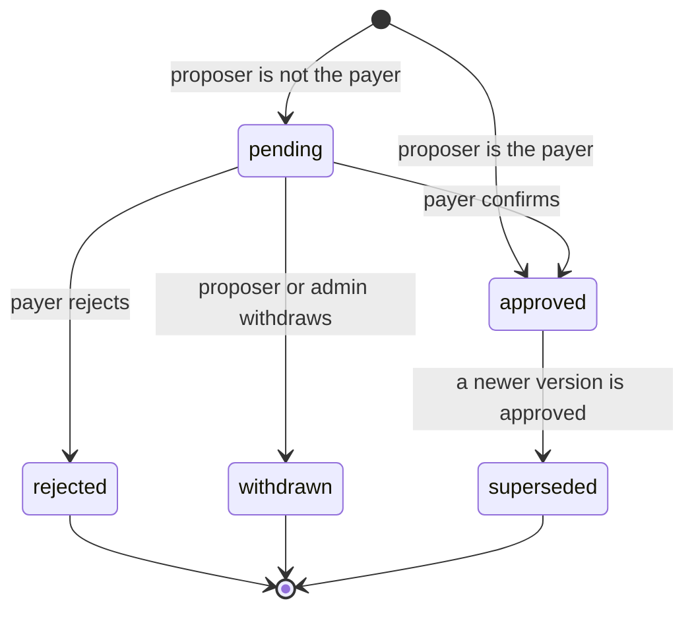
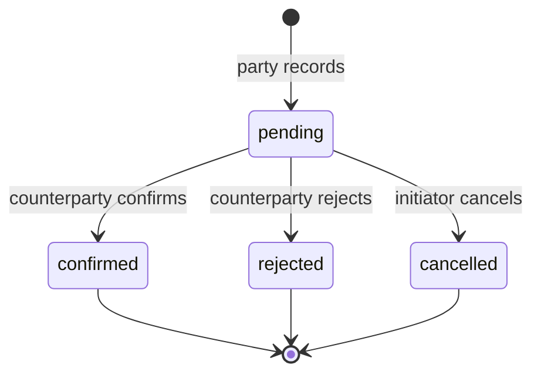

# FinPilot — Financial Rules

**Status:** Planning document, updated as the project develops · **Date:** 2026-11-05 · **Incorporates:** OD-1 to OD-5, OD-7, OD-8, OD-10, OD-16, OD-17, assumptions #4, #5, and #10, and the language decision
**Role:** This is the canonical source for every financial rule. If another document disagrees with this one, this one wins and the other is a bug.

**Start with §20** for the final model and worked scenarios. **Not yet final:** assumptions #1 and #13 (§18), and OD-18 (account deletion).

**Labels used here**

| Label | Meaning |
|---|---|
| **[D1]…[D12]** | Implements an approved product decision |
| **[Rule]** | Design rule proposed here; approved when this document is approved |
| **[Assumption]** | A choice the requirements left open; easy to change now, expensive later |
| **[OD-n]** | Refers to a decision in `RISKS_AND_OPEN_QUESTIONS.md`, where its status is shown as confirmed or open |

**Verification note.** Every worked example marked ✔ was executed with a throwaway script (exact integer and decimal arithmetic), along with 200,000 randomized cases for the allocation, conversion, and simplification properties. That verifies the *rules*. It does not verify an implementation, because none exists yet.

---

## 1. The Core Model

FinPilot has **two financial domains that are deliberately separate**:

| | Personal ledger | Trip obligations |
|---|---|---|
| Answers | "What happened to *my* money?" | "Who owes whom for this trip?" |
| Records | Actual cash movement | Cost allocation and reported repayments |
| Owner | One user, private | All trip members, shared |
| Currency basis | Each account's own currency | Trip base currency, keeping the originals |
| Mechanism | Double-entry journal | Immutable expense versions and settlements |

A trip expense **never** touches a personal ledger on its own. The only bridge for cash is a **personal link** (§11), which the account owner creates explicitly. Most double-counting risks disappear because of this separation:

- Account balances, cash flow, and income read only the ledger.
- Trip views read only trip data.
- The one figure that uses both, personal spending, follows a single defined formula (§16.2a) that adds non-trip ledger spending to allocated trip shares. Those measure different things, and neither contains the other.
- Ledger cash and outstanding trip balances are never added together.

### Why not one double-entry ledger for both?

Trip obligations could be modeled as journal entries, but it would add cost with no benefit:

- Corrections to shares would have to re-post across several users' books.
- The ledger would hold amounts that are not anyone's cash.
- Privacy boundaries would run through a single table.

Net balances are already provably zero-sum from a simple formula (§9), so double-entry adds no integrity there.

---

## 2. Money Representation

**[Rule] M1 — Stored amounts are `BIGINT` integers in the currency's minor unit.** No `float` anywhere. In Python, money is `int` (minor units) or `decimal.Decimal`. Never `float`.

**[Rule] M2 — API amounts are decimal strings** with an explicit currency: `{"amount": "12.50", "currency": "EUR"}`. JSON numbers are rejected, because JavaScript loses precision and silently accepts `12.499999`.

**[Rule] M3 — Currency exponents live in a `currencies` table** following ISO 4217: TRY/EUR/USD = 2, JPY = 0, KWD = 3. An input with more decimals than the exponent allows is **rejected**, not rounded (`12.345 EUR` → 422).

**[Rule] M4 — Exchange rates are `NUMERIC(28,12)`.** A rate states: `1 from_currency = rate to_currency`.

**[Rule] M5 — Display formatting belongs to the client; calculation does not.** The frontend formats strings from the API. It never adds, splits, or converts money. Where a form needs a live result, such as a split preview, it calls a backend preview endpoint. Charts may convert to JS numbers *for plotting geometry only*; their labels use API strings.

**[Rule] M6 — Amounts are capped at 10¹⁵ minor units per record** **[Assumption]**, by check constraint. `BIGINT` could otherwise overflow in intermediate arithmetic. PostgreSQL's `SUM(bigint)` returns `numeric`, and Python integers are unbounded, so totals of capped values are safe.

**[Rule] M7 — Amount input is parsed by the user's locale, then sent in canonical form, and always echoed back.** This is a financial risk, not a formatting detail: `1.234` means 1,234 in Turkish and 1.234 in English.

- The input accepts the active locale's separators, plus Arabic-Indic digits and the Arabic decimal mark (`٫`), and normalizes to `1234.56` before sending.
- An ambiguous value is **never guessed**. If `1.234` in Turkish is meant as 1,234, the field displays the interpreted value (`₺1.234,00`) before submission.
- A separator pattern that doesn't fit the locale is a validation error.
- The API accepts canonical form only, so the backend is never locale-dependent.
- Test cases cover all three locales, and every currency exponent.

**[Rule] M8 — Currency codes, amounts, and technical identifiers are never reversed or reordered by bidirectional text.** Each amount renders inside an isolated left-to-right run. The locale tag is exactly `ar`, not a regional tag: tested on ICU 77 (Node 24), `ar` gives Western digits, while `ar-EG` and `ar-SA` switch to Arabic-Indic digits and different separators. Financial values use Western digits by default **[OD-23]**. Details are in `ARCHITECTURE.md` §14.

---

## 3. Dates and Time Zones

The requirements ask for budgets and reports by user time zone, which contains a trap: if months are computed from a timestamp plus the user's *current* zone, then changing the zone in Settings moves historical transactions between months, and past budgets and reports silently change.

**[Rule] T1 — Every personal transaction stores two times:**

- `occurred_at` (`timestamptz`) — the precise instant, used for display and ordering.
- `effective_date` (`date`) — the user's local calendar date, computed once at entry from their zone at that moment. The user can edit it.

**[Rule] T2 — All period logic uses `effective_date`:** budgets, reports, opening balances, and analytics. Changing time zone affects only how future entries default and how timestamps display.

**[Rule] T3 — Trip expenses and settlements use a plain `date`.** A dinner in Tokyo happened on that date for everyone in the trip.

**[Rule] T4 — `posted_at` is the system timestamp of when an entry was written.** `effective_date` says when it counts; `posted_at` says when we learned about it. Together they give an audit timeline without a full bitemporal model.

**[Rule] T5 — Reports distinguish three times [Assumption #4 approved]:**

| Time | Personal transaction | Trip expense |
|---|---|---|
| **Effective financial date** | `effective_date` | `expense_date` |
| **Recording timestamp** | `posted_at` of the first entry | `created_at` of the first version |
| **Correction timestamp** | `posted_at` of the reversal and replacement | `created_at` of the correction version, and its `decided_at` (who approved it is in `decided_by`) |

All of them are stable when the user changes time zone, because business dates are plain dates.

---

## 4. Personal Ledger

### 4.1 Evaluation: is double-entry justified?

**Yes, in a minimal form.** Compared with a single signed `amount` per transaction:

| Benefit | Why it matters here |
|---|---|
| Cross-currency transfers balance per currency | A single row cannot honestly hold two currencies |
| An automatic integrity check at commit | A malformed posting cannot be stored |
| Reversals are mechanical | Corrections never edit history (D9) |
| Income, expense, and balance derive from one source | Dashboard, budget, and report cannot disagree |

The cost is small because users never see debits and credits. Double-entry is an internal integrity mechanism.

### 4.2 Ledger accounts

Each user has their own ledger accounts. Those without a linked financial account are created lazily, one per kind and currency.

| Kind | One per… | Purpose |
|---|---|---|
| `asset` | Financial account | Cash, bank, savings, wallet, other |
| `income` | User + currency | Income recognition |
| `expense` | User + currency | Expense recognition |
| `equity_opening` | User + currency | Counterparty for opening balances |
| `equity_adjustment` | User + currency | Counterparty for explicit adjustments |
| `fx_clearing` | User + currency | Bridges cross-currency transfers |
| `trip_clearing` | User + currency | Cash put into and received back from trips (§11.3). Never counted as a balance |

Categories are **not** ledger accounts. A category is a dimension stored on the journal entry. Renaming or archiving one therefore never touches financial history, and the account list stays small.

**Negative asset balances are allowed [Assumption #5 approved],** because a manually tracked account can legitimately be overdrawn or out of date. A valid transaction or transfer is never rejected because of the resulting balance. The response carries a `negative_balance` warning, and the UI shows it clearly. **FinPilot never creates an overdraft fee or interest charge.** Reports show the negative balance as it is. This matters for concurrency: no invariant depends on current balance, so posting needs **no balance locks** (§14).

### 4.3 Journal rules

- Line amounts are signed: **debit is positive, credit is negative**.
- **[Rule] L1** — For each entry and each currency, line amounts sum to exactly zero.
- **[Rule] L2** — An entry has at least two lines; no line amount is zero.
- **[Rule] L3** — Each line's currency equals its ledger account's currency.
- **[Rule] L4** — All lines in an entry belong to the entry's user.
- **[Rule] L5** — Journal entries and lines are immutable. They are never updated or deleted (one controlled exception: account erasure, §15).

### 4.4 Posting rules

`A` is the asset ledger account for a financial account.

| Type | Debit (+) | Credit (−) | Category | Counts as |
|---|---|---|---|---|
| `income` | A | Income | Income | Income |
| `expense` | Expense | A | Expense | Spending |
| `refund` | A | Expense | Expense | Reduces spending |
| `transfer` (same currency) | A(dest) | A(source) | None | Neither |
| `transfer` (cross-currency) | See §4.5 | | None | Neither |
| `opening_balance` | A | Equity:Opening | None | Neither |
| `adjustment` (increase) | A | Equity:Adjustment | None | Neither; listed separately |
| `adjustment` (decrease) | Equity:Adjustment | A | None | Neither; listed separately |
| `trip_expense_payment` | Trip Clearing | A | None | Actual cash out; **not** spending |
| `trip_settlement_paid` | Trip Clearing | A | None | Actual cash out; **not** spending |
| `trip_settlement_received` | A | Trip Clearing | None | Actual cash in; **not** income |

A negative opening balance swaps the two sides. The `trip_*` types come only from personal links (§11).

**Refund vs income.** A refund has its own type because it is not earned money. It reduces spending in the *refund's* period and category, and may reference the original transaction. A refund larger than that period's spending yields negative category spending, which is shown as such.

**Adjustment.** Used when a balance has drifted from reality: "my wallet actually holds 40, FinPilot says 55." A reason is optional (owner decision, 2026-11-06; it was a required note). Every adjustment is still its own immutable entry with an audit event, and it is never included in income, expense, or budgets.

### 4.5 Cross-currency transfers

**[Rule] A cross-currency transfer records both real amounts.** The user enters what left and what arrived. The implied rate (`dest / source`) is displayed and stored as a memo, and a suggested rate may prefill the form. FinPilot never invents either amount.

Moving 3,500.00 TRY to receive 100.00 EUR ✔:

| Ledger account | Currency | Amount (minor) |
|---|---|---|
| Asset: EUR Savings | EUR | +10000 |
| FX Clearing EUR | EUR | −10000 |
| FX Clearing TRY | TRY | +350000 |
| Asset: TRY Bank | TRY | −350000 |

Each currency sums to zero, satisfying L1. Fees are recorded as a separate expense if the user wants to see them. Otherwise they are visible in the implied rate.

### 4.6 Account vs transaction currency

The requirements list both "Currency" and "Account" on a transaction, and the reports need "Original amount / Original currency / Converted amount". Accounts have one fixed currency, so these could conflict.

**[Rule] A transaction posts in its account's currency, always.** Paying 20 USD from a TRY card is recorded as:

- **Posted amount:** 684.00 TRY — this is what affects the ledger, and what the user's statement shows.
- **Original amount (optional memo):** 20.00 USD, with an optional rate reference.

The memo never enters calculations. In reports, "Original" is the memo and "Converted" is the posted amount.

### 4.7 Balances

```
balance(account, on date D) = Σ amount_minor of lines
                              where ledger_account = account.asset_ledger_account
                              and   effective_date <= D
```

Balances are **always derived**, with no stored running balance. At FinPilot's expected scale (thousands of lines per user), an indexed `SUM` is fast, and it removes a whole class of cache-drift bugs. If measurement ever shows a need, a rebuildable cache can be added later without changing any rule.

### 4.8 Corrections and reversals [D9]

The `transactions` row is the user-facing document. Its journal entries are the immutable financial effect.

**Correcting a transaction**, in one database transaction:

1. Lock the transaction row and check `version` (optimistic concurrency).
2. Post a **reversal entry**: lines negated, `reverses_entry_id` set, and the **same `effective_date` as the original**.
3. Post a **replacement entry** with the corrected values.
4. Update the transaction document and increment `version`.
5. Write an audit event with before and after values.

**Voiding** is steps 1, 2, and 5, with the status set to `reversed`.

**Effective-date semantics: reports show the corrected truth [Assumption #4 approved].** Because the reversal keeps the original date, correcting a January expense in March changes January's numbers and leaves March alone. The original record, the correction event, its approval timestamp, and who made it are all preserved. Audit records are never rewritten. The consequences, deliberately accepted:

- A January report exported in February can differ from one exported in April. Every export carries its generation timestamp, and §16.9 explains any difference.
- **There's no accounting-period closing.** It isn't justified for a personal tool, and it would conflict with D11. The `posted_at` trail provides the explanation instead.

**A transaction's type is immutable.** Changing an expense to income means voiding it and creating a new transaction.

### 4.9 Account lifecycle

- Currency is immutable after creation.
- **Archiving requires a zero balance.** The user transfers or adjusts first. This keeps dashboard totals and reports in agreement, with no "excluding archived accounts" caveat.
- Archived accounts accept no new transactions, and remain in historical reports.
- An account with no journal entries can be hard-deleted. Otherwise it can only be archived.

### 4.10 Debts and loans [Approved in principle by the owner, 2026-11-06; implemented in M5]

The approved ledger has no personal debt model: §11 covers only trip obligations. Debts need one, because **borrowing isn't income, lending isn't spending, and a repayment is neither**. Recording a loan as income and its repayments as expenses would count the same money twice.

**Proposed extension:** two ledger kinds, one ledger account **per debt**:

| Kind | Meaning | Counted in "money held"? |
|---|---|---|
| `debt_payable` | Money the user owes someone (a liability) | No |
| `debt_receivable` | Money someone owes the user | No, shown separately as "owed to you" |

| Event | Debit (+) | Credit (−) | Counts as |
|---|---|---|---|
| Borrowing, cash received | A | Debt payable | Neither income nor spending |
| Repaying what I borrowed | Debt payable | A | Actual cash out; **not** spending |
| Lending, cash given | Debt receivable | A | Actual cash out; **not** spending |
| Being repaid | A | Debt receivable | Actual cash in; **not** income |
| A debt that existed before FinPilot | Equity:Opening ↔ Debt account | | Neither |

- **Remaining amount is derived:** the debt ledger account's balance. There's no stored "remaining" column to drift.
- **Partial payments and full settlement** are just repayments. The debt is settled when its balance reaches zero.
- **Currency:** a debt has one currency, like an account. Repaying from an account in another currency is a cross-currency movement through FX clearing (§4.5), with both real amounts entered.
- **Interest and fees aren't modelled.** If someone pays more than the principal, the extra must be recorded explicitly as a separate expense (or income), never folded into principal. Interest calculation needs its own approval.
- **Forgiving a debt** (writing off the remainder) reduces what is owed without cash. It needs an explicit, approved treatment, so it's excluded until decided.
- **Installments** are a recurring rule (§5a) linked to the debt. Confirming one posts a repayment, not an expense.

**As built in M5:** exactly the table above. Transaction types `debt_start` and `debt_payment`; each debt has its own `debt_payable` or `debt_receivable` ledger account, and the remaining amount is that account's balance. A repayment larger than what remains is refused (422 `exceeds_remaining`), so extra money must be recorded separately. Repayments are serialized per debt (row lock). A debt's start can't be voided while live repayments exist. A debt can be archived only at zero. Debts never appear in income or spending totals; their cash movements change account balances. **Still excluded:** interest, fees, penalties, forgiveness and write-offs (each needs its own decision).

### 4.11 What's built [A3.1, A3.2, A4, M5]

- **A3.1** (migration `0005`): currencies and exponents, financial and ledger accounts, the `transactions` document, an immutable journal checked at commit (L1 to L5), derived balances, and idempotent account creation with an opening balance.
- **A3.2** (migration `0006`): **adjustments** and **transfers**, same- and cross-currency, as specified in §4.4 and §4.5. The database also refuses a same-currency transfer whose two amounts differ, a transfer to the same account, and a destination that isn't the same user's account in its own currency.
- **Adjustments** are worked out by the backend from the real balance the person enters (M5). The request carries the balance they saw; if anything was recorded since, it's refused with 409 `balance_changed`, so a stale difference is never posted.
- **Transfers** across currencies require both real amounts. The implied rate is returned for display and confirmation only; it is never stored as a rate, never applied, and FinPilot never supplies one.
- **Locks:** an adjustment and an archive take `FOR UPDATE` on their account, because they act on its balance. Every other write takes `FOR SHARE` on its accounts in ascending ID order. Posting itself still needs no balance lock (§14).
- **A4** (migration `0007`): **income** and **expense**, posted as in §4.4: an expense debits the user's expense ledger account in that currency and credits the asset; income the reverse. Every line of the entry carries the category.
- **Corrections** (§4.8): changing the amount, account, category, or date reverses the live entry (same date and category, negated lines, `reverses_entry_id` set) and posts a replacement. Changing only the description or note posts nothing. **Void** reverses the live entry and marks the document `reversed`; it stays visible, crossed out. Nothing is deleted.
- **Monthly totals** are read from the journal: spending is the sum of expense lines in the month, income the negated sum of income lines, so a reversal in the same month nets out and a correction into another month moves the amount. Transfers, adjustments, and opening balances never count. Totals are per currency only.
- **Still to come:** refund (§4.4).
---

## 5. Categories

- **System categories** (`user_id` null) are shared and immutable. **Custom categories** belong to one user.
- A category has a kind (`income` or `expense`), which is immutable.
- **Rename:** reflected everywhere, including history, because history stores the ID.
- **Archive:** hidden from pickers, still shown on history, and an existing budget keeps working.
- **Delete:** only when nothing references it.
- **Changing a past transaction's category** is a correction (§4.8), so the budget effect is auditable.
- **[Rule] Trip expenses use system expense categories only.** A personal custom category is private and cannot appear on a shared record.
- **As built in A4:** defaults are per-user rows that keep their `system_key` (`PRD.md` §3.4). For trips (Phase B), "system category" will mean a `system_key`, which every user has; a renamed default still maps by its key.
- **System category names are translated** by `system_key`; custom names are displayed as the user typed them. Renaming or changing language never affects financial data.
- Trip cash flows have no category. Allocations carry the trip expense's system category (§11.10).

---

## 5a. Recurring Finances [Feature approved 2026-11-06; rules proposed]

Product requirements: `PRD.md` §3.8. The rules below keep **expected** money and **actual** money apart.

**[Rule] R1 — Expected never posts.** A recurring rule and its occurrences never create journal entries. Balances, income, spending, cash flow, and budgets read only the ledger, so a pending occurrence cannot affect them.

**[Rule] R2 — Confirmation posts once.** Confirming an occurrence creates exactly one ordinary transaction (`income`, `expense`, or a debt repayment), through the same posting service as a manual entry, with `created_via = 'recurring'`. Guarantees, all in one database transaction:
- The occurrence row is locked (`SELECT … FOR UPDATE`), and must still be `pending`.
- A unique constraint on `recurring_occurrences.transaction_id`, plus status `confirmed` only with a transaction, makes a second posting impossible even if two requests race.
- The request also carries an `Idempotency-Key` (§14.1). A repeated confirmation replays the first response; confirming a skipped occurrence is a 409.

**[Rule] R3 — Stable identity.** An occurrence is identified by `(rule_id, window_start)`, unique. Occurrences are created lazily, when the app reads them, up to a short horizon (proposed: 35 days ahead), with `INSERT … ON CONFLICT DO NOTHING`. Generation is idempotent, needs no background worker, and can never duplicate one.

**[Rule] R4 — Snapshots.** Each occurrence stores its expected amount, currency, account, and window when created. The actual amount, date, and account belong to the confirmed transaction, so a salary expected at 35,000.00 and received as 34,250.00 keeps both.

**[Rule] R5 — Dates are business dates in the user's time zone** (§3). "Today" is the user's local date. Windows are plain dates and don't move when the time zone changes.

**[Rule] R6 — Calendar edges.** A monthly day past the month's end falls on its last day: a window of the 29th to the 31st is 28 February to 28 February in 2027, and 29 February to 29 February in 2028. A yearly 29 February is 28 February in other years. Weekly rules use the weekday of their start date. A window never spans into the next period.

**[Rule] R7 — Edits apply forward.** Editing a rule changes only occurrences that are still pending and whose window hasn't started. Confirmed and skipped occurrences are history and never change. Overdue occurrences keep the expectation they had.

**[Rule] R8 — Pause and end.** A paused rule generates nothing new. Resuming starts from the next window after today; missed windows aren't invented as overdue. An end date stops generation after it.

**[Rule] R9 — Currencies stay separate.** Expected totals are shown per currency, like actual ones. Nothing converts without an explicit rate (§7).

### 5b. As built in M5 (2026-11-06, for review)

R1 to R9 are implemented as written, with these specifics:

- **Kinds:** `income`, `expense`, `debt_payment` (an installment of a recorded debt). An **installment plan** that isn't a debt (a phone paid in 10 monthly parts) is an `expense` rule with a total count; each confirmed occurrence is an ordinary expense.
- **Frequencies:** monthly (a day or a window of days, such as 25 to 28), weekly, every two weeks, yearly. Weekly and every-two-weeks fall on the start date's weekday.
- **Amount:** fixed, or variable (no expectation; the person enters what came).
- **Currency:** a rule may expect a currency other than its account's. Confirming then uses the same conversion step as Quick Add (§7.5).
- **Generation (R3):** up to 35 days ahead, `INSERT … ON CONFLICT DO NOTHING`, on every read of the Recurring page and Home. A new rule starts from today: windows that ended before it was created are not invented as overdue.
- **Pause and resume (R8):** pausing removes pending occurrences whose window hasn't started; resuming generates from tomorrow on.
- **Edits (R7):** pending occurrences whose window hasn't started are replaced; confirmed, skipped, overdue and open ones keep their expectation. Kind, frequency, start date and debt can't change (make a new rule).
- **Answers:** Received/Paid posts one transaction (R2). **Not yet** records nothing and rests the reminder until tomorrow. **Skip** closes that occurrence only.
- **Void:** voiding a transaction that confirmed an occurrence returns the occurrence to pending, so it can be confirmed again.
- **Reminders** are in-app only: Home shows the three nearest pending items (overdue and open first); a rule can start reminding 0, 1, 3 or 7 days early.

## 6. Budgets [§3.5 of the brief]

**[Rule]** A budget is `(user, category or overall, currency, monthly limit, effective-from month)`.

- **Effective-dated, not mutable.** Raising a limit in June inserts a new row from June, leaving May's report intact. The limit for month *m* is the row with the latest `effective_from_month <= m`.
- **Rollover:** none in the MVP.

**Spending for a month** (currency *c*, optional category *k*):

```
non_trip(m, c, k) = Σ amount_minor of lines
                    where ledger account kind = expense
                    and   line currency = c
                    and   entry.effective_date falls in month m
                    and   (k is null or entry.category_id = k)

allocated(m, c, k) = Σ base_share of the user's effective shares
                     where trip base currency = c
                     and   expense_date falls in month m
                     and   (k is null or expense category = k)

spent     = non_trip + allocated
remaining = limit − spent
progress  = spent / limit
overspent = spent > limit
```

| Item | Effect on budget |
|---|---|
| Time zone | None retroactively; months use `effective_date` (T2) |
| Refund | Reduces spending in the refund's month and category |
| Correction | Applied to the original's `effective_date`, so past months can change |
| Void | Removes the spending, because the reversal nets to zero |
| Own-account transfer | Excluded; no expense line exists |
| Adjustment, opening balance | Excluded; no expense line exists |
| Pending or rejected trip expense | Excluded: no effective version |
| Your allocated share of an approved trip expense | **Included** on `expense_date` **[OD-10 approved]**. €100 of a €300 restaurant bill counts as €100 |
| Cash paid or received for a trip (`trip_*` entries) | **Excluded**: cash isn't spending. A linked entry has no expense line, so it can't be counted twice |
| Trip corrections | Apply to the expense's date, once approved |
| Trip shares in another currency | Excluded and listed, like any other-currency spending **[OD-7 approved]** |

**Single-currency budgets [OD-7 approved].** Each budget uses one currency, and other currencies are never silently converted or combined. The budget view lists what's included and what's excluded because of currency: *"€45 of Food spending this month is not counted in this TRY budget."* A user can create a budget per currency. If a later version adds conversion, it must use an explicitly documented policy.

### 6.1 Category mapping between trips and budgets

Trip expenses use system categories only (§5). The mapping is by identity:

| Budget | Which allocated shares count |
|---|---|
| **Overall** | All, in the budget's currency |
| **System category** (such as Food and drinks) | Shares in that same category, in the budget's currency |
| **Custom category** | **None**, because a trip expense can't use a private category. The view states: *"Trip shares use standard categories, so they aren't in this budget. They're in your overall budget."* |

A per-user mapping from system to custom categories is a possible later addition, not part of the MVP.

---

### 6b. As built in M6 (2026-11-07, for review)

- **Series:** a budget is `(category or overall, currency)` with effective-dated rows (migration `0010`). The limit for a month is the latest row starting on or before it. Changing a limit writes a row from the chosen month; saving the same month again replaces that row. Earlier months keep their limits.
- **Archive:** a row without an amount ends the series from that month. Earlier months still show the budget; **Restore** writes a new limit from the viewed month.
- **Spent** = posted `expense` ledger lines dated in the month, in the budget's currency, in its category (all expense categories for an overall budget). Income, transfers, conversions, opening balances, adjustments and debt principal never count. A correction counts in its corrected month; a void nets to zero. Trip shares are not counted yet (Trip Mode, OD-10).
- **One currency (OD-7):** spending in the same category in other currencies is listed as "not counted" and never converted.
- **States:** **exceeded** when spent > limit; **approaching** when percent used ≥ the budget's warning level (default **80%**, 1–100 per budget); otherwise **normal**. Percent is Decimal, rounded half up to one decimal. Each state is shown as an icon and words, not colour alone; exceeded bars also carry a stripe texture.
- **Category groups** are not built (the category model has no grouping); overall budgets cover "all spending".

### 6c. Verified in M6.1 (2026-11-07)

- **Posted amount counts, once.** An expense entered as EUR 22 on a TRY account posts TRY 1,231.91; that posted amount counts toward a TRY budget in its category. The original EUR 22 is a memo on the transaction, never a second expense (`Transaction.currency` is the posted currency).
- **Account currency ≠ budget currency:** not counted (OD-7). The budget shows the total "not counted" and its detail lists those expenses one by one.
- **History never revalues:** a posted amount keeps its stored rate; today's rate changes nothing (tested).
- **Corrections and voids:** a corrected foreign expense counts once, in its corrected month; a void removes it (tested).
- **Never counted:** income, transfers, opening balances, adjustments, debt principal, and recurring expected amounts until confirmed (tested).

## 7. Exchange Rates [D4, D5]

### 7.1 Rate records

`fx_rates` rows are immutable observations:

| Field | Meaning |
|---|---|
| `from_currency`, `to_currency`, `rate` | `1 from = rate to` |
| `rate_date` | The date the **source says** the rate applies to |
| `source` | `provider` or `manual` |
| `provider`, `upstream` | For example `frankfurter` and `ECB` |
| `retrieved_at` | When FinPilot fetched it |
| `entered_by`, `trip_id`, `note` | For manual rates |

An expense version or settlement references a rate row. Because that row is immutable, **later market movement cannot change history**, which is how D4 is met. Same-currency records have no rate row, and a check constraint enforces exactly that.

### 7.2 Provider recommendation

Checked on 2026-11-05 against provider pages and live API calls. Pricing and terms can change; re-verify at step B3.

| Provider | Findings | Fit |
|---|---|---|
| **Frankfurter** (`api.frankfurter.dev`, v2) | No key and no quotas, though rate-limited against abuse. Daily rates from central banks. Historical data. Self-hostable with Docker. Caching encouraged. TRY confirmed via `/v2/currency/try`, with ECB and the Turkish central bank (TCMB) among its sources | **Recommended** |
| ExchangeRate-API open endpoint | No key. Daily updates. **Requires an attribution link, forbids redistribution, can be deprecated.** The open-access page does not offer historical data | Backup candidate only |
| Open Exchange Rates | Free plan: USD base only, 1,000 requests/month. Paid from $12/month | Not needed |

**Provenance choice.** Request a **single named provider** (`providers=ECB`), not Frankfurter's blended feed. Its documentation says blended values are its own calculation and that their last decimals may change, and it describes single-provider rates as the most suitable for compliance use. "ECB reference rate for 30 Oct" is also a far clearer audit answer than "a blend". If the pair isn't available from ECB, fall back to the blended feed and record `upstream = blended`. Frankfurter's docs say direct provider data is subject to each provider's terms, so **ECB's terms must be read before launch** (tracked as R-17).

**Reference rate ≠ the rate actually paid.** All of these are daily mid-market-style reference rates. The real card or exchange-bureau rate differs, and for volatile currencies it can differ noticeably. That is why manual rates are a first-class option, not a fallback.

### 7.3 Lookup behavior

Observed live: requesting EUR→TRY for Sunday 2026-11-01 from ECB returned `date: 2026-10-30`, the previous Friday. So:

**[Rule]** Always store the date the source **returned**, never the date requested.

| Situation | Behavior |
|---|---|
| Rate cached in `fx_rates` | Use it; no network call |
| Not cached | Call the provider (3-second timeout), then store the observation |
| `expense_date − rate_date` ≤ 4 days **[Assumption]** | Normal; show the rate date |
| More than 4 days | Marked **stale**; the user must acknowledge it or enter a manual rate |
| Provider down, older cached rate exists | Offer it as stale, and offer manual entry |
| Provider down, nothing cached | Manual entry is the only path |
| Future-dated expense | Rejected (one day of tolerance for time-zone differences) |

**[Rule] The same rules apply to settlements**, using `paid_on` in place of the expense date.

**[Rule] No financial record exists without a rate.** There is no "rate pending" state. That state would force every balance to handle incomplete data, and manual entry always provides a way forward.

**[Rule] Manual rate guard.** If a reference rate is available and the manual rate differs by more than 10% **[Assumption]**, the UI warns, and the deviation is stored in the audit event. It is not blocked, since airport exchange rates can really be that bad. Manual rates display a visible badge to all members.

### 7.4 Rate use after creation

- Correcting a description or split keeps the existing rate.
- Changing amount alone keeps the existing rate unless the proposer explicitly changes it.
- Changing currency or explicitly changing the rate requires a new rate row.
- **Nothing ever re-rates automatically.**
- A trip's base currency is immutable once any expense has been created.

---

### 7.5 As built in M5 (2026-11-06, for review)

**Providers.** Checked again on 2026-11-06 against the official pages and live calls.

| Use | Provider | What it is | Stored? |
|---|---|---|---|
| Currencies, for recording and equivalents | Frankfurter v2 (`api.frankfurter.dev/v2/rate/{base}/{quote}`) | Daily central-bank reference rates. ECB is asked first (`providers=ECB`); a pair ECB doesn't publish uses Frankfurter's blended rate, recorded as `upstream = blended` | Yes, in `fx_rates`, once per provider, upstream, pair and **returned** date |
| Gold (XAU), equivalents only | Frankfurter v2 | Blended daily central-bank prices per troy ounce of fine gold. Outliers are excluded by Frankfurter | Yes, like a currency pair |
| Bitcoin, equivalents only | Coinbase public spot price (`api.coinbase.com/v2/prices/BTC-XXX/spot`), no key | An indicative market price, quoted directly in many currencies (TRY, EUR, USD, GBP, SAR, AED, EGP...) | **No.** Cached in memory for 60 seconds; never used to record money |

Frankfurter's BTC data lags by days and has few sources, so a separate adapter is used for a usable Bitcoin price. Both adapters sit behind one small interface; replacing either touches no ledger code.

**Safety.** Hosts are fixed in code. Each call has a 3-second timeout and at most one retry (timeout or 5xx). Responses are parsed as `Decimal`, never float, and refused when the shape, pair, sign, size (1e-9 to 1e12), or date is wrong. A date after the requested day is refused; one day ahead of "today" is tolerated for "latest", because Asia-Pacific sources publish first. All outbound calls share a budget of 60 per minute per process. A failure is cached for 60 seconds, an unsupported pair for 24 hours. Answers are cached in memory (a past day for 24 hours, "today" and "latest" for 30 minutes).

**Recording in another currency** (§4.6 holds: the ledger posts only the account's currency).

- The preview (`GET /fx/convert`) fetches and stores the reference rate and shows the estimate. Saving references that stored row by id, so **posting never calls the network**, and the conversion can be reproduced from the transaction alone.
- Three choices, stored as `fx_method`: `reference` (original × rate, rounded once, half up, to the account currency's minor unit, §8.2), `manual_rate` (a typed rate, stored as a manual `fx_rates` row owned by the person), `actual_amount` (the amount charged, recorded exactly; the implied rate is stored for display).
- The original amount and currency are a memo on the transaction. They are never added to any total, so nothing is counted twice.
- A reference more than **4 days** older than the transaction's date (or a fallback when the provider is down) needs explicit acknowledgement (`accept_stale`), or 409 `fx_rate_stale`. With no stored rate at all, the answer is 503 `fx_unavailable` and the person enters the amount charged or a rate. **No rate is ever invented.**
- A typed rate or charged amount more than 10% from a stored reference is allowed, returned as the warning `rate_far_from_reference`, and written to the audit log (§7.3).
- **Corrections** reverse and replace as in §4.8. The stored rate is reused when the amount, date, category or account changes (same pair); today's rate is never applied (§7.4). If the charged amount was typed, a new amount needs a new charged amount. Changing to an account in another currency needs a new conversion.

### 7b. Home: this month's spending, approximately (M6.1, display only)

Home shows this month's spending at **today's** daily reference rate in a currency the person chooses (USD, EUR, TRY, GBP first, then every supported currency; the choice is remembered in the browser). Rules:

- The ledger's per-currency totals above it are unchanged and remain the authoritative figures.
- Each currency's subtotal is converted with exact Decimal arithmetic, rounded half up to the target's minor unit. With several currencies, the **combined** figure is the sum of the rounded parts (so the parts shown add up to it), labelled "approximate, all currencies".
- If any currency has no rate, **no combined total is shown**, and the missing currency is named.
- Each part shows its rate, source (ECB or blended reference), reference date, and when it was checked; an older stored rate (provider down, or older than the stale window) is marked "older rate". No rate is ever invented.
- **Refresh** asks the provider again, bypassing the half-hour answer cache. A day's reference is stored once and never changes, so a refresh changes the figure only when a newer day has been published.
- Nothing is written except the reference rate itself (the existing FX cache). No transaction, journal line, balance, budget, or stored transaction rate changes, and the approximate figure is never saved.

## 7a. Amount Equivalent [M5, display only]

What an amount is roughly worth in favourite currencies, gold, or Bitcoin. **It never changes a balance, creates a transaction or journal line, records a holding, or claims a quote is executable.**

- Targets: any active currency, `XAU_G` (grams of fine gold), `XAU_OZ` (troy ounces of fine gold), `BTC`. Defaults: USD, EUR, gold in grams, BTC; up to 12, per person (`users.equivalent_targets`).
- **Gold:** XAU is one troy ounce of fine gold. 1 troy ounce = **31.1034768 g** exactly. Grams = ounces × 31.1034768. Only fine gold is offered; other purities (22k, 18k) are not mixed in.
- **Precision:** currencies to their minor unit; gold and Bitcoin to 4 significant figures (at most 3 decimals for grams, 4 for ounces, 8 for BTC), so a daily reference never looks more precise than it is.
- **Labels:** daily references show "Reference for {date}"; Bitcoin shows "Indicative price, {time}". Neither is called real-time. An unavailable quote shows "Not available right now" and no number.
- A negative balance isn't converted on account pages (it isn't something you hold).

## 8. Expense Allocation [§4.4, §4.5 of the brief]

### 8.1 Order of operations

**[Rule] Allocate in the original currency first, then convert the total, then allocate the converted total proportionally.** Both sets of shares are stored.

```
1. orig_shares[i] = split(orig_total, method, inputs)   -- sums exactly to orig_total
2. base_total     = convert(orig_total, rate)           -- one rounding, on the total only
3. base_shares[i] = allocate(base_total,
                             weights = orig_shares)     -- sums exactly to base_total
```

**Why not convert each share separately?** Rounding N conversions independently can miss the converted total by up to N/2 minor units. The trip would then not sum to zero, and someone would be owed money that does not exist.

**Why not allocate only in base currency?** Fixed splits are stated in the receipt's currency ("I had the 30 USD steak"), and users need to see those exact amounts.

### 8.2 Conversion formula

```
base_minor = ROUND_HALF_UP( orig_minor × rate × 10^(exp_base − exp_orig) )
```

Worked examples ✔:

| Convert | Rate | Calculation | Result |
|---|---|---|---|
| 100.00 USD → TRY (2→2) | 34.2517 | 10000 × 34.2517 | 342517 = 3,425.17 TRY |
| 1000 JPY → KWD (0→3) | 0.00203 | 1000 × 0.00203 × 10³ | 2030 = 2.030 KWD |
| 12.345 KWD → JPY (3→0) | 492.61 | 12345 × 492.61 × 10⁻³ | 6081 JPY |
| 0.01 TRY → EUR (2→2) | 0.0200 | 1 × 0.02 | 0 → **rejected** |

**[Rule]** A positive amount converting to zero is rejected (`conversion_rounds_to_zero`).

**[Assumption]** `ROUND_HALF_UP` was chosen because it is the rule people expect and can verify by hand. Rounding runs once per record, so half-even's reduction in bias has no practical value here. Python's `Decimal` defaults to half-even, so the mode must always be stated explicitly.

### 8.3 Allocation algorithm (largest remainder)

```
function allocate(total, weights, expense_id):
    W = sum(weights)
    for each member i:
        exact[i] = total × weights[i] / W     -- exact rational arithmetic
        share[i] = floor(exact[i])
        rem[i]   = exact[i] − share[i]
    leftover = total − sum(share)
    order members with weight > 0 by (rem descending,
                                      sha256(expense_id : member_id) ascending)
    give +1 minor unit to the first `leftover` members
    return share
```

**The hash tie-break** keeps the result deterministic (same expense, same result) and avoids always charging the same person the extra cent, which is what sorting by user ID would do. The cost is one line of code.

**Guaranteed properties** ✔ (randomized, 200,000 cases):

- Shares sum exactly to the total.
- No share is negative.
- A zero weight always receives zero.
- The result is deterministic.

### 8.4 Split methods

| Method | Input | Original-currency shares |
|---|---|---|
| `equal` | Selected beneficiaries | `allocate(total, {each: 1})` |
| `fixed` | Amount per beneficiary | As entered; must sum **exactly** to the total, otherwise 422 |
| `percentage` | Percent with up to 4 decimals per beneficiary | `allocate(total, percentages)`; must sum **exactly** to 100 |

Selected-beneficiary splits are the same methods applied to a subset. One-third cannot be expressed exactly as a percentage, so the UI points users to `equal`, or fills in `33.3333 / 33.3333 / 33.3334`.

Worked examples ✔:

| Case | Original shares | Base shares |
|---|---|---|
| 100.00 USD equal among 3, rate 34.2517 | 33.33 / 33.34 / 33.33 | 1,141.61 / 1,141.95 / 1,141.61 TRY (sum 3,425.17) |
| 100.00 USD fixed 70/30, rate 34.2517 | 70.00 / 30.00 | 2,397.62 / 1,027.55 TRY (sum 3,425.17) |
| 1000 JPY equal among 3, rate 0.00203 | 333 / 334 / 333 | 0.676 / 0.678 / 0.676 KWD (sum 2.030) |
| 100.00 at 33.3333 / 33.3333 / 33.3334% | 33.33 / 33.33 / 33.34 | |

Which member receives the extra unit depends on the hash; the labels in the table reflect one run with sample IDs.

### 8.5 Expense classification

| Class | Definition |
|---|---|
| **Personal** | The payer is the only beneficiary |
| **Paid for others** | The payer is not among the beneficiaries |
| **Shared** | Everything else: at least one beneficiary other than the payer, and the payer among them |

For dashboards: `total spending = Σ base_total` across effective versions. "Shared" in the summary means *shared + paid for others*; "personal" means *personal*. The two parts sum to the total.

---

## 9. Trip Balances

### 9.1 Effective set [D10, D11]

An expense counts toward balances only through its **effective version**: the one version in state `approved` whose kind is not `cancellation`. Pending, rejected, withdrawn, and superseded versions never count.

### 9.2 Formula

For member *i*, all values in base-currency minor units:

```
paid_i = Σ base_total(v)      over effective versions v where payer = i
owed_i = Σ base_share(v, i)   over effective versions v
sent_i = Σ base_amount(s)     over confirmed settlements s where payer = i
recv_i = Σ base_amount(s)     over confirmed settlements s where recipient = i

net_i  = paid_i − owed_i + sent_i − recv_i
```

`net_i > 0`: others owe this member. `net_i < 0`: this member owes others.

**Reversals need no special case.** A reversal of "Bob paid Alice 40" is stored as a confirmed settlement "Alice → Bob 40" of kind `reversal`, so the formula nets it automatically.

**Zero-sum proof.** `Σ base_share(v, i) = base_total(v)` per version, so `Σ(paid_i − owed_i) = 0`. Each settlement adds to one member's `sent` and the same amount to another's `recv`, so `Σ(sent_i − recv_i) = 0`. Therefore `Σ net_i = 0`, always and exactly. All values are integers, so **no tolerance or "dust" threshold is needed**.

**Balances are derived on read**, never stored.

### 9.3 Worked scenario ✔

Trip base EUR; members A, B, C. TRY rate `1 TRY = 0.0200 EUR`.

| Expense | Payer | Original | Base | Shares (EUR) |
|---|---|---|---|---|
| X1 Dinner | A | 300.00 EUR | 300.00 | A 100, B 100, C 100 |
| X2 Hotel | B | 3,000.00 TRY | 60.00 | A 30, C 30 |
| X3 Museum | C | 100.00 EUR | 100.00 | A 100 |

| Step | Net A | Net B | Net C | Σ | Suggested payments |
|---|---|---|---|---|---|
| Initial | +70 | −40 | −30 | 0 | B→A 40, C→A 30 |
| B pays A 40, confirmed | +30 | 0 | −30 | 0 | C→A 30 |
| X1 corrected **up** to 330.00 (110 each) | +50 | −10 | −40 | 0 | C→A 40, B→A 10 |
| X1 corrected **down** to 150.00 (50 each), starting again from the row "B pays A 40" | −70 | +50 | +20 | 0 | A→B 50, A→C 20 |

The last row is D11 in action:

- The confirmed 40 payment is **untouched**.
- B has now overpaid, and the balance has flipped.
- A is the debtor, and a refund flow appears through ordinary suggestions.

---

## 10. Debt Simplification [D12]

### 10.1 Algorithm

```
function suggest_settlements(net):                 -- integers summing to 0
    creditors = members with net > 0, sorted by (amount desc, user_id asc)
    debtors   = members with net < 0, sorted by (|amount| desc, user_id asc)
    payments  = []
    while creditors and debtors not empty:
        c = creditors[0];  d = debtors[0]
        x = min(c.amount, |d.amount|)
        payments.append(d pays c amount x)
        reduce both by x; remove any that reach 0
        re-sort both lists by the same keys
    return payments
```

### 10.2 What it guarantees ✔

- **Deterministic:** the same nets always yield the same list, regardless of input order.
- **Complete:** executing every payment brings every net to exactly zero.
- **Bounded:** at most `k − 1` payments, where `k` is the number of members with a non-zero balance.

### 10.3 What it does not guarantee

**It does not always minimize the number of payments.** Finding the true minimum requires partitioning balances into the most possible zero-sum groups, which is NP-hard in general.

Counterexample ✔: creditors C1 +9, C2 +6; debtors D1 −5, D2 −4, D3 −3, D4 −3.

| | Payments | Count |
|---|---|---|
| This algorithm | D1→C1 5, D2→C2 4, D3→C1 3, D4→C2 2, D4→C1 1 | 5 |
| Best possible | D1→C1 5, D2→C1 4, D3→C2 3, D4→C2 3 | 4 |

The UI says **"Suggested payments"**, never "optimal" or "minimum".

Suggestions are computed from confirmed balances only, are never stored as records, and may connect members who never shared an expense (D12). The UI shows pending settlements beside them, so nobody pays twice.

---

## 11. Personal Account Linking and Trip Accounting [D1, D8, OD-1]

**Status.** The user-facing behavior in §11.1 is **confirmed (OD-1)**. Deriving allocations from trip records, in §11.2–11.4, is **approved (OD-16)**. Counting allocated shares as personal spending, in §11.10, is **approved (OD-17)**. Reconciliation is exact per trip, and no reimbursement ever needs to map to one expense.

### 11.1 Five figures that must stay separate [confirmed]

| # | Figure | Meaning | Authoritative source |
|---|---|---|---|
| 1 | **Actual cash flow** | Money that really entered or left the user's accounts | Personal ledger, asset lines |
| 2 | **Personal spending** | What things cost the user: non-trip spending plus their allocated trip shares | Ledger for non-trip; trip shares for allocation |
| 3 | **Outstanding trip balance** | What others still owe them, or what they still owe | Trip `net_i` (§9.2) |
| 4 | **Confirmed settlement payments** | Payments reported between members and confirmed | `settlements` table |
| 5 | **Income and non-trip expenses** | Everyday finance unrelated to trips | Personal ledger |

**Approved example ✔.** Alex pays €300 from their bank for a shared expense. Their share is €100, and two others owe €100 each.

| | After paying | After €200 is confirmed **and linked** |
|---|---|---|
| Bank balance change | −€300 | −€100 |
| Actual cash flow (cumulative) | −€300 | −€100 |
| Personal spending (allocation) | €100 | **€100, unchanged** |
| Outstanding reimbursement | €200 | €0 |
| Income | No change | **No change** |

If the €200 is confirmed but **not** linked, the outstanding reimbursement still drops to €0, because that is a trip fact. The bank balance stays at −€300, because nobody has recorded the cash, and the report shows the gap (§11.4).

### 11.2 Can double-entry do this cleanly? [OD-16 approved: option A]

**Yes, with one new ledger account kind, and without posting allocations.** The evaluation is kept below for reference. **No second €100 ledger expense exists because of an allocated share.**

| | **A. Cash in ledger, allocation derived** (recommended) | B. Post allocations into the ledger | C. Earlier "reimbursement as refund" plan |
|---|---|---|---|
| Linked payment posts | Dr Trip Clearing, Cr Bank | Same, plus Dr Expense, Cr Trip Clearing | Dr Expense, Cr Bank |
| Personal spending right after paying | €100 ✓ | €100 ✓ | €300 ✗ |
| Matches approved OD-1 | **Yes** | Yes | **No: replaced** |
| Member A's correction affects member B's private ledger | No | **Yes**: the system posts into B's books | No |
| Non-payer with no linked account | Works | Needs ledger entries for someone who never opted in | Works |
| Trip base ≠ account currency | Simple | Each allocation needs FX clearing lines | Simple |
| One correction touches | One trip row | Every beneficiary's ledger, in one transaction | One trip row |
| Spending total comes from | Ledger + trip shares | Ledger alone | Ledger alone |

**Option B's one real advantage:** all spending would sit in one table. Its cost is high. Another member's correction would write into private ledgers, against the spirit of D1 and D8 even if no financial account is touched, and the ledger and trip module would become tightly coupled.

**Under option A each fact has one authoritative home:** the ledger for cash, and trip shares for allocation. The identity in §11.4 connects them exactly. INV-18 stays true: no trip event ever posts to a personal ledger.

### 11.3 Ledger treatment

**One new ledger account kind: `trip_clearing`**, one per user and currency. It holds cash the user has put into trips, net of cash they have received back. It is **not** a financial account, is never included in account balances, and is never shown as money the user holds.

**Three new transaction types**, none of which has a category and none of which touches Income or Expense accounts:

| Type | Debit (+) | Credit (−) | Reported as |
|---|---|---|---|
| `trip_expense_payment` | Trip Clearing | A | Cash out for a trip expense |
| `trip_settlement_paid` | Trip Clearing | A | Cash out as a settlement payment |
| `trip_settlement_received` | A | Trip Clearing | Cash in as a reimbursement |

**This is why a reimbursement can't become income:** the entry has no income line. It is structurally impossible, not a reporting filter.

Each entry balances per currency (L1), posts in the account's currency (§4.6), and is reversed through §4.8 like any other.

### 11.4 The trip position identity [OD-16 approved]

From the definition of `net_i` in §9.2, rearranging gives an exact identity for every member, in base-currency minor units:

```
cash_position_i = paid_i + sent_i − recv_i  =  owed_i + net_i
```

In words: **what you put into the trip, net, equals your share plus what you are still owed.** Alex: €300 = €100 + €200. After full settlement: €100 = €100 + €0.

**This is computed per trip, per member, so it never needs to map a reimbursement to an original expense.** A settlement simply changes `sent` or `recv`. That is what makes simplified settlements and one payment covering several expenses work.

To connect the trip to the ledger, each personal link stores a signed `linked_base_amount_minor`, in trip base currency: positive for expenses paid and settlements paid, negative for settlements received. For a user and trip:

```
linked_i      = Σ linked_base_amount over the user's live links in that trip
unrecorded_i  = (owed_i + net_i) − linked_i
```

| `unrecorded_i` | Meaning | UI wording |
|---|---|---|
| 0 | Personal records match the trip | Nothing shown |
| Positive | The trip shows cash paid that isn't in your accounts | "€X paid in this trip isn't recorded in your accounts" |
| Negative | The trip shows cash received that isn't in your accounts, or a linked amount is out of date | "€X received isn't recorded in your accounts" |

It is informational. It never blocks anything, and it never changes a balance. Full linking isn't required (D1), so a non-zero value is normal for anyone who doesn't link everything.

**For a single-currency trip with accounts in that currency**, `linked_i` also equals the Trip Clearing balance for that trip, which provides a ledger-level cross-check (INV-20).

### 11.5 Worked edge cases ✔

All amounts below were executed in the model described in §19.

| Case | Scenario | Result |
|---|---|---|
| **Simplified settlement across people who never shared** | A paid €90 for B. B paid €90 for C. Nets: A +90, B 0, C −90. Suggested: C→A €90 | A: position 0 = share 0 + net 0. B: 90 = 90 + 0. C: 90 = 90 + 0. A and C never shared an expense, and every identity holds |
| **One payment covering several expenses** | A paid €50, €70, €30, each split with B. B owes €75 and pays once | Net 0 for both. No mapping to individual expenses needed |
| **Correction after settlement** | A paid €300 (€100 each). B and C each paid €100, confirmed. Corrected to €240 (€80 each) | Nets: A −40, B +20, C +20. Settlements byte-identical. A's position: 80 − 40 = €40. Link not yet updated: linked €100, unrecorded −€60, `needs_review`. Link updated: linked €40, unrecorded 0 |
| **Three currencies** | Base EUR. Alex pays 12,000 TRY at 0.025 = €300, and their TRY card actually charged 12,300 TRY. B pays €100 to their EUR account. C pays 4,200 TRY to their TRY bank = €100 | Trip: share €100, net €0, linked €100, unrecorded 0. Ledger: TRY bank −8,100, EUR bank +100, TRY clearing +8,100, EUR clearing −100. Each currency balances |
| **Overpayment** | A paid €300 (€100 each). B pays €120 | Nets: A +80, B +20, C −100. Suggested: C→A 80, C→B 20. B: 120 = 100 + 20. A: 180 = 100 + 80 |
| **Pending, then reversal** | B owes A €100. B records payment | Pending: nets unchanged. Confirmed: 0 and 0. Reversal confirmed: back to +100 and −100, and the original stays `confirmed` in history |
| **Receipt confirmed, not linked** | Alex's €200 confirmed, no link | Share €100, net €0, linked €300, unrecorded −€200 |
| **Rounding** | 100.00 USD among 3, at 34.2517, base TRY | Shares sum to 3,425.17 TRY exactly; nets sum to 0 exactly |
| **Personal cash report** | Opening €1,000; income €500; non-trip expense €120; trip payment €300; reimbursement €200 | Closing €1,280 = 1,000 + 500 − 120 − 300 + 200. Actual cash flow +€280. Income €500, not €700 |

**No FX gain or loss is computed.** In the three-currency case, Alex paid 12,300 TRY for something the trip valued at 12,000 TRY, and part of their money came back in another currency. Each currency is reported honestly in its own block. Turning that into a single gain or loss figure would need a valuation policy that hasn't been defined, so the MVP doesn't state one (R-58).

### 11.6 What can be linked, and by whom

| Item | Who may link | Transaction type |
|---|---|---|
| Approved trip expense | **The payer only**, to their own account | `trip_expense_payment` |
| Confirmed payment, as payer | That payer, to their own account | `trip_settlement_paid` |
| Confirmed payment, as recipient | That recipient, to their own account | `trip_settlement_received` |
| A beneficiary's share | **Nobody** | No cash moved. Allocation appears by §11.10 |
| Reversal | **Nobody** | The original payment's link goes to `needs_review` (§11.9) |

Pending and rejected items can't be linked. No financial record ever needs a link to be valid (D1).

### 11.7 Avoiding double entry, and duplicate warnings

Because allocated shares always count as spending (§11.10), a manually entered expense for the same event would double-count until it's resolved. FinPilot **warns and asks. It never merges or replaces a transaction on its own.**

**Create new:** posts a new `trip_*` transaction.

**Attach existing:** for a transaction the user already entered by hand. Only after the user confirms, in one database transaction:

1. Voids the original (§4.8), since a transaction's type is immutable. The original stays in history, marked reversed.
2. Creates a `trip_*` transaction with the same account, amount, and date, with `replaces_transaction_id` set.
3. Creates the link.

The confirmation states exactly what changes: *"This €300 moves out of Food spending. Your €100 share of the trip counts instead. Your account balance doesn't change."* **Unlinking** can undo it (§11.9).

**How a possible duplicate is identified [Assumption: thresholds tunable]:**

A candidate is one of the user's own posted, unlinked, plain `expense` transactions, whose `effective_date` is within 3 days of the expense date, and whose amount matches one of these:

| Match | Strength |
|---|---|
| Exactly the expense's original amount and currency | Strong, within 1 day; otherwise possible |
| Exactly the base amount in base currency | Strong, within 1 day; otherwise possible |
| Exactly the user's own share, in original or base currency | Possible. They may have recorded only their part |
| In another account currency, within 5% of the converted amount at the snapshot rate | Possible |

**Where it's shown:**

| When | What happens |
|---|---|
| Linking an expense | Candidates appear before "create new" |
| A trip expense is approved, or a share is assigned | A notification, if there's a strong match |
| A manual expense is saved that matches an existing trip expense | A non-blocking notice after saving. The save is never prevented |
| Dashboard and personal report | A "Possible duplicates: N" review card, until resolved |

**What the user can do:**

| Action | Effect |
|---|---|
| **Attach** (payer only) | As above |
| **Void my entry** (a beneficiary who recorded their share by hand, with no cash having moved) | A normal void (§4.8), with confirmation |
| **Attach to a settlement** (the entry was really a repayment) | The same void and replace, against the settlement |
| **Not a duplicate** | Stored per pair in `duplicate_dismissals`. It's never suggested again. Figures don't change |

**Detection limit (R-42):** matching can't be perfect. A manual entry on a different date, or with a different amount, won't be found, and two unrelated expenses can match by coincidence. So nothing is automatic, and the report labels the two spending components separately, so that a duplicate can be noticed by eye.

**Database guards:** one live link per (owner, expense) and per (owner, settlement), and one live link per personal transaction.

### 11.8 Amounts across currencies

| Amount | Currency | Where |
|---|---|---|
| Expense original | Receipt currency | Expense version |
| Expense and share in base | Trip base | Expense version, shares |
| Actually charged | Account currency | Personal transaction |
| Linked base value | Trip base | Personal link |

If the account currency matches the item's currency, the amount prefills. If not, it prefills via the snapshot rate, and the user can edit it to match their statement. Trip records keep the allocation and the ledger keeps the cash, so the two can legitimately differ.

### 11.9 Corrections: nothing posts automatically

**[Rule] The system never modifies a personal ledger as a side effect of a trip event.** The account owner authorizes every posting (D1). A cancelled trip expense also doesn't prove the money came back, so an automatic reversal could make the ledger wrong.

| Trip event | Cash link | Personal spending figure |
|---|---|---|
| Linked expense amount or date corrected | `needs_review` | Updates if the user's share changed |
| Linked expense cancelled | `needs_review` | Share removed |
| Linked settlement reversed | `needs_review` | Unaffected |
| Description or category corrected | No change | Category may move |
| Split corrected, amount the same | No change | Updates |
| Another member's unrelated expense | No change | Updates only if the user is a beneficiary |

**A correction by someone else can change your personal spending figure, without touching your ledger (R-53).** The user gets a notification explaining the change: *"Your share of Dinner changed from €100 to €80."*

In `needs_review`, the owner chooses **Update my transaction**, **Keep as is**, or **Reverse my transaction**. Updating also updates the link's `linked_version_id` and `linked_base_amount_minor`. *Keep as is* leaves the link's base amount alone and the difference in `unrecorded`. If a payer corrects their own expense, the same request can carry the update.

**A merchant refund on a trip expense** is a correction of the trip expense to the lower amount. The payer then resolves the link, which records the cash.

Editing a personal transaction doesn't affect the trip. The owner sees a mismatch indicator.

**Unlinking** reverses the link and offers two choices: reverse the personal transaction, or convert it back to a plain `expense` or `income`, with void and create in one transaction, as in §11.7.

**Privacy:** links, duplicate dismissals, and all figures derived from them are visible only to their owner. No trip API, report, or activity feed reveals whether a link exists.

### 11.10 Trip shares in personal spending [OD-17 approved]

**A user's allocated share of approved trip expenses counts toward their personal spending analytics, for every trip they're part of.** There's no per-trip setting. This replaces the earlier proposal.

**It also counts when nothing is linked.** A beneficiary who paid nothing still has a cost: their share. It shows as spending with no matching cash, and the UI says so plainly: *"Allocated from Rome 2026. This is your share of the cost, and isn't necessarily money that has left your accounts."*

**The filter is on the view, not the data:**

| `trip_allocation` | Personal spending shows | Default? |
|---|---|---|
| `include` | Non-trip plus allocated shares | **Yes**, everywhere that spending is shown |
| `exclude` | Non-trip only | |
| `only` | Allocated shares only, by trip | |

The view can be set on the Insights and Reports pages, and on spending exports. It **never** changes balances, cash flow, income, budgets, or trip figures. A side-by-side view compares **actual cash flow** with **allocated spending** for a period.

**Budgets don't take this filter:** they always use allocated shares (§6, OD-10).

**Allocation dating:** a share counts on the effective version's `expense_date` (§12.9).

**Allocation category:** the expense's system category (§6.1).

**Allocation currency:** the trip's base currency, in that currency's report block, and never converted (OD-8).

**Who is included:** anyone with a share in an effective version, including people who've since left the trip.

### 11.11 Transaction boundary [§4.9 of the brief]

The trip domain and ledger share one PostgreSQL database, so linking is a **single local transaction**. There is no saga or distributed coordination, which is a concrete benefit of the modular monolith.

```
BEGIN
  lock the expense or settlement row
  verify: item is eligible, actor is the correct party, account belongs to actor
  check the idempotency key
  post the trip_* transaction and entry (attach: void the original first)
  insert the personal_links row with its base amount
  write audit event (owner-scoped)
COMMIT
```

- **Any failure rolls back everything**, and the trip record is untouched.
- **Combined requests:** creating or approving an expense can carry an optional `link` object in the same transaction. If the link is invalid, the *whole* request fails with a specific error, and the client offers "continue without linking". This avoids a half-completed state.

---

## 12. Expense Lifecycle [D7, D10, D11]

### 12.1 Structure

An **expense** is a stable identity with an immutable payer. A **version** is an immutable statement of its financial content. Corrections add versions; they never edit one.

Version state machine:



**The one rule:** a version is auto-approved **if and only if its proposer is the payer**. Otherwise the payer must confirm that specific version, by ID. Approving by version ID means nobody can approve content that changed after they looked at it.

### 12.2 Expense status (derived from versions, never stored)

| Status | Condition |
|---|---|
| `pending_payer` | No approved version; latest version pending |
| `approved` | An approved version of kind `initial` or `correction` exists |
| `rejected` | No approved version; latest version rejected |
| `cancelled` | Approved version of kind `cancellation`, or no approved version and latest withdrawn |

Flags: `is_corrected` (the approved version number is greater than 1) and `has_pending_correction`.

Decision 10 asks for "corrected" as a state. It is presented as a flag on `approved` because a corrected expense *is* approved, and a separate state would duplicate that.

### 12.3 Behavior during a correction

**[Rule] The current approved version stays effective until a correction is approved.** Balances do not move on a proposal, and a rejected correction changes nothing.

Only one pending version can exist per expense; a second attempt returns 409 with a link to the existing one. This also applies to the payer: a payer who wants to correct their expense while someone else's proposal is pending first rejects that proposal, in one action on the same screen.

**A rejected or withdrawn first version** can be followed by a new proposal. The expense returns to `pending_payer`.

### 12.4 Cancellation

Cancelling an approved expense is a correction of kind `cancellation`, under the same rule: immediate if the payer does it; otherwise the payer must confirm.

**Once a cancellation is approved, the expense is closed.** No further versions are allowed (409), and restoring it means creating a new expense.

### 12.5 Changing the payer

**[Rule] The payer is immutable on an expense.** To change it, cancel the expense and create a new one, with `replaces_expense_id` connecting them.

This resolves a real gap: if the payer could be edited, the old payer would lose credit and the new payer would gain obligations, which requires two confirmations and a far more complex state machine. Cancel-and-recreate gets both confirmations from the existing rule: the old payer confirms the cancellation, and the new payer confirms the new expense.

### 12.6 Who can do what

The full permission matrix is in `SECURITY.md` §4. In summary: any member may propose an expense naming any active member as payer; the proposer or an admin may propose changes; **only the payer confirms, with no admin override** (D10).

### 12.7 Stuck-state handling

A payer who is unresponsive, has left, or has deleted their account leaves a pending version that affects nobody's balance. Its proposer or an admin can withdraw it. Reminders are sent. Nothing is ever auto-approved.

### 12.8 Disputes [OD-2 confirmed; the details below are proposed]

A dispute records a beneficiary's objection to an **approved** expense. **It's a flag, not a state: it never changes a balance, a share, or the expense's status.** Decision 10 protects the payer, and this protects the people who are assigned a cost.

| Question | Rule |
|---|---|
| **What it records** | Expense, the version in dispute, the disputing participant, a required reason (up to 500 characters), timestamp, and status |
| **Who can create one** | A beneficiary of the current approved version, including one who has left the trip, since the obligation still affects them. The payer can't dispute their own expense; they can correct it |
| **Several beneficiaries** | Yes. Each may have one open dispute per version |
| **Withdraw** | The person who raised it, at any time |
| **Who can resolve** | Owner or admin, with a required note. **Someone with an interest can't dismiss it:** not the payer, and not the person who proposed that version |
| **No neutral resolver** | For example, in a two-person trip where the owner paid. The dispute stays open and visible. It blocks nothing, and it needs no override |
| **Resolution is not a correction** | "Upheld" is only a record. Changing the money takes a normal correction, which the payer must confirm (D10) |
| **Who is notified** | Owner, admins, payer, and proposer on creation. The disputing person on resolution |
| **Expense corrected** | Approval of a new version closes open disputes as `closed_superseded`, and notifies the disputing person. If it's still wrong, they can dispute the new version |
| **Beneficiary removed by correction** | Their dispute closes the same way. Their share is now zero |
| **Expense cancelled** | Open disputes close as `closed_superseded` |
| **Settlements during a dispute** | **Stay fully available.** Suggestions still use confirmed balances. The UI marks a suggestion when the member's balance involves a disputed expense, so nobody pays without knowing |
| **Trip completion** | A warning, not a block. Otherwise one dispute could hold a trip open forever |
| **Visibility** | All trip members can see it and its reason (OD-4) |
| **Reports** | A "Disputed" marker on the row, an open-disputes section, and a `dispute_status` CSV column. **Totals are unchanged** (§16.6) |
| **Audit** | Every create, withdraw, and resolve is a trip-scoped audit event |
| **Abuse limit** | One open dispute per person per version, plus a rate limit |

### 12.9 Effective date of an approved expense [Assumption #10 approved]

**An approved expense counts on its original `expense_date`, once it's approved.** The date is a plain date, so changing time zone can't move it between periods. Confirmation time is recorded separately in `decided_at`.

An expense dated January 12, proposed January 13, and confirmed January 15:

| Report generated | January spending | Notes |
|---|---|---|
| January 14 | Excludes it | Listed as pending, not in totals |
| January 16 | **Includes it, under January 12** | `decided_at` shows January 15 |
| February 2, if rejected on January 15 instead | Excludes it | Optional audit section only |

**The effective date is chosen by the person recording the expense** and can only change through a correction. Report figures for a period can therefore change after that period ends (§16.9).

---

### 12.10 As built in Trip Mode checkpoint T1 (B1-B3, 2026-11-09, for review)

- §8 allocation, §9 balances, §10 suggestions and §12.1-12.7 are implemented as written: largest remainder with the sha256(expense:member) tie-break; split in the original currency, convert once, allocate the base total in proportion; only the payer approves, by version id; one pending and one approved version per expense (database partial unique indexes); corrections add versions; a cancellation is a share-less version; the payer is immutable.
- **Multi-currency (B3):** an expense in another currency needs a stored reference rate (by id, with the staleness acknowledgement) or a typed rate, which is stored as a manual `fx_rates` row and shown with a "entered by hand" badge to every member. The rate and base amount never change afterwards.
- **Categories:** a trip expense stores a default category **key** (the 14 expense keys), not a category row, because category rows became per-user in A4.
- **Not built yet:** settlements and their reversal (§13, B4), disputes (§12.8), personal linking (§11, B5). Suggested payments are shown from confirmed expenses only and say so.

## 13. Settlements [D6, D11]

### 13.1 State machine



| Kind | Initiated by | Confirmed by |
|---|---|---|
| `payment` | The payer | The recipient |
| `reversal` of a confirmed payment | Either party | The other party |

The financial columns are immutable. Only the state and decision fields change, and a database trigger enforces that. Admins cannot confirm for anyone.

### 13.2 Amounts

A settlement stores its original amount and currency, the rate, and the base amount, all fixed **when recorded**. The recipient's confirmation covers those numbers. If they disagree, they reject.

**Partial payments** need no special handling, because a payment of any size reduces the net by that amount.

**Paying in another currency: "settle in full".** Converting 40.00 EUR into TRY and back can land one minor unit off, leaving a confusing 0.01 balance. When the client sends `settle_in_full: true` with a target base amount, the server uses that exact amount as long as it is within rounding tolerance: the base value of one original-currency minor unit, plus one base minor unit. The computed and target values are both kept in the audit event.

### 13.3 Overpayment

**[Rule] Overpayment is allowed, with a warning, never blocked.** Blocking would be unreliable because balances change as pending items resolve, and a real overpayment did really happen. The formula handles it: the balance flips and a suggestion runs the other way.

### 13.4 Correcting a settlement

**[Rule] Confirmed payments are never edited.**

- **It never happened, or it was recorded by mistake:** either party initiates a `reversal`, and the other confirms. On confirmation, the original displays as *reversed* and the net effect is zero. It stays in the history, and only one live reversal can exist per settlement.
- **The amount was wrong:** a reversal, plus a new payment with `corrects_settlement_id` set. The UI presents this as one "Correct this payment" flow, though they are two records confirmed separately.
- **The counterparty won't respond:** the reversal stays pending, and balances don't change. FinPilot doesn't transfer money and can't arbitrate disputes, so this is documented behavior rather than a defect.

A reversal of a reversal is not allowed; record a new payment instead.

### 13.5 Duplicate recording

Idempotency keys stop double submits. If a user records a payment with the same counterparty, amount, and date as an existing live settlement, the UI asks for confirmation.

---

## 14. Concurrency and Atomicity

| Scenario | Mechanism | Result |
|---|---|---|
| Simultaneous transactions on an account | Lines are append-only; balances are derived | Both succeed; the balance is correct. No lock needed |
| Duplicate API submission | Idempotency key inserted in the **same database transaction** as the operation (§14.1) | First wins; repeat replays the stored response |
| Failed transfer | Single database transaction; deferred balance check at commit | All lines or none |
| Two edits to one transaction | `If-Match` version, conditional update | The second gets 409 or 412 and re-reads |
| Correction racing with approval | `SELECT … FOR UPDATE` on the expense row; approval targets a version ID | One wins; the other gets a clear conflict |
| Double confirmation of a settlement | Conditional update `WHERE state = 'pending'` under a row lock | Same-party repeat is an idempotent success; a conflicting decision gets 409 |
| Member removed while expense is created | `FOR SHARE` lock on the member rows | Serialized; validation sees the final state |
| Trip completed while expense or settlement is created | `FOR SHARE` on the trip row for writes; `FOR UPDATE` when changing status | Serialized; the write sees the final status |
| Dispute raised while a correction is approved | Both lock the expense row | Dispute either attaches to the new version or is rejected as outdated |
| Link created while the item is corrected or reversed | Link locks the item first, and records the version and base amount it saw | Later change moves the link to `needs_review` |
| Report during writes | One `REPEATABLE READ, READ ONLY` transaction per report (§16.5) | Internally consistent snapshot |
| Lazily creating ledger accounts | `INSERT … ON CONFLICT DO NOTHING`, then select | One row |
| Adjustment while other entries land on the account | `FOR UPDATE` on the account; other writes take `FOR SHARE` in ID order; the request carries the balance it was based on | Posted against the balance the person saw, or 409 `balance_changed` |

**Lock order, to prevent deadlocks:** trip → expense → settlement → personal transaction. **Default isolation:** `READ COMMITTED`, using explicit row locks where needed. Serializable isolation would add retries to every endpoint for no gain here.

### 14.1 Idempotency

Required on every financial `POST`, sent as an `Idempotency-Key` header holding a client-generated UUID. For Quick Add, it is created when the form opens and is unchanged across retries.

```
BEGIN
  INSERT idempotency_keys (user, key, request_hash) ON CONFLICT DO NOTHING
  if the insert affected 0 rows:
      -- it waited for any in-flight holder to commit, so the row is final
      read the row
      same request_hash → return the stored status and body
      different request_hash → 422 idempotency_key_reused
  ...perform the operation...
  store the response status and body on the row
COMMIT
```

Because this shares the operation's transaction, a failure rolls back the key too, and a retry runs cleanly. Keys expire after 7 days **[Assumption]**, which is long enough for future mobile offline retries.

---

## 15. Account Deletion and Immutability — [OD-3, OD-18]

**Status.** Blocking normal self-service deletion while trip balances are open is the **current product decision**. Whether that rule is safe is **unresolved and flagged**: see the privacy and legal-risk review in `SECURITY.md` §11. The financial mechanics below are **proposed** and work under any outcome of OD-18.

**Three different things must not be merged:**

| Track | What it is | Rule |
|---|---|---|
| **1. Normal self-service deletion** | A user clicks "Delete my account" | **Blocked** while they have a non-zero net in any trip, or pending items [confirmed preference] |
| **2. A legally valid erasure request** | A data protection request, made by any route | **Never auto-refused because of a debt.** Reviewed individually against the applicable law, within its deadline (`SECURITY.md` §11.3) |
| **3. Minimal retained trip records** | What may remain for other members' histories | Only what other members' records need, on a documented basis, and treated as personal data unless shown otherwise |

**What each kind of data needs:**

| Data | Others depend on it? | Handling |
|---|---|---|
| Accounts, transactions, ledger, budgets, custom categories, links, duplicate dismissals | **No** | Erasable without touching any other person. **Proposed:** a separate "Erase my personal finance data" action, **never blocked** by trip balances (OD-18) |
| Private audit events | No | Erased with the above, since they contain before-and-after financial values |
| Email, Google identity link, sessions, time zone, preferences | No | Erased on deletion |
| Display name on trip records | Partly | Replaced by a neutral label such as "Former member" |
| Amounts, dates, and shares in trip records | **Yes** | Kept while others' balances depend on them |
| Free text the person wrote: descriptions, notes, dispute reasons | Partly | Descriptions are kept because others rely on them. Personal notes and dispute reasons are replaced with a placeholder |

**Immutability:** erasure is the only permitted path past the immutability trigger. It runs through one audited database function, using a transaction-scoped setting that normal application code never sets.

**A renamed member isn't anonymous.** The other members know who was on their trip. This is why retained records must be treated as personal data (`SECURITY.md` §11.2).

**Financial effects of erasure:**

- Erasing personal finance data changes no trip figure, because the ledger is never an input to trip balances. `Σ net_i = 0` holds.
- A departed member's `net_i` stays in the trip, displayed under the neutral label. It can't be settled unless a forgiveness mechanism exists (OD-19).
- Their expenses become frozen (R-28), since D10 has no override.

Whether this meets any specific privacy law needs a separate check. **FinPilot makes no compliance claim.**

---

## 16. Reporting Semantics

### 16.1 Single source of truth

**[Rule] Reports have no separate financial tables.** Dashboard, budget, report, PDF, and CSV all call the same backend query functions. A test asserts that these surfaces produce identical numbers (INV-14).

### 16.2 Personal report identity

Reports are **per currency**. For each currency *c* and selected account set *S*:

```
Closing = Opening
        + InitialBalances
        + Income
        − NetExpenses
        − TripCashOut + TripCashIn
        + TransfersIn − TransfersOut
        + ConversionsIn − ConversionsOut
        + Adjustments
```

All terms are computed from **asset lines** of accounts in *S*, grouped by the entry's transaction type:

| Term | Definition |
|---|---|
| `Opening` | Lines with `effective_date` before the start date |
| `InitialBalances` | `opening_balance` entries inside the period |
| `Income` | `income` entries in the period |
| `NetExpenses` | `expense` minus `refund` entries in the period |
| `TripCashOut` | `trip_expense_payment` and `trip_settlement_paid` entries |
| `TripCashIn` | `trip_settlement_received` entries |
| `TransfersIn/Out` | Same-currency transfer lines |
| `ConversionsIn/Out` | Cross-currency transfer lines |
| `Adjustments` | `adjustment` entries |
| `Closing` | Lines with `effective_date` on or before the end date |

**[Rule] This identity must hold on every report and every export**, and each report displays it as a reconciliation row. That is what "clearly distinguish balances from income and cash flow" looks like in practice.

- **Whole-portfolio view:** same-currency transfers within *S* net to zero and can be collapsed.
- **Single-account view:** they appear, so the identity reconciles.
- **Conversions never net within a currency**, because value truly left TRY and arrived in EUR.

**As built in M6:** until Trip Mode exists, the identity has no trip terms, and gains the debt terms personal debts need (M5): `+ DebtsIn − DebtsOut` (borrowing and being repaid bring money in; lending and repaying send it out). `reporting.movements` nets each transaction's asset lines first, then classifies it by type, so a single-account report shows its transfers and the identity reconciles (`reconciles` is returned and tested). **Net cash flow** on every surface is `Income − Expenses`; transfers, conversions, opening balances, adjustments and debt principal are balance movements, not income or spending.

### 16.2a Canonical definitions [OD-1]

Each figure has exactly one definition, implemented once in `reporting.queries`. Every surface calls these and none recalculates.

| Figure | Definition | Source |
|---|---|---|
| **Actual cash flow** | `Income − NetExpenses − TripCashOut + TripCashIn` | Ledger |
| **Income** | `Income` above. Never includes reimbursements | Ledger |
| **Non-trip spending** | `NetExpenses` above | Ledger |
| **Trip allocation** | Σ `base_share` of the user's effective shares (§11.10), by `expense_date` | Trip shares |
| **Personal spending** | `Non-trip spending + Trip allocation`, per currency | Both |
| **Internal transfers** | `TransfersIn/Out`, `ConversionsIn/Out` | Ledger |
| **Reimbursements received** | `TripCashIn`: cash recorded in the user's accounts | Ledger |
| **Settlements paid (cash)** | The `trip_settlement_paid` part of `TripCashOut` | Ledger |
| **Outstanding trip balance** | `net_i`, per trip | Trip |
| **Confirmed settlements** | Confirmed `settlements`, as `sent_i`, `recv_i` | Trip |
| **Unrecorded** | `unrecorded_i` (§11.4) | Trip + links |

Personal spending and actual cash flow **will differ, on purpose.** Alex's first month shows spending of €100 and cash flow of −€300, and each is correct. The UI always labels which one it's showing (R-41).

Outstanding trip balances are **memo items**. They are never added to account balances or to any total of money held.

### 16.3 Filter semantics

An omission in the brief: *a balance has no category*, and *an allocation has no account.*

| Filter | Cash totals and table | Opening/Closing | Trip allocation |
|---|---|---|---|
| Date, month, year | Applied | Defines the period | Applied, using `expense_date` |
| Account | Applied | Applied | **Not applicable** |
| Currency | Applied | Applied | Applied, using trip base currency |
| **Category** | Applied. Trip cash has no category, so it's excluded | **Not applicable** | Applied |
| **Transaction type** | Applied | **Not applicable** | Shown only when no type filter is active |
| **`trip_allocation`** (`include`, `exclude`, `only`; default `include`) | No effect | No effect | Controls whether allocation appears in **spending figures only** (§11.10) |

With a category or type filter active, the report hides Opening, Closing, and the identity row, and states: *"Balances are not shown because they cover all transactions in an account."* With an account filter active, it hides trip allocation and states: *"Your share of trip costs isn't tied to one account."* Silently showing unfiltered figures beside filtered totals would invite wrong conclusions.

**Reversed transactions** are hidden from the table by default (there is a toggle), and excluded from the transaction count. Their entries net to zero in every total.

**As built in M6:** a type or category filter hides balances (`balances_applicable = false`). The description search (`q`) narrows only the transaction table; summary, categories and the breakdown cover the whole filtered period. **Comparison period:** a period starting on the 1st compares with the same days of the month before (1–7 Nov with 1–7 Oct; whole months with the same number of whole months); any other period with the same number of days immediately before. **Counts:** Home and Insights count income and expense entries; Reports count every posted transaction, matching the table. **Breakdowns** list every day, week (ISO, Monday) or month in the period, zeros included, so charts never join across a gap.

**Verified in M6.1:** for the same period and filters, Home, Budgets (overall), Insights, Reports, CSV and PDF report the same spending, income and net (one reconciliation test covers all six, including a foreign-currency expense and a void). **Counts are labelled by definition:** Home and Insights show "Income & expense entries"; Reports and the PDF show "All transactions" (every type, including transfers, adjustments and debts), which matches the transaction table. Dates are the user's own calendar dates (`effective_date`), so time-zone boundaries follow the user's zone. **Description search:** the report returns `table_count` (rows matching the search) beside `transaction_count`; the page says "Narrowed by …: N of M transactions. The totals above aren't narrowed." Calculating totals from search results is **not** done (a proposal awaiting approval).

### 16.4 Reporting currency [OD-8 approved: deferred]

For the initial release: **authoritative per-currency totals only**, with no combined total, original currency preserved, and balances separated by currency. An explicit reporting currency is deferred, since it requires its own methodology: which rate date for balances, which for flows, and how to handle missing rates.

**This doesn't touch Trip Mode.** Trips keep their base currency and historical rate snapshots (D4, D5), and trip allocations appear in that base currency's block without further conversion. The dashboard may show one clearly labeled estimate: *"≈ 12,400 TRY total, at ECB rates of 30 Oct"*, as a display convenience computed from the latest cached rates.

### 16.5 Consistency

**[Rule] All queries for one report run in a single `REPEATABLE READ, READ ONLY` database transaction**, so summary and table always agree. This covers personal reports that read both ledger and trip shares. Exports carry `generated_at` and the time zone.

**Exports use one snapshot.** Paging through a report on screen spans multiple requests, so rows can shift if the user edits data meanwhile; each page is individually correct, and the UI refetches on change. A PDF or CSV is the authoritative point-in-time view.

### 16.6 Trip reports

| Reported item | Source |
|---|---|
| Total, shared, and personal spending | Effective versions |
| Paid and allocated per member | `paid_i`, `owed_i` |
| Net and remaining balance | `net_i` |
| Suggested settlements | §10, from current nets |
| Confirmed settlements | State `confirmed`, including reversals labeled as such |
| Pending settlements and expenses | **Separate, clearly labeled sections. Never in totals** |
| Rejected expenses | Optional audit section; never in totals |
| Corrections | Current values, plus a "corrected" marker and history in the detail view |
| Disputes | A "Disputed" marker on the row, and a separate open-disputes section. **Totals are unchanged** |
| Multi-currency | Original amount, rate, rate source and date, plus base amount per row |

**Reconciliation shown on the report:** `Σ net_i = 0`, and `Σ paid_i = Σ owed_i = total spending`.

**Trip reports contain no personal cash data:** no linked accounts and no `unrecorded`. Those belong to the personal side only.

### 16.7 Where each figure appears [OD-1]

✓ = shown · — = not shown · "Own" = visible only to the person it concerns

| Figure | Dashboard | Personal report | Trip report | Participant report | PDF | CSV |
|---|---|---|---|---|---|---|
| Account balances, per currency | ✓ | ✓ | — | — | Personal | — |
| Actual cash flow | ✓ | ✓ | — | — | Personal | — (derivable from rows) |
| Personal spending total | ✓ | ✓ | — | — | Personal | — |
| Non-trip spending | ✓ | ✓ | — | — | Personal | `transactions.csv` |
| Trip allocation | ✓ | ✓ | `owed_i` per member | `owed_i` | Personal, Trip, Participant | `trip-allocations.csv`, `balances.csv` |
| Income | ✓ | ✓ | — | — | Personal | `transactions.csv` |
| Internal transfers | Excluded, noted | ✓ | — | — | Personal | `transactions.csv` |
| Reimbursements received (cash) | ✓ | ✓ | — | Own block only | Personal | `transactions.csv` |
| Outstanding trip balance | Memo | Memo | `net_i` | `net_i` | Personal memo, Trip, Participant | `balances.csv` |
| Confirmed settlements | — | — | ✓ | ✓ | Trip, Participant | `settlements.csv` |
| Pending items | Pending Actions | — | Separate section | Separate section | Separate section | Status column |
| Unrecorded | Own | Own | — | Own block only | Personal | `trip-allocations.csv` |

**Participant report's "Own" block** shows linked cash and `unrecorded`. It appears only when a member views their own report, and it is **excluded from the PDF unless they explicitly tick "Include my private account details"**, since PDFs get shared.

### 16.8 Report localization

All text comes from translation catalogs; all numbers come from the same backend calculation. Language can never change a figure (INV-24). See `ARCHITECTURE.md` §14.

### 16.9 Why a report can differ from an earlier one [Assumption #4 approved]

A report generated today may show different figures for January than one generated in February. **That's correct, and it has to be explainable.**

**Every report and export records** `generated_at`, its filters, and its time zone.

**"What changed since this report?"** Given a period and an earlier `generated_at`, the backend lists what affected that period after that time, from existing data with no extra tables:

| Change | Found through |
|---|---|
| Personal corrections and voids | `journal_entries` with `posted_at` later than that time, and `effective_date` in the period |
| Backdated new transactions | Same query |
| Trip expense approvals, corrections, and cancellations | `trip_expense_versions` with `decided_at` later than that time, and `expense_date` in the period, including the version they replaced |

Each row shows the effective date, when it was recorded, who made it, and the before and after amounts. **Personal rows are owner-only, and trip rows follow trip visibility.**

**Limits:** this explains figures. It doesn't reproduce the old PDF byte for byte, and export files expire after 24 hours. Full "as known on date X" reports could be built on the same fields later (R-35), though they aren't in the MVP.

---

## 17. Financial Invariants

Each one is an automated test. Those marked **PBT** are property-based tests using Hypothesis, running random sequences of operations. Those marked **DB** are also enforced by the database, and the test verifies that the database rejects a violation directly.

| ID | Invariant | Type |
|---|---|---|
| INV-01 | Every journal entry sums to zero per currency | DB, PBT |
| INV-02 | Line currency = ledger account currency; line user = entry user | DB |
| INV-03 | Journal entries and lines cannot be updated or deleted | DB |
| INV-04 | Account balance = opening balance + sum of its transactions' effects, under any operation sequence | PBT |
| INV-05 | After any sequence of corrections and voids, each transaction has at most one un-reversed entry | PBT |
| INV-06 | A transaction's document amount and account equal its un-reversed entry's asset line | PBT |
| INV-07 | Own-account transfers change neither income nor expense totals | PBT |
| INV-08 | Replaying an idempotency key causes no second effect | PBT |
| INV-09 | `Σ orig_share = orig_total` and `Σ base_share = base_total` for every version | DB, PBT |
| INV-10 | Allocation is deterministic, non-negative, and gives zero weight zero | PBT |
| INV-11 | `Σ net_i = 0` for every trip after any operation sequence | PBT |
| INV-12 | Pending, rejected, withdrawn, and superseded versions and non-confirmed settlements do not affect any net | PBT |
| INV-13 | Executing all suggested payments brings every net to zero; count ≤ k − 1; output is independent of input order | PBT |
| INV-14 | Dashboard, budget, report, CSV, and PDF view model all produce equal totals for the same filter | Integration |
| INV-15 | The report identity (§16.2) holds for any filter of date, account, and currency | PBT |
| INV-16 | A confirmed settlement's financial fields never change; later corrections leave it byte-identical | DB, PBT |
| INV-17 | A later market rate change never alters any existing balance | PBT |
| INV-18 | No trip event ever creates, changes, or removes a personal journal entry; linking is the only bridge and always has the owner as actor | PBT |
| INV-19 | At most one live link per expense or settlement per owner, and per personal transaction | DB |
| INV-20 | For every member and trip, `paid + sent − recv = owed + net` exactly. If all their items are linked and current, `linked = owed + net`; and, in a single-currency case, the Trip Clearing balance equals `linked` | PBT |
| INV-21 | No trip entry ever creates an income line. Reported income equals exactly the sum of `income` entries | DB, PBT |
| INV-22 | Account balances include asset lines only. Trip Clearing and outstanding trip balances are never in any balance or total of money held | PBT |
| INV-23 | Every personal-account operation is scoped to the session user. Links can reference only the owner's transactions | DB, Integration |
| INV-24 | Language and locale never change a stored or calculated value: the same report in `en`, `ar`, and `tr` has identical figures | Integration |
| INV-25 | Cash `trip_*` entries never count as personal spending or in a budget. Allocated shares of approved expenses always count in budgets and, by default, in spending | PBT |
| INV-26 | Opening, resolving, or closing a dispute never changes any net, share, or settlement | PBT |
| INV-27 | Parsing an amount in any supported locale yields the canonical value the user was shown, across every exponent | PBT |
| INV-28 | For any user and period, spending analytics' allocation, budget allocation, and trip `owed` are equal for the same currency and category; and cash, share, and net satisfy §11.4 | PBT |
| INV-29 | `spending(include) = spending(exclude) + spending(only)`, and the filter never changes balances, cash flow, income, or budgets | PBT |
| INV-30 | A valid transaction or transfer is never rejected for the resulting balance, and no entry is ever created that the user didn't request (no fees or interest) | PBT |
| INV-31 | An approved expense counts on `expense_date` however late it's approved; changing time zone changes no period total | PBT |
| INV-32 | Attaching a transaction leaves the account balance unchanged, and keeps the original as reversed | PBT |
| INV-33 | The change list for a period (§16.9), applied to an earlier total, gives the current total | Integration |
| INV-34 | No recurring rule or unconfirmed occurrence ever creates or changes a journal entry (R1) | PBT |
| INV-35 | Each occurrence produces at most one transaction, under any interleaving of confirm, skip, and retry (R2) | DB, PBT |
| INV-36 | Occurrence generation is idempotent: running it any number of times yields the same set (R3) | PBT |
| INV-37 | Every generated window lies inside its period, for every month length and leap year (R6) | PBT |
| INV-38 | Editing a rule never changes a confirmed or skipped occurrence (R7) | PBT |
| INV-39 | Debt principal and repayments never appear in income or spending (§4.10, proposed) | PBT |

---

## 18. Assumptions Review

| # | Assumption | Could it invalidate correctness? | Status |
|---|---|---|---|
| 1 | `ROUND_HALF_UP` for conversion (§8.2) | **No**, because allocation absorbs rounding, but it should be fixed before the first real record | Needs approval before B3; recommended: keep |
| 2 | 4-day rate staleness limit (§7.3) | **No** arithmetic risk; a fairness risk | Provisional |
| 3 | 10% manual-rate warning (§7.3) | **No**; disputes are the real protection | Provisional |
| 4 | **Corrections change the original period** (§4.8) | **Yes** | **Approved** |
| 5 | **Negative balances allowed, with a warning** (§4.2) | **Yes, structurally** | **Approved** |
| 6 | Idempotency keys kept for 7 days (§14.1) | **Low**; future mobile offline queues must respect the window | Provisional |
| 7 | Grace period before erasure (§15) | **Not financial, but a legal risk.** Recommended: 14 days for self-service | **Open, with OD-18** |
| 8 | Percent precision of 4 decimals (§8.4) | **No** | Provisional |
| 9 | Amount cap of 10¹⁵ minor units per record (M6) | Prevents overflow in intermediate arithmetic | Provisional |
| 10 | **A share counts on `expense_date`** (§12.9) | **Yes, for monthly figures** | **Approved** |
| 11 | Stale-rate rules apply to settlements (§7.3) | Without it, a settlement could silently use an old rate | Provisional |
| 12 | Exact locale tag `ar`, with Western digits in financial values (M8) | **Display only**, though a misread digit is a financial error | Open, with OD-23; before C7 |
| 13 | No FX gain or loss is reported (§11.5) | **Not a calculation error**, but cross-currency trip cash has no single summary figure | Needs approval before B5; recommended: keep |
| 14 | Duplicate-match thresholds: 3 days, 5% (§11.7) | **No**: they only control warnings | Provisional |

**No remaining assumption can invalidate financial correctness on its own.** #1 and #13 need a yes before Phase B builds on them, and the others can be tuned.

---

## 19. Invariant Verification

**What this section is.** A **model validation**: throwaway Python scripts (standard library only, not in the repository) that model these rules in memory. **There is no application, database, API, or authorization code behind these results, and no software has passed any test.** Each invariant still needs a real test at implementation (§17).

**What ran on 2026-11-05, against the final rules:**

| Check | Volume | Result |
|---|---|---|
| Scenarios A–F (§20) | 6 scenarios, plus budget and negative-balance cases | All match the documents |
| Random operation sequences, half fully linked and half partly linked | 3,000 runs, 63,966 steps, base currencies with 0, 2, and 3 decimals | No violation |
| Earlier allocation, conversion, and suggestion properties | 200,000 cases | No violation |
| Earlier OD-1 model | 3,000 runs, 65,282 steps | No violation |
| Operation orderings under an **assumed** per-row lock | All 120 orderings of 5 conflicting operations | No violation. **This doesn't test PostgreSQL's locking** |
| **Negative control:** convert each share separately | 20,000 cases | Missed the converted total in **65.3%** of cases |
| **Negative control:** reimbursement as income | 1 scenario | Wrong, as expected |
| **Negative control:** count both the paid amount and the share | 1 scenario | €400 instead of €100, as expected |
| **Negative control:** posting without an idempotency key | 1 scenario | 2 postings, as expected |

Random sequences use accounts in the trip's base currency. Other account currencies are covered by Scenario D, not at random. The same person wrote the rules and the models, so shared misunderstandings wouldn't be caught.

| # | Invariant | Maps to | How checked | Result |
|---|---|---|---|---|
| 1 | Every posted entry balances per currency | INV-01 | Model, every posting; control | Held |
| 2 | Shares sum exactly to the expense amount | INV-09 | Model, every version | Held |
| 3 | Converted shares sum exactly to the converted amount | INV-09 | Model, every version | Held |
| 4 | Member nets sum to zero | INV-11 | Model, every step; proof in §9.2 | Held |
| 5 | Pending settlements don't change confirmed balances | INV-12 | Model, before and after | Held |
| 6 | Confirmed settlements stay auditable | INV-16 | Model: snapshot equality; schema triggers proposed | Held in model |
| 7 | Corrections don't silently modify historical payments | INV-16 | Model: snapshot equality | Held |
| 8 | Reimbursements aren't income | INV-21 | Model; structural (§11.3) | Held |
| 9 | Internal transfers aren't expenses | INV-07 | Model | Held |
| 10 | Account balances aren't double-counted | INV-22 | Model | Held |
| 11 | Authorization on every personal account operation | INV-23 | **Not model-checked.** Design review only | **Unverified until implemented** |
| 12 | Report totals reconcile with the ledger | INV-15 | Model: identity on random periods | Held in model. Real SQL unverified |
| 13 | The five views of an expense agree | INV-28 | Model: analytics equals trip `owed`; budget equals non-trip plus `owed` | Held |
| 14 | Spending filter adds up: `include = exclude + only` | INV-29 | Model | Held |

---

## 20. The Final Financial Model and Worked Scenarios

**All figures here were executed in the model (§19).** Implementation tests are still to be written.

### 20.1 Ten distinct concepts

| # | Concept | What it is | Source | Never confused with |
|---|---|---|---|---|
| 1 | **Ledger cash movements** | Debits and credits on accounts | `journal_lines` | Allocation |
| 2 | **Account balances** | Sum of an account's asset lines | Derived from 1 | Trip Clearing or trip balances |
| 3 | **Personal expense allocations** | Your share of approved trip expenses | `expense_shares` | Cash paid |
| 4 | **Income** | `income` entries only | Ledger | Reimbursements |
| 5 | **Internal transfers** | Between your own accounts | Ledger, `transfer` | Spending or income |
| 6 | **Reimbursements** | Cash recorded as received from a trip | Ledger, `trip_settlement_received` | Income, or reduced spending |
| 7 | **Trip obligations** | Who owes whom: `net_i` | Trip records | Account balances |
| 8 | **Confirmed settlements** | Reported payments, confirmed | `settlements` | Ledger entries, unless linked |
| 9 | **Budget spending** | Non-trip spending plus allocations, in the budget's currency | §6 | Cash paid |
| 10 | **Report totals** | The canonical definitions in §16.2a | Both | A separate calculation |

### 20.2 One expense in five views [OD-10]

Alex pays €300 for a shared restaurant dinner on January 12, linked to their bank. Their share is €100.

| View | What it shows | Formula |
|---|---|---|
| **1. Personal cash flow** | **−€300**, on January 12 | Trip Clearing and asset lines |
| **2. Spending analytics** | **€100** in Food, January | `base_share`, by `expense_date` |
| **3. Budget** | **€100** against a EUR Food budget for January | Same value as view 2 |
| **4. Trip report** | Total €300. Alex: paid €300, allocated €100 | `paid_i`, `owed_i` |
| **5. Settlements** | Alex's net **+€200**. Suggested payments follow | `net_i` |

**The views agree because of one identity:** €300 (view 1) = €100 (views 2, 3, and 4) + €200 (view 5).

For Bob, who has a €100 share and paid nothing, view 1 shows **€0**, views 2–4 show **€100**, and view 5 shows **−€100**. The same identity holds: €0 = €100 + (−€100).

### 20.3 Scenario A: simple trip

Three people share a €300 expense paid by Alex, from a €1,000 balance.

| Item | Result |
|---|---|
| Ledger | Dr Trip Clearing €300, Cr Bank €300. Balanced. **No expense line** |
| Bank balance | €1,000 → €700 |
| Allocations | Alex €100, B €100, C €100. Sum €300 |
| Nets | Alex +€200, B −€100, C −€100. Sum 0 |
| Suggested | B→Alex €100, C→Alex €100 |
| January Food budget (EUR) | **€100**, not €300 |
| Spending: include, exclude, only | €100, €0, €100 |
| Income | €0 |

### 20.4 Scenario B: partial settlement

B repays €40 of the €100 owed, confirmed and linked.

| Item | Result |
|---|---|
| Alex's bank | €700 → €740 |
| Alex's cash flow, cumulative | −€260 |
| Income | **Still €0** |
| Alex's spending | **Still €100** |
| Nets | Alex +€160, B −€60, C −€100 |
| Remaining suggestions | C→Alex €100, B→Alex €60 |
| Position check | Clearing €260 = share €100 + net €160 |

### 20.5 Scenario C: correction after a confirmed settlement

The €300 dinner of January 12 is split among three. B paid Alex €100 on January 20, confirmed and linked. On February 5, Alex corrects the expense to €240 (€80 each).

| Item | Before | After |
|---|---|---|
| Nets | Alex +100, B 0, C −100 | Alex +60, B **+20**, C −80 |
| Suggestions | C→Alex 100 | C→Alex 60, **C→B 20** |
| The confirmed €100 payment | | **Unchanged**, byte for byte |
| Alex's January spending | €100 | **€80** |
| February spending | €0 | €0. The correction's date doesn't move it |
| Audit | Version 1: €300, approved Jan 12 | Version 1 `superseded`; version 2: €240, proposed and approved Feb 5, by Alex |
| Alex's link | Linked €200 | **Stale:** owed + net = €140, linked €200, unrecorded −€60, `needs_review` |
| After he updates the link | | Clearing €140 = €80 + €60. Bank €860 |

**Overpayment:** B paid €100 against a share that's now €80, so B is owed €20. Nothing was rewritten. It shows up as an ordinary suggestion.

**If the correction also moves the date** to February 10, January drops to €0 and February shows €80.

### 20.6 Scenario D: USD expense, EUR trip, TRY account

Alex pays 300.00 USD, at a snapshot rate of 1 USD = 0.90 EUR. Their card charges 10,800.00 TRY. Three equal shares.

| Item | Result |
|---|---|
| Original expense | 300.00 USD, kept on the version |
| FX snapshot | `fx_rates` row: USD→EUR, 0.90, with source, date, and retrieval time |
| Converted | €270.00. Shares €90 each, summing exactly |
| Original shares | $100 each |
| Actual debit | **10,800.00 TRY**, as on the statement. Memo: 300.00 USD. Link base amount: +€270 |
| B settles | €90 to Alex's EUR account |
| C settles | 3,600.00 TRY to Alex's TRY account, at 1 TRY = 0.025 EUR = €90, with its own snapshot |
| Trip | Nets all 0. Alex: share €90, linked €90, unrecorded 0 |
| TRY report block | Bank −7,200.00. Clearing +7,200.00. Cash flow −7,200.00. Balanced |
| EUR report block | Bank +90.00. Clearing −90.00. Cash flow +90.00. Balanced |
| Personal spending | **€90**, in the EUR block |
| EUR Food budget | Counts €90 |
| TRY Food budget | Counts **0**, and notes *"€90.00 of trip spending isn't in this budget"* (OD-7) |

**No combined figure is shown** (OD-8), and no FX gain or loss is calculated (§11.5). Trip conversion and personal reporting are different things: the trip **must** convert to its base currency using snapshots, while personal reports **don't** convert at all.

### 20.7 Scenario E: duplicate personal entry

Alex records a manual €300 Food expense, and later a matching trip expense is approved, with their share at €100.

| Stage | Bank | Cash flow | Non-trip | Allocation | Spending shown |
|---|---|---|---|---|---|
| Before linking | €700 | −€300 | €300 | €100 | **€400, with a "Possible duplicate" warning** |
| After he confirms attach | €700 | −€300 | €0 | €100 | **€100** |
| If he says "Not a duplicate" | €700 | −€300 | €300 | €100 | €400; the warning is gone |

**The bank balance never changes,** because the void and the replacement cancel out. The original transaction stays in history as reversed, referenced by `replaces_transaction_id`. Nothing happens without his confirmation. See §11.7.

### 20.8 Scenario F: concurrent operations

**Designed behavior.** The model checked all orderings under an assumed lock, but real concurrency tests against PostgreSQL are still to be written.

| Overlap | Boundary and protection | Outcome |
|---|---|---|
| Payer approves v2 while a member proposes v3 | Both lock the expense row. Partial unique index allows one pending | One order wins. The other gets `correction_already_pending` or `version_not_pending` |
| Payer approves v2 while the proposer withdraws it | Row lock; state checked inside the lock | First wins; the second gets 409 |
| Recipient confirms while payer cancels | Conditional update on `state = 'pending'`, under a row lock | Exactly one succeeds |
| Same POST sent twice | Idempotency key in the same transaction | One effect, and the second replays the response |
| Two people link the same item | Unique partial indexes | One link |
| Two edits to one transaction | `If-Match` version check | The second gets 412 |
| Transaction and transfer on the same account | Append-only lines; no balance lock (Assumption #5) | Both succeed, and the balance is exactly right. Warnings may lag |
| Correction while a report runs | `REPEATABLE READ` snapshot | The report is consistent, before or after, never half |
| Trip completed while an expense is added | Share and update locks on the trip row | Serialized |
| Correction while linking | Lock order: trip → expense → settlement → personal transaction | No deadlock from opposite order; a stale link goes to `needs_review` |

**Negative-balance warnings are advisory.** They're calculated from the committed balance after posting, so two simultaneous transactions may each miss the other. Nothing depends on the warning, so this is safe.

## As built in Trip Mode B4 (2026-11-10, for review)

- **Settlements (§13)** are built as specified: a payment is recorded by its payer and counts only once its recipient confirms; reject and cancel change nothing; a confirmed payment is never edited: either party records a **reversal** (same amount, the other way), the other confirms it, and the original shows as *reversed*. One live reversal per payment (database partial unique index); a reversal can't be reversed. "Correct this payment" = a reversal plus a new payment with `corrects_settlement_id`.
- **Balances:** net = paid − owed + sent − received over confirmed settlements only (§9.2). Suggestions (§10) are recalculated from those nets, labelled "Suggested, not paid", never stored, and shown beside pending payments.
- **Overpayment** is allowed with the warning `exceeds_outstanding_balance` (§13.3). A same-amount, same-day, same-recipient live payment needs a second confirmation (§13.5).
- **Idempotent confirmation:** the same person repeating the same decision gets the same answer; a different decision on a decided settlement is 409 (§14). Concurrent confirmations are serialised by row locks and count once (tested with parallel requests).
- **Currency:** B4 records settlements in the trip's base currency only. Paying in another currency and "settle in full" (§13.2) are deferred.
- **Disputes (§12.8)** are built as specified: raised by a beneficiary of the current approved version (never the payer), one open per person per version, withdrawn by the raiser, resolved (upheld or dismissed, with a required note) only by an owner or admin who is not the payer, the version's proposer or the raiser; closed as `closed_superseded` when a newer version or cancellation is approved; never change a balance. In-app notice: the trip's attention panel (for resolvers and the payer), markers on the expense and suggestions, and the activity feed. A suggestion is marked when the **paying** person's balance includes a disputed expense.

## As built in Trip Mode B5 (2026-11-11, for review)

- **Cash versus share (§11.1–11.4)** is built as option A. A link posts only the cash that moved, through the owner's `trip_clearing` account in the account's currency: `trip_expense_payment` and `trip_settlement_paid` (Dr Trip Clearing, Cr the account), `trip_settlement_received` (Dr the account, Cr Trip Clearing). None has a category or an income or expense line. Alice's €90 dinner for three: her bank −€90, her spending €30 (her share), €60 owed to her; two €30 settlements bring €60 back as cash, never income; outstanding returns to €0 (tested end to end).
- **Trip shares in spending (§11.10)** are read from the trip records by `reporting` (never posted): the person's `base_share_minor` on each effective version (approved, not a cancellation), dated by `expense_date`, in the trip's base currency, in the person's own category with the same system key. Included by default in Home, Insights, Reports, the PDF and CSV; `trip_allocation=exclude|only` on Insights, Reports and exports. **Budgets always include shares**: an overall budget counts every share in its currency; a category budget counts shares whose system category is that category; a custom category gets none. **An account filter leaves shares out** (a share has no account); a type filter keeps them only with `expense`.
- **Cash reconciliation** gains two terms: closing = opening + … + debts_in − debts_out **+ trips_in − trips_out**. "Expenses" in the reconciliation is cash spent as plain expenses; the share is never cash.
- **Who links what (§11.6)** is enforced: the payer only for an expense (403 `not_payer`); payer or recipient for a confirmed payment (403 `not_party`); never a reversal (409), a pending or rejected item (409), or someone else's account (404). A former member can still record their own cash.
- **Review is computed, not stored** [decision for approval]. A correction never writes anything personal (INV-18), so a link "needs review" when the expense's approved version isn't the linked one and its base amount or date differs, or it was cancelled; or when a linked payment has a confirmed reversal the owner hasn't kept. *Update* reverses and reposts the owner's transaction; *Keep* moves the marker (the difference stays in `unrecorded`); *Reverse* voids it and ends the link.
- **Attach existing (§11.7)** needs `confirm: true`; it voids the hand entry and posts the `trip_*` replacement (same account, amount and date) with `replaces_transaction_id`, in one transaction. A confirmed recurring item can't be attached. **Unlink** reverses, or converts back to a plain expense or income (the replaced entry's category if still active, else the trip key's category, else Other).
- **Duplicates (§11.7)**: candidates are the person's posted plain expenses within ±3 days matching the original amount, the base amount (strong within a day), their share (possible), or, charged in the base currency, within 5% of the base amount (possible). The "within 5% in another account currency" rule needs a rate between the receipt and a third currency and isn't built (limitation). "Not a duplicate" is stored per pair.
- **Currencies (§11.8)**: the account amount is what the owner types (prefilled from the item when currencies match, or as a labelled estimate from the stored reference rate when they differ, or blank). When the account's currency isn't the trip's, the transaction's memo records the trip base amount with method `actual_amount` and the implied rate of the two actual amounts. No rate is invented and history is never revalued.
- **Trip report (§16.6)**: trip figures only, from trip modules. Counts approved versions only; pending versions are a count. Filters (period, category, member) narrow expenses and their breakdowns; balances, payments and suggestions always cover the whole trip; suggestions are separate and labelled. A former member sees only their part.

## As built in the everyday milestone (2026-11-12, for review)

### 4.11 Refunds [built per §4.4 and §6]
- A refund is its own type, `refund`: **Dr the account, Cr Expense**, in the purchase's category (even if that category was archived since). It is never income: it has no income line.
- **Period (as documented in §4.4 and §6):** it reduces spending in the **refund's** month and the purchase's category. A refund in a month with less spending in that category shows negative category spending (tested: €150 bought in October, €50 back in November: October stays €150, November shows −€50). The purchase's own month is never rewritten.
- It points at the purchase (`refunds_transaction_id`, same owner). Full and partial refunds; several partial refunds; history on the purchase (refunded, still refundable, every refund including voided ones).
- **Limit:** live refunds together never exceed the purchase's posted amount (409 `refund_exceeds_original`, with the amount left). **No exception is built** (decision for approval). The purchase row is locked, so concurrent refunds can't overshoot (tested with parallel requests).
- **Account and currency:** any active account in the purchase's **posted** currency (another currency is refused, 422 `refund_currency_mismatch`). The amount may be entered in the receipt's currency with the usual explicit conversion (reference rate, own rate, or the amount actually received); the limit is checked on the posted amount.
- **Dates:** never before the purchase, never in the future.
- **The purchase is protected:** it can't be voided, and its amount, account or category can't be corrected, while it has live refunds (409 `has_refunds`); void the refunds first. A refund is voided like any entry (its amount becomes refundable again) and isn't correctable.
- Reconciliation gains a **refunds** term: closing = opening + … − expenses **+ refunds** + … Budget detail lists refunds beside expenses.

### 4.12 Savings goals [new]
- A goal is a target (amount, currency, optional date) with **progress the person records by hand**: an append-only history (`added`, `reduced`, `target_changed`, `status_changed`, `renamed`, `created`); a database trigger refuses UPDATE and DELETE.
- **Progress is not money.** It is never an account balance, never in any total, and nothing moves between accounts. **Goals are not linked to accounts** (decision for approval), so no money can be counted twice by a link.
- Progress can't go below zero; it changes only while the goal is active (paused and archived goals keep their figures). Percent = progress / target, Decimal, one decimal, half up; it may pass 100.

### Quick templates
- Shortcuts only: choosing one opens Quick Add with its kind, amount (or none), account (or the default), category and text, **dated today**; the person reviews and saves through the normal route (`created_via = template`). A template never posts and isn't a schedule. Deleting one deletes no financial record.

### Category groups
- Each expense category is in at most one group, so a group total is the sum of its categories' totals and **nothing is counted twice** (tested: moving a category moves its whole total; the overall figure is unchanged). Income categories aren't grouped.
- Defaults (Essentials, Lifestyle, Other) are seeded once per person on first use; afterwards the person's choices are kept. Archiving a group makes its categories ungrouped; no amount changes. A breakdown uses today's grouping for every period (moves are audited) (decision for approval).

### Calendar
- Days are the person's own dates (`effective_date`, in their time zone; tested with a UTC+14 zone). Spending per day uses the same definition as everywhere (trip shares included, refunds reduce it), one currency at a time; never combined. Expected recurring payments are shown on their due date with their state and are never marked paid.

### Subscriptions
- A subscription is a **recurring rule** marked `is_subscription` (monthly or yearly expense only). The recurring engine schedules, reminds and asks for confirmation; nothing is paid automatically; a payment changes a balance only when confirmed. Cancelled = ended rule.
- **Cost view:** per currency, active subscriptions only. Monthly = monthly amounts + each yearly amount ÷ 12 (rounded half up per rule, marked ≈); annual = monthly × 12 + yearly amounts. Variable-amount subscriptions are counted separately, not guessed.

### 13.2 Settlements in another currency [built]
- A payment can be made in any currency. It keeps **what was actually paid** (amount, currency) and **its trip-currency value** (`base_amount`), fixed when recorded, with the rate row used: a stored reference rate, a typed rate (recorded as a manual rate), or both amounts stated ("€30 settled with 1,689.30 TRY"), whose implied rate is recorded as the person's own rate. **No rate is ever invented** (422 `rate_required`). Balances, suggestions and the overpayment warning use the trip-currency value; a later rate never changes a recorded payment. The recipient confirms as before; a reversal repeats exactly the same values.

### 11.11 One-step linking [built]
- `POST /links/expense`: the payer records a trip expense they paid **and** their cash for it, in one transaction (approved at once, since the payer recorded it). `POST /links/approve`: when someone else recorded an expense the person paid, the person approves it and records their cash at once. Nobody can choose an account for someone else (403 `not_payer`); an invalid link fails the whole request and nothing is saved. Cash-paid versus share is unchanged.

## As built in the expansion milestone (2026-11-14, for review)

### 4.13 Installment plans [owner decisions 2026-11-14]

Two decisions by the owner shape this section: **a financed purchase counts its full price as
spending once, in the purchase month**, and **interest and fees are spending, in their own
"Interest & fees" category**. Everything else follows the existing debt model (§4.10).

- **A plan is a debt the person owes** (`debt_payable`, its own ledger account). What remains is
  that account's balance; nothing stores a remaining figure.
- **Purchase:** two ordinary entries in one database transaction: an `expense` for the full price
  from the chosen account, and the existing `debt_start` ("borrowed, money arrived") for the
  financed part into the same account. The account loses only the down payment; spending shows
  the full price once; the debt holds the financed part. The purchase account must be in the plan's
  currency. **Loan:** only the `debt_start` into the account (never income). **Already running:**
  only what remains, against opening equity (never spending), with the number of installments paid
  before FinPilot kept for display.
- **Payment:** the principal is a `debt_payment` (never spending; refused above what remains, 422
  `exceeds_remaining`; it may come from an account in another currency with both real amounts).
  Interest and fees, when the agreement states them, are separate `expense` entries in "Interest &
  fees", paid in the plan's currency. **FinPilot never calculates interest or amortization**: the
  person enters what the agreement says, per installment, and can change it when paying.
- **Schedule (expectation only, like R1):** `installment_items` never post and never change a
  balance. Which installments are paid is computed from the principal actually repaid (the debt's
  ledger), oldest first: paid, partial, due, overdue or upcoming. An early or extra payment covers
  later installments; voiding a payment undoes it automatically. Equal principal per installment,
  the rounding remainder on the last.
- **Rescheduling** supersedes the installments not fully paid (a trigger allows only that: rows are
  never edited or deleted) and writes new ones for the same principal. The old rows stay as history.
- **Guards:** a plan's purchase and debt start can't be voided on their own, and the purchase's
  amount, account and conversion can't be corrected (409 `managed_by_installment_plan`). A plan
  recorded by mistake can be **removed** before any payment: both entries are voided (documents and
  reversals stay) and the plan is archived. Only a settled plan can be archived.
- **Linked savings goal:** a goal can follow one plan; its progress is the principal repaid ahead of
  the schedule (derived, never entered), and manual additions are refused. No money is counted
  twice.

### 7c. Total Balance (display only)

**Owner decision (2026-11-09): FinPilot has no net worth figure.** Total Balance is the only overall
figure anywhere in the product.

- **Total Balance** is what the person's active accounts hold: each currency's exact ledger balance,
  and a combined figure converted at the latest stored daily reference rate.
- It never includes cars, property, other assets, loans, installment debts, or personal debts. Those
  systems stay as they are and are reported on their own pages.
- Converting is for display: nothing is posted or stored, and balances never change.
- One missing rate means no combined figure, with the reason and each currency's subtotal. Old rates
  are flagged. The rate source and date are available on request.

### 11.12 Trip planning and budgets

- **Plan items** (stays, travel, activities, notes, links) are shared with current members. Their
  estimates and deposits are planning figures, **never spending**; only approved trip expenses are.
  An item may point at the expense that recorded its real cost. Links must be https. No passport or
  card fields exist.
- **Shared budget:** a planned total for the group in the base currency, set by admins, compared
  with approved expenses. Changing the base currency asks for it again.
- **Personal budget:** one member's private limit, read and written only by that member (no route
  takes another member's id), compared with their **allocated share** (§11.10), never with cash
  paid, so nothing is double-counted.
- **Phases:** upcoming, ongoing, ended (past its dates, not closed), completed, cancelled, archived.
  **Cancelling** keeps every expense, payment and balance; payments can still be settled; no new
  expense is added until reinstated. Leaving a future trip uses the existing rules: refused while a
  balance or pending item involves the member, and nothing is erased.

### 6. Budgets: removal

Ending a budget from a month keeps earlier months (unchanged). **Restore** brings an ended budget
back from a month with its last limit. **Delete** removes a budget entirely only when no month
before the current one uses it (otherwise 409 `budget_has_history`, with the advice to end it).
A budget never holds money, so none of this touches transactions or spending.

## Home dashboard and removal (2026-11-15, for review)

### 7d. Total Balance (Home)

Home shows **Total Balance only**: active accounts, each currency's exact total, and an
approximate combined figure at the latest reference rate in a currency the person picks
(`GET /balances/total`). Debts, installment plans and money owed are never read for it, and it is
A missing rate means no combined figure, with the reason and each
currency's subtotal; old rates are flagged; rate details are shown on request.

### 15a. Deleting and archiving, everywhere

Permanent deletion only when nothing in the person's history depends on the item; otherwise
archive (or end, or cancel) and restore. Every refusal names the reason.

| Item | Delete | Otherwise |
|---|---|---|
| Account | Nothing ever recorded on it and no recurring item or template uses it (the Quick Add default is cleared) | Archive at zero balance; restore |
| Category | Custom and never used by any entry (even voided), budget, recurring item or template | Archive; restore. Defaults are never deleted |
| Budget | No month before the current one uses it | End from a month; restore |
| Recurring item / subscription | No payment ever confirmed | End (cancel); history stays |
| Installment plan | Remove before any payment (its entries are voided, not deleted) | Archive when paid off; restore |
| Template | Always (no financial history) | — |
| Savings goal | Never (its history is append-only) | Pause, archive, restore |
| Trip | Never (shared history with other members) | Cancel, complete, archive, unarchive |

### 16.6 Spending Intelligence (display only)

`GET /analytics/intelligence`, the Spending Intelligence tab of Analytics. Every figure sums `reporting.day_lines`, the same journal lines and trip shares as Reports. Per currency, in minor units.

- **Spending:** expense lines plus allocated trip shares, net of refunds, voids and corrections. Transfers, debts, debt principal, adjustments, opening balances and trip cash are never spending.
- **Comparable period:** the same calendar position earlier. Month to date: the same elapsed days of the previous month. Last complete month: the whole month before. Quarter (Q1 Jan-Mar, Q2 Apr-Jun, Q3 Jul-Sep, Q4 Oct-Dec) to date: the same elapsed position of the previous quarter, and of the same quarter last year. Year to date: from January 1, against last year. Half-year to date: from January 1 or July 1, against the previous half. Rolling six months: the latest six months against the six before. A day that doesn't exist in the earlier month moves to its last day. Dates are in the person's time zone.
- **Percent change:** `(current - previous) / previous`, one decimal. Withheld, with the reason, when the comparable spending is zero, or when the person's first recorded activity is after the start of the comparable period. The absolute difference is always shown.
- **Spending pace:** so far this month divided by calendar days elapsed, against the same days of up to three earlier months that the records fully cover. **Month-end estimate:** so far plus the current daily average for the days left. Always labelled an estimate, needs at least three days.
- **Fixed and variable:** decided per transaction, never per category. Fixed: confirmed from a recurring rule (marked subscriptions shown apart) or installment interest and fees. Financed: a purchase on an installment plan, once at full price. Trip: allocated shares. Variable: everything else. A refund follows what it refunds. The parts never overlap and add up to spending.
- **Category highlights:** fastest growing needs a comparable amount of at least 2% of comparable spending. Unusual: at least 1.5 times the category's average over the same stretch of at least three earlier periods (the first nine days against the first nine days of earlier months), and at least 5% of the period's spending. Periods spanning more than a quarter don't have enough earlier ones to compare.
- **Commitments:** actual figures are transactions. Scheduled figures are pending payments due within 30 days, shown apart and never counted as paid; an installment already expected by a recurring rule is counted once. "Left after known commitments" is this month's income less spending and known payments still due this month: an estimate, not guaranteed spendable money.
- **Indicative currency:** optional. Each currency's total in both periods is valued at the same latest daily reference rates, so a change can't come from the exchange rate. No historical entry is revalued. One missing rate means no combined figure.
- **Filters:** date, currency, account, category, type and trip shares apply to every sum. An account excludes trip shares; a category hides commitments; budgets always cover the whole budget. Each limit is stated on the page.
