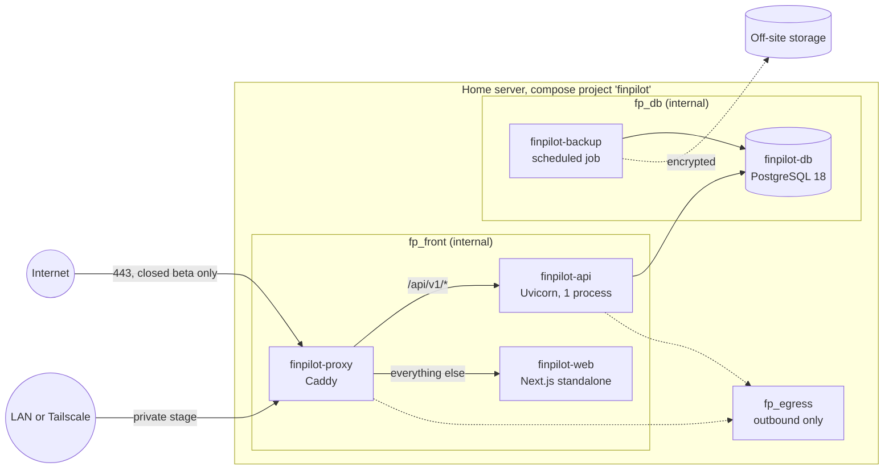

# FinPilot production readiness audit (Phase 1)

**Date:** 2026-11-12. **Goal:** a private deployment on the owner's Ubuntu home server, then a controlled closed beta. Demo Mode is deferred.

**Scope and method.** I read the repository and documentation only. Nothing was deployed or installed, and no server was contacted. No migration ran, and no credential was read, rotated or printed. `finpilot_dev` wasn't touched. Every statement about the home server is a requirement or a question; **nothing about its current configuration or capacity is assumed.**

**Where things stand.** The application layer is in good shape for a small private deployment. Sign-in, sessions, CSRF, isolation, exports, the restricted role and RLS were all built and tested in earlier milestones (`SECURITY_AUDIT.md`, `SECURITY.md`, last section). **What's missing is everything around the application:**

- no container images, compose file, proxy configuration, backups, monitoring or deployment procedure exist in the repository;
- there's no beta access control: any Google account with a verified email can create an account today;
- there are no legal pages;
- erasure can't run against a real database.

This audit is a self-assessment. It doesn't show the system is secure, and it isn't an external review.

### Status after P2a, production packaging (2026-11-12)

The packaging is built: `backend/Dockerfile`, `apps/web/Dockerfile`, `deploy/compose.yaml`, `deploy/Caddyfile` (since P4: `deploy/caddy/`), and the scripts in `deploy/scripts/`. Instructions and rollback are in [`deploy/README.md`](../deploy/README.md).

**Docker wasn't available on the build machine, so no container has run.** Running Caddy locally wasn't permitted either. What was actually run:

- static checks of every deployment file (`tests/test_deploy_config.py`);
- the scripts' refusal paths and secret generation, run for real;
- the production-mode API, as the restricted role, on a throwaway server provisioned by the real scripts, behind the standalone web server (`tests_stack/local_stack.py`).

Run `deploy/scripts/stack-test.sh --run` on a machine with Docker before going further.

| Item | State |
|---|---|
| LB-1 Packaging | **Built, not run in containers** |
| LB-3 Migration credentials | **Done.** `MIGRATION_DATABASE_URL` (or a file). In production, migrations refuse to fall back to the app's role |
| LB-4 Client address | **Done.** `TRUSTED_PROXIES` names the proxy, and production refuses to start without it or with a catch-all. The proxy sends `/api/v1/*` straight to the API. Tested at the app level; the proxy path is untested |
| LB-5 One process | **Done** in the image |
| LB-6 HTTPS and ingress | Proxy configuration built: TLS, 1 MB bodies, timeouts, query strings and headers kept out of logs. **Untested**, and OD-20 is still open |
| LB-7 Backups | Encrypted dump (as the owner) and restore into a new database are scripted. The off-site copy, schedule and alerting aren't |
| LB-8 Secrets | Files only, never environment variables (`FINPILOT_SECRETS_DIR`, `*_FILE`). `init-secrets.sh` generates them once and never replaces them. No production secret exists |
| LB-9, LB-10 | Open: the host inspection, and a recorded build source |
| PB-9 PDF sandbox | **Found and fixed: Chromium's sandbox was off.** Playwright passes `--no-sandbox` unless asked not to, so PDFs rendered unsandboxed everywhere until now. It's on now, with no setting to turn it off. Verified locally on Windows. **Under Docker's default seccomp profile it's unverified**: if it can't start there, PDF export answers 503 rather than run unsandboxed |
| PB-1 to PB-8, PB-10 to PB-12 | Open, unchanged |

### Status after P4 preparation (2026-11-13)

The server integration test is ready to run, and the owner runs it (SSH needs the key's passphrase). It hasn't run yet, so the container rows above stay **unverified** until its report arrives. Details are in [`deploy/README.md`](../deploy/README.md).

| Item | Change in P4 |
|---|---|
| PB-9 PDF sandbox | Docker 29.9.2's own profile **does** refuse what the sandbox needs without `CAP_SYS_ADMIN` (read from the profile, not assumed). The API now has its own profile: Docker's default plus `clone`, `unshare` and `chroot`, with no capability. A probe checks, from `/proc`, that each renderer is in its own PID namespace under its own seccomp filter. The sandbox is never turned off |
| LB-4, LB-6 Ingress | Behind-proxy mode for the home server (Cloudflare Tunnel, then the existing Caddy). Each hop trusts one address, and the API always receives a single client address. Tested by a stand-in edge proxy in the stack test |
| LB-7 Backups | restic (installed on the server) replaces `age` as the recommended encryption. A failed dump leaves no snapshot. Off-site, the schedule and alerting are still open |
| User IDs | api 10201 and web 10202, unused on the server; they were 10001, the AI app's ID, and 1000, the administrator's |
| Packaging | Fixed subnets for every network. Test services moved out of the production compose file |


## 1. Findings by classification

Classes, in order:

- **Launch blocker:** must be done before the first deployment that holds real data, even the owner's own.
- **Pre-beta:** must be done before anyone else is invited.
- **Optional:** worthwhile, but not required for a closed beta.

### 1.1 Launch blockers (private deployment)

| # | Area | Finding | Required outcome |
|---|---|---|---|
| LB-1 | Packaging | No Dockerfiles, `.dockerignore`, compose file or proxy configuration. The web app has no `output: "standalone"`, and `npm start` binds to 127.0.0.1 only | Images and compose as designed in §3, built off the server |
| LB-2 | Database role and RLS | Built and tested on isolated servers only. Production `/readyz` already refuses an unhardened database, so production can't start without them | A **new** production database: migrate, then `apply`, then `verify`, then start the app (§2.2). `finpilot_dev` is never part of this |
| LB-3 | Migration credentials | `migrations/env.py` takes `DATABASE_URL` from the full `Settings`. A production migration job therefore needs every production setting, including the Google secret, with `DATABASE_URL` pointed at the owner role | Migrations use their own variable, `MIGRATION_DATABASE_URL`, and need nothing else. Interim workaround: a separate env file for the migration job |
| LB-4 | Client address | The web app's `/api/v1` rewrite makes every API request come from the Next.js server, so sign-in rate limits share one bucket. Uvicorn isn't run with trusted-proxy settings | The entry proxy sends `/api/v1/*` **directly** to the API. Uvicorn runs with `--proxy-headers --forwarded-allow-ips=<proxy's fixed internal address>` |
| LB-5 | Workers | The rate limiter is per process. `ARCHITECTURE.md` §11.1 plans 2 API workers, which would double every limit | **One** Uvicorn process. Revisit only with a shared limiter (§1.3) |
| LB-6 | HTTPS and ingress | OD-20 is undecided. No TLS, body limit, timeouts or log policy exist | As in §3.4. Access logs must not record query strings, because the Google callback carries `code` and `state` |
| LB-7 | Backups | None exist. **A `pg_dump` by a role that RLS applies to fails** (pg_dump turns row security off and errors out rather than dump a filtered table). So the planned read-only `finpilot_backup` role doesn't work as documented | Nightly dump as the schema owner, or as a backup role with `BYPASSRLS` and read-only grants. Encrypted, off-site, with append-only credentials and the key held off the server. One verified restore before real data (§2.4) |
| LB-8 | Secrets | No production secrets exist yet, which is correct | New values only: a production Google OAuth client, database passwords and DNS token. Root-owned `0600` files outside the repo. Nothing reused from development |
| LB-9 | Host | Nothing is known about the server | The read-only inspection (§5) has no unresolved failure, and conditions HC-1 to HC-8 (`SECURITY.md` §13.6) have written answers |
| LB-10 | Source of builds | This working copy isn't a Git repository, although CI is defined. Images have no traceable source revision | Builds come from a recorded revision: GitHub-hosted CI, or a local build from a tagged commit. Images are referenced by digest. (Committing and pushing need the owner's approval) |

### 1.2 Pre-beta work (before inviting anyone)

| # | Area | Finding | Required outcome |
|---|---|---|---|
| PB-1 | **Beta access control** | `resolve_user` creates an account for any new Google `sub` with a verified email. There's no allowlist, account cap or kill switch | A sign-up mode, `closed`, `allowlist` or `open`, defaulting to `allowlist` in production, with an empty list meaning nobody new. A global cap on new accounts (default 25), and a kill switch that needs no deploy. A translated `not_invited` refusal. Existing accounts are unaffected (§4.1) |
|  | *2026-11-14* | Public registration: `open` is now the production default and no longer refused. Built: the three modes (`closed` is the switch, applied by restart). Not built: the global cap on new accounts | Cap still to do |
| PB-2 | Legal pages | No privacy notice or terms exist, in any language. No acceptance is recorded | Beta privacy notice and terms in the languages offered to testers (en, ar and tr for public launch). Acceptance recorded with a version, after first sign-in. The text comes from the owner, with legal advice where needed (§4.3) |
| PB-3 | Erasure | `scripts/erase_account.py` refuses every database not named `*_test`. There's no `erasure_log`, so restoring a backup would bring erased people back | An approved production erasure path: owner-approved, audited, honouring a grace period (default 14 days). An `erasure_log` that a restore re-applies. A test for "restore, then re-apply erasures" |
| PB-4 | Deletion queue | Nothing runs a pending deletion when its grace period ends. There are no background jobs | An operator procedure, run weekly, that lists due requests and runs the approved erasure (§4.2) |
| PB-5 | Retention | No retention periods are set for audit events, backups, logs or retained trip records | The defaults in §4.2, disclosed in the privacy notice |
| PB-6 | Monitoring | None | At least one external availability check (it sees only `/api/v1/healthz`), plus alerts for a failed backup, low disk and TLS expiry |
| PB-7 | Incident and contact | No `security.txt`, breach plan, or way to reach beta users | A contact address, a one-page incident plan, and a list of testers' addresses kept by the operator |
| PB-8 | Proxy rate limits | Only in-process limits exist | Per-IP limits at the proxy on `/api/v1/auth/*`, plus connection limits |
| PB-9 | PDF in a container | Chromium's sandbox needs either user namespaces or a seccomp profile that allows them. Docker's default profile may refuse it. `PDF_BROWSER_CHANNEL` defaults to `chrome` | The image sets `PDF_BROWSER_CHANNEL=` (bundled Chromium), with Arabic and Turkish fonts. Verify a PDF renders with the sandbox **on**. If it can't, disable PDF exports and record that, rather than pass `--no-sandbox` |
| PB-10 | Reversibility | No command removes hardening if it blocks a needed fix | A tested `db_hardening.py revert`, for owner use only, on the throwaway cluster first |
| PB-11 | Abuse handling | `suspended` exists in the schema, but no operator tool sets it | An audited operator script to suspend or restore an account, which ends its sessions |
| PB-12 | Rollback drills | None run | Each procedure in §7 performed once in the private stage |

### 1.3 Optional improvements

| # | Improvement | Note |
|---|---|---|
| OP-1 | Secrets as files (`secrets_dir` or `*_FILE`) | Keeps passwords out of `docker inspect`. Anyone in the host's `docker` group is effectively root anyway |
| OP-2 | Shared rate-limit store | Only if more than one API process is ever needed |
| OP-3 | Site-wide `X-Robots-Tag: noindex` during the beta | Account pages already have `noindex` |
| OP-4 | CSP violation reporting | Self-hosted only, never a third party |
| OP-5 | Align the data export limit with the documented quota | Built: 5 an hour. `SECURITY.md` §13.2 says 2 a day |
| OP-6 | Restrict `/readyz` to the internal network | It reveals nothing, but has no outside use |
| OP-7 | New-device sign-in notice, status page, CrowdSec or fail2ban at the proxy | After the beta starts |
| OP-8 | Development tooling advisories | 13 low or moderate, development-only (`SECURITY_AUDIT.md`) |
| OP-9 | Disk encryption | HC-8 needs a written decision. Recommended for any host holding real financial data |

### 1.4 Reviewed and fine as built

| Area | Evidence in code |
|---|---|
| Production config | `Settings` refuses: production without Google; http origins outside loopback development; a web origin different from the API origin outside development; and a redirect URI with a path other than the callback. Validation errors hide input, and API docs are off outside development and test |
| OAuth | Single-use, expiring, browser-bound state; PKCE; nonce; identity by `sub`, never email; fixed error codes; no tokens in redirects; callback query strings never logged by the app |
| Sessions and cookies | Opaque hashed tokens; 7-day idle and 30-day absolute expiry; `HttpOnly`, `SameSite=Lax`; `Secure` and `__Host-` decided by environment and not configurable |
| CSRF and origins | Origin or Referer must be FinPilot's own (a missing one fails), plus a per-session token compared in constant time. The browser only ever calls its own origin, so no CORS |
| Headers | API: `no-store`, `nosniff`, frame denial, `no-referrer`, CORP and HSTS. Web: nonce CSP, COOP, Permissions-Policy, HSTS in production, `no-store` on account pages |
| Exports | `no-store`, attachments, row caps, partial labels, formula neutralization, PDF without JavaScript or network |
| Logging | JSON to stdout, an allowlist of fields, route templates instead of URLs, uvicorn's access log off |
| Database timeouts | `statement_timeout` 15 s, `idle_in_transaction_session_timeout` 150 s. The pool (5 + 5) stays under the role's connection limit (20) |
| Health | `/healthz` is process only. `/readyz` checks the database, migration heads and, in production, hardening, and reveals no reason |

---

## 2. Database: role, RLS, migrations, backup and rollback

### 2.1 Roles in production

| Role | Login | Used by | Rights |
|---|---|---|---|
| `postgres` (container superuser) | Local socket inside the container only | `create-role`, emergencies | Everything. Never used by the app or backups |
| `finpilot_owner` | Yes | Migration job, `apply`, erasure, backups | Owns the schema. RLS doesn't apply to it (`FORCE` is off) |
| `finpilot_app` | Yes, `CONNECTION LIMIT 20` | The API only | What `app/db/hardening.py` grants. No DDL. RLS applies |
| `finpilot_backup` (optional) | Yes | Backup job | `SELECT` only, plus `BYPASSRLS`, so `pg_dump` works. Otherwise back up as `finpilot_owner` |

### 2.2 Order on every deployment

1. A fresh backup, as the owner (§2.4).
2. **Migration job**, as `finpilot_owner`: `alembic upgrade head`.
3. **`db_hardening.py apply`**, as the owner. It's re-runnable: it drops and recreates each policy and replaces grants. It refuses any table that isn't classified, so a new table without a decision stops the deploy here.
4. **`db_hardening.py verify`**, as `finpilot_app`. Any forbidden action that isn't refused stops the deploy.
5. Start or replace the API. Traffic goes to it only once `/readyz` passes, which in production includes `is_hardened`.
6. Replace the web container.

Migrations stay expand-then-contract (`ARCHITECTURE.md` §11.8), so the previous app version keeps working against the new schema during steps 2 to 5.

**Not on `finpilot_dev`.** Production starts as a new, empty database in its own container. `finpilot_dev`, its roles and its data stay exactly as they are.

### 2.3 What RLS does and doesn't cover

These are unchanged from `SECURITY.md` and restated here for the deployment review:

- RLS catches a query that forgot its user filter. It doesn't stop arbitrary SQL injection, because the runtime role sets `app.user_id` itself.
- `users`, `user_identities`, `sessions`, `oauth_states`, `audit_events`, `currencies` and `fx_rates` have no RLS, each for a reason listed in `hardening.py`.
- A future beta allowlist table belongs in that list too: it's read before anyone is identified.

### 2.4 Backups

| Item | Default |
|---|---|
| What | `pg_dump -Fc` of the FinPilot database only, plus the deployment configuration without secrets |
| When | Nightly, and immediately before every migration |
| Role | `finpilot_owner`, or `finpilot_backup` with `BYPASSRLS` |
| Encryption | `age` to a public key on the server. The private key is kept off the server, in two places |
| Off-site | A storage account whose credentials can add but not delete or overwrite (object lock or append-only) |
| Retention | 7 daily, 4 weekly, 3 monthly. Disclosed in the privacy notice |
| Restore check | Into a throwaway container: per-currency ledger balance, `Σ net = 0` per trip, row counts matching, and `/readyz` passing against it. Monthly, plus once from the off-site copy only, before the beta |
| Alerts | A missing or failed nightly backup alerts the owner |

**Erasure and backups:** until `erasure_log` exists (PB-3), a restore brings back anyone erased since that backup. That's one reason erasure stays disabled for real data until PB-3 is done.

### 2.5 Rollback (database)

- **Application only:** redeploy the previous image digests. Safe whenever the last migration was additive, which expand-then-contract guarantees for one release.
- **A failed migration:** Alembic runs each migration in its own transaction, so a failure rolls that migration back by itself. Fix it and redeploy.
- **A bad migration that succeeded:** don't run `alembic downgrade` on real data. Most downgrades drop tables. Restore the pre-migration backup into a new database, check it (§2.4), and point the app at it. The broken database is kept until the owner decides.
- **Hardening blocks a fix:** re-run `apply` after correcting the classification, which is the normal path. `revert` (PB-10) is the last resort, and while it's in effect production `/readyz` fails, on purpose.

---

## 3. Isolated deployment design for the home server

This is a design to check against the inspection results, not a configuration to apply. Every port, path, subnet and size is a placeholder until §5 has been run.

### 3.1 Layout



| Network | Members | Internet access |
|---|---|---|
| `fp_front` (internal) | proxy, web, api | None |
| `fp_db` (internal) | api, db, backup | None |
| `fp_egress` | proxy (ACME), api (Google, Frankfurter, Coinbase), backup (upload) | Outbound |

The web container and the database have no internet access. Nothing is shared with other software on the host: no networks, volumes, credentials or database server. **FinPilot never uses a PostgreSQL server that's already on the host.**

### 3.2 Containers

| Service | Image | Memory / CPU / PIDs (initial estimates) | Healthcheck |
|---|---|---|---|
| `finpilot-proxy` | Caddy 2, pinned by digest | 128 MB / 0.5 / 128 | Caddy's admin endpoint inside the container, never published |
| `finpilot-web` | Node 24 slim, Next.js standalone, uid 10001 | 384 MB / 1.0 / 256 | `GET /en` on the internal port |
| `finpilot-api` | Python 3.14 slim, uv-installed, Playwright Chromium, Noto and DejaVu fonts, uid 10001 | 1 GB / 1.5 / 512 (Chromium, 2 concurrent PDFs) | `GET /api/v1/healthz` for liveness. Traffic also needs `/readyz` |
| `finpilot-db` | `postgres:18`, pinned by digest, ICU | 1 GB / 1.0 / 256 | `pg_isready` |
| `finpilot-migrate` | Same image as the API | One-off | Exit code |
| `finpilot-backup` | Small image with `pg_dump` 18, `age` and an upload tool | 256 MB, nightly | Exit code, and a missing run alerts |

Every service: `restart: unless-stopped` (jobs: no), `read_only: true` with a `tmpfs` for `/tmp` (and for `HOME` on the API, which Chromium needs), `cap_drop: [ALL]`, `security_opt: [no-new-privileges:true]`, the default seccomp profile, and no Docker socket. Logs use `json-file` with `max-size: 10m` and `max-file: 5`.

Only the proxy publishes a port. In the private stage it binds a LAN or Tailscale address. If the host already runs a reverse proxy, that proxy forwards to FinPilot's on a loopback port, and 443 stays with the host proxy. **That choice waits for the inspection.**

**Minimum free capacity** for the estimates above: about 3 GB of RAM, 2 cores, and 20 GB of disk plus local backup space. The inspection confirms whether this exists alongside everything else on the host. Limits are replaced by measured values in the private stage.

### 3.3 Configuration and secrets

| File | Owner and mode | Holds |
|---|---|---|
| `/opt/finpilot/compose.yaml` | root, 0644 | Images by digest, limits, networks. No secrets |
| `/opt/finpilot/env/api.env` | root, 0600 | `APP_ENV=production`, `DATABASE_URL` (runtime role), Google client, `WEB_ORIGIN`, `PDF_BROWSER_CHANNEL=` |
| `/opt/finpilot/env/migrate.env` | root, 0600 | `MIGRATION_DATABASE_URL` (owner role) only, once LB-3 is done |
| `/opt/finpilot/env/db.env` | root, 0600 | The superuser password, used only inside the container |
| `/opt/finpilot/env/backup.env` | root, 0600 | Owner or backup role URL, `age` public key, upload credentials (append-only) |
| `/opt/finpilot/env/proxy.env` | root, 0600 | DNS API token, if DNS-01 certificates are used |

The `age` private key is never on the server. Secret files never enter Git, images or logs. Rotation follows `scripts/rotate_dev_password.py`'s approach (SCRAM verifier, staged config, nothing printed), adapted for production when needed.

**Google OAuth:** a new production client. The only redirect URI is exactly `https://<host>/api/v1/auth/google/callback`. Scopes stay `openid email profile`. During the beta, keep the consent screen in **Testing** status with the testers listed: it's a second gate behind PB-1 (limit 100 people), never the only one.

### 3.4 Ingress and HTTPS (recommended default for OD-20)

1. **A dedicated hostname** such as `finpilot.<owner's domain>`, never the apex of a domain that serves other sites, because both FinPilot and the API send HSTS with `includeSubDomains`.
2. **Private stage:** no router port opened. The hostname resolves on the LAN, or through Tailscale, to the server. Caddy gets certificates by **DNS-01**, so no inbound port is needed even for certificates.
3. **Closed beta:** forward 443 (and 80, for redirects only) to FinPilot's proxy. This is conditional on the inspection showing a public IPv4 (no CGNAT) or usable IPv6, and on HC-7, the provider permitting it. Caddy terminates TLS, so no third party sees the traffic.
4. **Fallback** if direct exposure isn't possible or permitted: a tunnel such as Cloudflare Tunnel. It opens no port and hides the home address, but the tunnel provider terminates TLS and can see traffic. The privacy notice must say so.

**Proxy rules:**

- `/api/v1/*` goes straight to the API, everything else to the web container.
- A 1 MiB body limit, plus read, header and idle timeouts against slow clients.
- Per-IP rate limits on `/api/v1/auth/*` (PB-8).
- Access logs keep method, route, status and duration, **with the query string removed**. No request bodies.
- HTTP redirects to HTTPS.

### 3.5 Deployment workflow (recommended default for OD-25)

- Images are built **off the server**: in GitHub-hosted CI from `main` once the code is under version control, or locally from a tagged commit until then. Every image has a vulnerability scan with no unresolved high findings, and is recorded by digest.
- The server never builds code and never runs a CI runner. The owner runs a short deploy script on the server: pull by digest, back up, migrate, `apply`, `verify`, roll out, check `/readyz`, and on failure put back the previous digests (§7).
- Every deployment is recorded: date, digests, migration head, backup file name.

---

## 4. Account lifecycle, retention, legal and beta access

### 4.1 Beta access control (PB-1, design)

- `SIGNUP_MODE`: `closed` (no new accounts), `allowlist` (default in production), or `open` (public launch only, behind `SECURITY.md` §13.1).
- **Allowlist:** the operator adds an invited tester's address with an audited script. On the **first** sign-in of a new Google `sub` with a verified email, the address must be on the list. It's only checked for admission: identity stays the `sub`, and no account is ever linked by email.
- **Cap:** at most `BETA_MAX_ACCOUNTS` new accounts (default 25), whatever the list says.
- **Kill switch:** an operator script sets sign-up to `closed` without a deploy. Existing testers keep working.
- Refusals use the landing page's existing error route, with a new translated code `not_invited` and an audit event. They don't say whether an address is listed.
- Needs one additive migration, a `NO_RLS` classification (it's read before identification), and tests: unlisted refused, listed admitted, cap reached, kill switch, existing users unaffected.

### 4.2 Deletion, erasure and retention

What's built: the download, the reversible request, the blocks and warnings, and erasure for test databases (`SECURITY.md`, last section). What the beta needs:

| Item | Recommended default | Status |
|---|---|---|
| Grace period | 14 days from the request, then erasure by the operator within 7 days | Assumption. Confirm with legal advice (R-55) |
| Erasure runs | Weekly operator procedure: list due requests, re-check blockers, take a backup, run erasure with `--owner-approved`, record it in `erasure_log` | Not built (PB-3, PB-4) |
| `erasure_log` | User ID and time only, kept as long as the oldest backup, re-applied after any restore | Not built |
| Retained trip records | Kept while the trip exists for other members, shown as a former member without name or email (`SECURITY.md` §11.2) | Policy recorded. Period still needs legal advice |
| Audit events | 12 months, then removed or pseudonymized, once the audit erasure exception is designed (OD-18) | Not built. Until then, kept and disclosed |
| Sessions, OAuth states | Already cleaned inline after expiry | Built |
| Backups | 3 months at most (§2.4) | Configuration |
| Container logs | About 14 days by rotation. They contain no personal data by design | Configuration |
| OD-18 block scope | Keep the built behaviour for the beta: trip balances, pending items, disputes and open trips with others block; personal debts only warn. A tester can always ask the operator | **Owner and legal decision before public launch** |

### 4.3 Legal pages (PB-2)

- **Needed for the beta:** a privacy notice and beta terms, reachable from the landing page and the app, accepted with a recorded version after first sign-in.
- **Content the notice needs:** who operates FinPilot and how to reach them; home hosting with no SLA; that the operator can technically read stored data; Google as sign-in provider; Frankfurter and Coinbase lookups, which receive no personal data; any tunnel or monitoring provider; retention periods; deletion and its limits; that FinPilot isn't a bank and moves no money.
- **Not decided here:** the jurisdiction, the age rule and the legal basis. Those need advice, and this audit doesn't guess them. For a closed beta of known, invited people, plain-language beta terms plus the notice are the safe minimum. Professionally reviewed versions in all three languages remain a public launch requirement.

---

## 5. Read-only server inspection (for a later stage)

> P3 (2026-11-12): done. The findings, the behind-proxy design and the integration-test plan are in the private server report ([`SERVER_READINESS.md`](SERVER_READINESS.md) is its public summary); the script is [`deploy/inspection/inspect-server.sh`](../deploy/inspection/inspect-server.sh).

**Don't run these yet.** They're for the owner to run, or to approve running, at the inspection stage.

Every command here only reads, and nothing is installed or written on the server. Output goes to the terminal only. It identifies the machine (addresses, hostnames, other software), so it's kept **outside this repository**, as `ARCHITECTURE.md` §12 requires.

**Never run during inspection:**

- `docker inspect` or `docker compose config` (they print other projects' environment variables, including secrets);
- `env`, or `cat` of any `.env`, key or credential file;
- anything with `install`, `up`, `restart`, `rm`, `prune`, `enable` or `set`.

```bash
# 1. System and capacity
cat /etc/os-release; uname -r; uptime
nproc; free -h; swapon --show
df -hT; df -i; lsblk -o NAME,SIZE,TYPE,FSTYPE,MOUNTPOINTS,ROTA
cat /proc/pressure/memory /proc/pressure/cpu /proc/pressure/io 2>/dev/null
vmstat 1 5

# 2. Time, updates, reboot need
timedatectl show -p NTPSynchronized -p Timezone
systemctl is-active unattended-upgrades; cat /etc/apt/apt.conf.d/20auto-upgrades 2>/dev/null
apt list --upgradable 2>/dev/null | wc -l; ls /var/run/reboot-required 2>/dev/null

# 3. Disk health and encryption (smartctl only if already installed)
lsblk -f | grep -i crypt; command -v smartctl && sudo smartctl -H /dev/sda

# 4. Listening services and firewall (what already uses 80, 443, 5432)
sudo ss -tulpn
sudo ufw status verbose 2>/dev/null; sudo nft list ruleset 2>/dev/null | head -100

# 5. Network
ip -br addr; ip route; resolvectl status 2>/dev/null | head -30
# Optional, contacts an outside service to compare with the router's WAN address (CGNAT check):
# curl -s https://api.ipify.org; echo

# 6. Docker, names and usage only
docker version --format '{{.Server.Version}}'; docker compose version
docker info --format 'root={{.DockerRootDir}} driver={{.Driver}} cgroup={{.CgroupVersion}} seccomp={{.SecurityOptions}}'
docker ps --format 'table {{.Names}}\t{{.Image}}\t{{.Status}}\t{{.Ports}}'
docker network ls; docker network inspect $(docker network ls -q) --format '{{.Name}} {{range .IPAM.Config}}{{.Subnet}} {{end}}'
docker volume ls --format '{{.Name}}'; docker system df
docker stats --no-stream --format 'table {{.Name}}\t{{.MemUsage}}\t{{.CPUPerc}}'
getent group docker

# 7. Existing web entry points and PostgreSQL (presence only, never connect)
systemctl list-units --type=service --state=running --no-pager | grep -Ei 'nginx|caddy|traefik|apache|haproxy|postgres|tailscale|cloudflared'

# 8. SSH and accounts (settings only, no keys)
sudo sshd -T | grep -Ei '^(port|listenaddress|permitrootlogin|passwordauthentication|pubkeyauthentication|allowusers|allowgroups) '
getent group sudo; last -n 10 reboot

# 9. Chromium sandbox prerequisites
sysctl kernel.unprivileged_userns_clone 2>/dev/null; sysctl user.max_user_namespaces
sysctl kernel.apparmor_restrict_unprivileged_userns 2>/dev/null

# 10. Logs and space
journalctl --disk-usage
```

**What the answers decide:**

| Answer | Decides |
|---|---|
| Free memory, cores, disk, pressure | Whether §3.2's limits fit (HC-2) |
| Ports 80, 443, 5432 in use, existing proxy | How FinPilot's proxy binds (§3.2), and that there's no collision with the existing PostgreSQL |
| Docker subnets | FinPilot's subnets and the proxy's fixed address for `--forwarded-allow-ips` |
| Firewall, SSH settings, `docker` group | The isolation review (HC-3, HC-5) |
| Public IP, CGNAT, provider terms | Direct ingress or the tunnel fallback (§3.4, HC-7) |
| Disk encryption, SMART | HC-8, and the disk risk statement |
| User namespace settings | Whether Chromium's sandbox can work (PB-9) |

---

## 6. Implementation plan

Each phase needs the owner's approval before it starts.

| Phase | Work | Where | Estimate |
|---|---|---|---|
| **P1** | This audit | Local docs | Done |
| **P2a: code** | `MIGRATION_DATABASE_URL` (LB-3); beta sign-up mode, allowlist, cap and kill switch (PB-1); suspend and restore script (PB-11); `db_hardening.py revert` and a backup role with `BYPASSRLS` (PB-10, LB-7); `erasure_log` and the production erasure path (PB-3); legal pages and recorded acceptance, with owner-supplied text (PB-2); `output: "standalone"` | Local, tested on `finpilot_test` and the throwaway cluster | 5 to 7 days |
| **P2b: packaging** | Dockerfiles, `.dockerignore`, compose, Caddyfile template, deploy, backup and restore scripts with placeholders and no secrets. Local image builds, scans and container tests (G1, G2) | Local only | 3 to 4 days |
| **P3** | Read-only inspection (§5), written answers to HC-1 to HC-8, final sizes and addresses | Server, read-only, owner-run or approved | 0.5 day |
| **P4** | Private deployment: production Google client, new database, hardening, backups, restore drill, rollback drills, measured limits. Owner-only access | Server, owner-approved | 2 to 3 days |
| **P5** | Closed beta: open ingress, allowlist testers, external monitoring, incident plan, first erasure drill on a synthetic account | Server, owner-approved | 1 to 2 days, plus legal text time |

Migrations in P2a are additive only: an allowlist table, `erasure_log`, and terms acceptance. They run on `finpilot_test` during development. They reach `finpilot_dev` only with the usual separate approval.

---

## 7. Rollback procedures

| # | Situation | Procedure | Data effect |
|---|---|---|---|
| R1 | New release unhealthy (`/readyz` fails, errors rise) | The deploy script puts back the previous web and API digests and waits for `/readyz` | None |
| R2 | Migration failed | Its own transaction rolled back. Leave the previous release running, fix, redeploy | None |
| R3 | Migration succeeded but is wrong | Stop the API. Restore the pre-migration backup into a **new** database, check it (§2.4), switch the app to it, redeploy the previous release. Keep the wrong database | Changes since the backup are lost; that's why the backup is taken immediately before |
| R4 | Hardening blocks the app | Fix the classification and re-run `apply`, then `verify`. Only with the owner's approval: `revert`, knowing `/readyz` stays failed | None |
| R5 | Ingress problem or suspected attack | Close the router forward or stop the tunnel. The service is back to private immediately | None |
| R6 | Full stop | `docker compose stop` in the FinPilot project only. Volumes and other software untouched | None |
| R7 | Secret exposed | Revoke and replace it (Google client secret, database password, DNS or upload token), restart the affected service, check the audit and access logs | None |
| R8 | Host lost | New host, same images by digest, restore from the off-site backup, re-apply `erasure_log`, verify | Back to the last off-site backup |

---

## 8. Test gates

A gate passes only on evidence from an actual run.

| Gate | When | Must pass |
|---|---|---|
| **G0: code** | Every change | Ruff, format, mypy, import contracts; backend tests as owner and as the restricted role; frontend tests, typecheck, ESLint, Prettier, build; browser tests in both database modes. Plus new tests: beta admission, erasure log re-apply, `revert`, migration URL separation |
| **G1: images** | Every image | Runs as uid 10001 with a read-only root filesystem; no high vulnerabilities unresolved; no secrets in layers; Chromium renders an Arabic and a Turkish PDF with its sandbox on; size recorded |
| **G2: local stack** | Before P3 | Compose on a throwaway database: migrate, `apply`, `verify`, and `/readyz` passes in production mode. A database without hardening makes `/readyz` fail. The API sees the client address, not the proxy's. Bodies over 1 MiB are refused at the proxy. No query strings in proxy logs. The database and web have no internet access |
| **G3: inspection** | Before P4 | §5 complete; HC-1 to HC-8 answered; no collision with existing services |
| **G4: private deployment** | Before P5 | Real Google sign-in. Backup, then restore into a throwaway database, with the ledger checks. R1, R3 and R5 performed once. Limits replaced by measurements. One restore from the off-site copy only |
| **G5: beta opening** | Before inviting anyone | An unlisted Google account is refused; a listed one is admitted; the kill switch works. Legal pages are live and acceptance is recorded. External check and alerts proven by a test alert. Erasure drill on a synthetic account, including restore and re-apply. **Explicit owner approval recorded** |

---

## 9. Decisions, with the recommended defaults

| Decision | Recommended default | Who |
|---|---|---|
| OD-14 Database placement | A dedicated `postgres:18` container on an internal network, never an existing server | Owner, confirmed by inspection |
| OD-20 Public entry | A dedicated hostname. Private: LAN or Tailscale with DNS-01 certificates. Beta: direct 443 to FinPilot's proxy if possible and permitted; otherwise a tunnel, disclosed | Owner, after inspection |
| OD-25 Deployment workflow | Images built off the server, by digest; an owner-run deploy script; no runner on the server | Owner |
| Version control | Put the code under Git with a private remote before P4, so images have a source revision | Owner |
| Beta access | `allowlist`, a cap of 25, the kill switch, Google consent screen in Testing | Owner |
| Workers | One Uvicorn process | Default |
| Grace period | 14 days | Owner, with legal advice |
| Retention | As in §4.2 | Owner, with legal advice |
| OD-18 | Built behaviour for the beta only | Owner and legal, before public launch |
| Jurisdiction, age, legal basis | Not guessed | Legal advice |
| Disk encryption (HC-8) | Yes, if the inspection shows it's practical | Owner |

**Requires the owner's explicit approval, and was not done:** any SSH or server access, creating a Google OAuth client, buying or configuring a domain or DNS, opening router ports, creating production credentials, applying anything to `finpilot_dev`, committing or pushing, and inviting testers.
