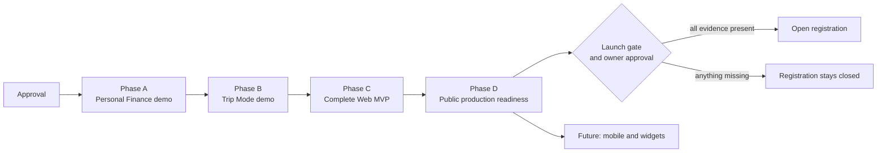

# FinPilot — Development Roadmap and Test Strategy

**Status:** Revision 5: Google is the only sign-in method, and A2 is re-estimated · **Date:** 2026-11-05 · **Incorporates:** portfolio-first delivery (OD-11), and all approved financial decisions

**All durations are estimates based on judgment, not measured velocity.** Re-estimate after Phase A, using real data. **Nothing has started, and Phase A doesn't begin without owner approval.**

---

## 1. Summary

**Portfolio-first delivery [OD-11 approved]:** a working demo with synthetic data first, then the complete Web MVP, then public production. **All previously approved features stay in scope, and each has a phase (`PRD.md` §10).**

| Phase | Planned focused days | Contingency | With contingency | Cumulative | Weeks at 5 / 4 / 3 days per week |
|---|---|---|---|---|---|
| **A: Personal Finance demo** | 32 | 20% | **39** | 39 | 8 / 10 / 13 |
| **B: Trip Mode demo** | 34 | 25% | **43** | 82 | 16 / 21 / 27 |
| **Fast portfolio delivery (A + B)** | **66** | | **82** | | **16 / 21 / 27** |
| **C: Complete Web MVP** | 64 | 25% | **80** | 162 | 32 / 41 / 54 |
| **D: Public production readiness** | 24 | 30%, rounded up | **32** | 194 | 39 / 49 / 65 |
| **Complete product (A–D)** | **154** | | **194** | | **39 / 49 / 65** |

**Focused days aren't calendar days.** A focused day is 5–6 hours of real work. Weeks above count only those days, for one developer working part of each week.

**External waits aren't included:** legal advice, native reviewers, and server issues add calendar time.

### Challenge to the targets

| Target | Assessment |
|---|---|
| **Phase A: 15–25 days** | **Exceeded: 32 planned, 39 with contingency.** Google-only sign-in brought A2 from 9 days to 6. The cut list below saves about 3. 15 isn't realistic without weakening correctness or deployment safety |
| **Phase B: 25–40 more days** | **Realistic: 34 planned, 43 with contingency.** The upper end assumes few surprises in correction UX |

**To save about 3 days, cut these, in order:** search on the history page (1), corrections through a simpler screen, with API and tests intact (1), fewer dashboard charts (1). **Never cut:** ledger triggers, invariant tests, authorization tests, or deployment isolation.

### Why this is lower than the earlier 198 days, and how far to trust that

| Change | Days |
|---|---|
| Earlier plan | 198 |
| New demo work: seed data and sandbox, demo deployment, demo integration | +8 |
| Planning already done | −3 |
| Claude Code assistance on routine work | −36 |
| Sequencing and reuse | −15 |
| Google-only authentication in A2: 4 days added to Phase A, 2 moved out of C1 | +2 |
| **This plan** | **154** |

**Assistance can realistically help with:** scaffolding, CRUD endpoints, form and table screens, test boilerplate, migrations, translation drafts, and documentation.

**Sequencing and reuse help with:** one deployment path used by demo and production; components and queries shared by demo and later phases; abuse work only when it's needed; and tests that carry forward.

**It helps much less with:** reviewing financial logic, which the developer must fully understand; correction and approval UX; native-language review; operations on a real server; and legal questions. **These are the areas that most often overrun.**

**This is a hypothesis, not a measurement.** The earlier plan assumed no time saving from assistance, and this one assumes about 20% on the code work. **Re-estimate after Phase A from real velocity.** If there's no saving, the complete product returns to about 200 planned days, and 260 with contingency. Treat **194–260 focused days** as the honest range for the complete product.

### Fast portfolio delivery, by activity

| Activity | Days | Steps |
|---|---|---|
| Features, with their tests (about 30% of this is test writing) | 55 | A1–A6, B1–B5 |
| Synthetic data and demo tooling | 2 | A7 |
| Safe demo deployment | 3 | A8 |
| Integration, end-to-end testing, essential documentation | 6 | A9, B6 |
| **Planned** | **66** | |
| Contingency | 16 | |
| **Total** | **82** | |

### Complete product, by activity (Phases C and D)

| Activity | Days | Steps |
|---|---|---|
| Remaining Web MVP features | 21 | C1–C4 |
| Financial reporting | 12 | C5 |
| PDF, CSV, printing | 9 | C6 |
| Multilingual implementation | 14 | C7 |
| Web MVP testing, accessibility, audit | 8 | C8 |
| Public launch safeguards, privacy | 10 | PD1, PD2 |
| Infrastructure hardening, production deployment | 8 | PD3 |
| Production security and performance review | 4 | PD4 |
| Launch and portfolio documentation | 2 | PD5 |
| **Planned** | **88** | |
| Contingency | 24 | |
| **Total** | **112** | |

### Major uncertainties

| Area | Why | Possible swing |
|---|---|---|
| **Available developer time** | One developer | **The largest factor** |
| Real velocity with assistance | Unmeasured | Up to +46 planned days overall |
| Correction and linking UX (B2, B5) | Hard to make understandable | ±6 days |
| Real Google behavior | Confirmed in A2.4: PKCE works; Google gives no `auth_time` and ignores `max_age` (`SECURITY.md` §2.3) | Retired |
| Server inspection results (A8) | Unknown capacity, proxy, and network | +1 to +5 days, or a demo that can't be hosted here |
| Arabic PDF (C6) | Untested. A Chromium fallback adds work and memory | +1 to +8 days |
| Charts in RTL (C7) | Recharts' RTL behavior is unconfirmed | +1 to +3 days |
| Hosting conditions (PD3) | Could require a VM or more | ±4 days |
| Legal review (PD2) | Could force product changes | Unknown |

### Where a portfolio piece is useful

**The first demo worth showing is Phase A, after about 8–13 weeks of focused work.** The stronger one is Phase B, after about 16–27 weeks. A recorded walkthrough can be used from A6, before any public deployment.

### Cut options, requiring owner approval

These change approved scope, so none of them is assumed.

| Option | Saves | Effect |
|---|---|---|
| Move personal linking (B5) from the Phase B demo to Phase C | About 4 days earlier | Still in the MVP; only the order changes. **The approved OD-1 figures wouldn't be demonstrated until then** |
| Cover images as presets (OD-13) | 2 days | Narrows a listed feature |
| Launch with fewer languages | Up to 14 days | **Changes a confirmed requirement** |
| Invite-only launch first | Part of PD1 | **Changes OD-5** |

---

## 2. Phases

### Phase A — Personal Finance Portfolio Demo · 32 days

| Step | Scope | Days | Depends on |
|---|---|---|---|
| **A1 · Project Foundation** | Monorepo, FastAPI, Alembic, Next.js shell, design tokens, hosted CI with real PostgreSQL. Catalogs, locale routes, logical CSS from day one. **Moved to where they're first needed:** generated API client (A2) and `<Money>` (A3). Shell strings exist in all three languages, as unreviewed drafts | 3 | Approval; local PostgreSQL option |
| **A2 · Authentication and authorization** | **Google sign-in only,** in sub-steps A2.1–A2.5 below: identity schema, Google OAuth backend, sessions and user management, frontend sign-in, and real Google testing. Also user scoping, audit basics, idempotency, error format, generated API client, authorization matrix test | 6 | A1 |
| **A3 · Ledger and accounts** | Currencies, money type, ledger accounts, posting, DB triggers and constraints, accounts, opening balances, derived balances, negative-balance warning, accounts UI | 5 | A2 |
| **A4 · Transactions and transfers** | Income, expense, corrections, voids, same and cross-currency transfers, system categories | 4 | A3 |
| **A5 · History and Quick Add** | History, filters, search, keyset pagination, Quick Add with duplicate-submit protection. **Mostly delivered early, in A4** (the expense-first brief); what remains is refunds, sorting options, amount filters, and transfers recorded from history | 3 | A4 |
| **A6 · Polished dashboard** | Per-currency balances, income, spending, cash flow, category and trend charts, empty states, light and dark themes, phone layout | 4 | A5 |
| **A7 · Synthetic data and sandbox** | Realistic generator, per-visitor sandbox, demo routes, nightly reset, banner, limits | 2 | A6 |
| **A8 · Safe demo deployment** | **Host inspection**, containers, isolated network and database, entry point, hosted image, pull-based deploy, monitoring, stop procedure | 3 | A7, DG items, OD-14, OD-20, OD-25, **owner approval** |
| **A9 · Integration and documentation** | End-to-end journeys, bug fixing, README, architecture summary, walkthrough recording | 2 | A8 |

| | |
|---|---|
| **Deliverables** | A working demo. Repository a reviewer can understand. A recorded walkthrough |
| **Testing** | Google sign-in rules (`SECURITY.md` §2.7). INV-01–08, INV-22, INV-27 (English), INV-30. Raw-SQL rejection tests. Concurrency tests for duplicate POSTs and edits. Authorization matrix. Playwright: Quick Add, transfer, correct, dashboard. Cross-sandbox isolation |
| **Acceptance** | `PRD.md` §11.1, §11.1a |
| **Definition of Done** | CI is green against real PostgreSQL. Every visible control works. The ledger and each trigger are understood and explained in documentation. If deployed: every item in `SECURITY.md` §14.4 has evidence |
| **Major risks** | Dashboard polish without limit: timebox to 4 days. Server inspection surprises. Skipping tests to meet the date. Local database setup |
| **If A8 is blocked** | Coding can proceed through A7 and A9. Use the recorded walkthrough until hosting is cleared |

**A2 sub-steps:**

| Sub-step | Scope | Days | Status |
|---|---|---|---|
| **A2.1** Identity schema | Users, identities, sessions, audit, and constraints | 1 | **Done** |
| **A2.2** Google OAuth backend | Configuration checks, the provider boundary, start and callback, state, PKCE, nonce, ID token verification, user creation, `oauth_states`, and tests against a fake Google | 1.5 | **Done** |
| **A2.3** Sessions and user management | Migrations 0003 and 0004 applied. Session issue, checks, rotation, expiry, logout, revocation, `/auth/me`, profile updates, authorization dependencies, CSRF, in-process rate limits, and audit events | 1.5 | **Done** |
| **A2.4** Real Google backend integration | The owner created development credentials. Real sign-in, PKCE, claims, cookies, repeat sign-in, logout, and revocation confirmed, backend only. Fixed missing `no-store` on account routes | 0.5 | **Done, awaiting review** |
| **A2.5** Frontend and end to end | Sign-in page, protected routes and redirects, translated errors, app shell (sidebar, tablet rail, phone tab bar), profile and preferences, signed-in devices, logout, and CSP. Browser-tested against a mocked API in three languages and seven widths. Real Google through the new pages: with the owner | 1.5 | **Done, awaiting review** |

**A3 sub-steps** (proposed 2026-11-06, with the Recurring Finances feature):

| Sub-step | Scope | Days | Status |
|---|---|---|---|
| **A3.1** Ledger core | Migration 0005: currencies, financial and ledger accounts, transactions (opening balances), immutable journal with commit-time balance checks, idempotency keys. Posting service, derived balances, accounts API. Backend only | 1.5 | **Done, awaiting review** |
| **A3.2** Accounts UI, adjustments, transfers | Migration 0006. Accounts overview with per-currency totals, account detail and activity, add, rename, archive and restore, balance adjustments with a reviewed difference, same- and cross-currency transfers with a confirmed implied rate. Amount input parsed by locale (M7). Browser-tested against the real backend on the test database, in three languages, light and dark, at six sizes | 2 | **Done, awaiting review** |
| **A4** Expense-first experience | Migration 0007. Automatic Cash and Bank, per-user default categories (custom, rename, archive), default account. Income and expense through the ledger, corrections (reversal and replacement) and voids. Home with Quick Add (inline, and from the top bar or N), this month per currency, top categories, recent entries. Transactions page grouped by day, with search, filters, paging, detail and history. Browser-tested against the real backend on the test database, in three languages, light and dark, at seven sizes | 4 | **Done, awaiting review** |
| **R1** Recurring rules and occurrences | Tables, the date engine (R3, R5, R6), lazy generation, Recurring page with expected and pending items. Posts nothing | 2 | Planned, after A4 |
| **R2** Confirmations | Confirm, not yet, skip; one posting per occurrence (R2); in-app reminders | 2 | Planned |
| **R3** Debts and loans | Needs approval of `FINANCIAL_RULES.md` §4.10 first | 3 | Blocked on a decision |

Recurring Finances add about 7 days to Phase A. **On 2026-11-06 the owner asked for them as part of a larger combined milestone (M5, below).**

**Combined milestone M5 · Multi-currency spending, Amount Equivalent, Recurring Finances** (owner brief, 2026-11-06). It replaces R1 to R3 above and pulls the personal parts of B3 (exchange rates) forward. Internal checkpoints, each with its own tests before the next starts:

| Checkpoint | Scope | Depends on |
|---|---|---|
| **M5.1** Exchange-rate service | `fx_rates` (immutable observations and manual rates), Frankfurter v2 adapter for currencies and gold, Coinbase spot adapter for Bitcoin (display only), caching, timeouts, one retry, outbound budget, sanity checks | A3 money rules (M1 to M4) |
| **M5.2** Conversion when recording | Quick Add takes the amount in any supported currency; the ledger posts in the account's currency, and the original amount, rate, source and method stay on the transaction. Accept the reference rate, type the amount actually charged, or type a rate. Corrections keep the stored rate unless a new one is given | M5.1, A4 |
| **M5.3** Amount Equivalent | Display-only values of an amount or balance in favourite currencies, gold (gram, troy ounce) and Bitcoin, with source and time. Never posts, never claims ownership | M5.1 |
| **M5.4** Recurring rules and occurrences | Rules (income, expense, installments with a count), monthly date windows, weekly, every two weeks, yearly; lazy idempotent generation 35 days ahead; Recurring page | A4 |
| **M5.5** Confirmation | Received/Paid, Not yet, Skip; one posting per occurrence, with conversion when the rule's currency differs from the account's | M5.2, M5.4 |
| **M5.6** Personal debts | `FINANCIAL_RULES.md` §4.10, only if its rules prove complete on inspection; otherwise stopped and documented | M5.4 |
| **M5.7** Home Upcoming, design, three languages, browser tests | Compact Upcoming list on Home, equivalents as a secondary action | All above |

Not in M5: budgets, reports, trips, deployment, notifications outside the app.

**Status (2026-11-06): M5.1 to M5.7 done, awaiting review.** Migrations 0008 and 0009 applied to development. Debts were implemented because §4.10's rules proved complete; interest, fees, forgiveness and write-offs stay excluded.

**Combined milestone M6 · Live money formatting, Budgets, Insights, Reports and Export** (owner brief, 2026-11-07). One money input everywhere (live grouping, caret kept, ambiguous separators refused); monthly budgets (migration `0010`); Insights; Reports with sections A–F; CSV, PDF (Chromium) and print; Home budget panel. **Status (2026-11-07): done, awaiting review.** Not in M6: Trip Mode, category groups, async export jobs, deployment.

**M6.1 · Financial accuracy and reporting polish** (2026-11-07): budget currency rules verified, cross-surface reconciliation, Print via the complete PDF, explicit PDF completeness, renderer hardening, search-narrowing labels, Home spending equivalent. **Status: done, awaiting review.** No migration. Trip Mode not started.

**Why the reorder:** checking real Google straight after A2.3 means a surprise, such as PKCE behaving differently for this client type, is found before the frontend depends on it. It costs nothing extra, but needs credentials one step earlier. **It needs your approval;** otherwise the original order stands.

**Google sign-in is off in the demo** (`SECURITY.md` §14). **Development credentials exist (A2.4). Production credentials are needed only before public production.**

**Excluded from Phase A, and delivered later:** custom categories, refunds, adjustments, budgets, reports, exports, Arabic and Turkish. **These aren't shown as controls.**

### Phase B — Trip Mode Portfolio Demo · 34 days

**Each step ends in something demonstrable, so the demo can be updated partway through.**

| Step | Scope | Days | Depends on | Demonstrable result |
|---|---|---|---|---|
| **B1 · Trips and participants** | Trips, synthetic personas as registered participants, roles, policy module, persona switching | 4 | Phase A | A trip with members |
| **B2 · Expense engine** | Allocation, versions, payer confirmation, corrections, cancellation, preview endpoint, balances, notifications (basic), trip dashboard | 9 | B1 | **Milestone: single-currency shared expenses with approvals** |
| **B3 · Multi-currency** | Provider adapter, rate cache, stale handling, manual rates, two-stage allocation, provenance display | 5 | B2; assumption #1 | Expenses in several currencies |
| **B4 · Settlements** | Record, confirm, reject, partial, overpayment, reversal, settle in full, suggestions, balances page | 6 | B3 | **Milestone: a complete trip, without personal linking** |
| **B5 · Linking and allocation** | `trip_*` transactions, links, attach, `needs_review`, unlink, allocation in dashboard, cash vs allocated view, trip-allocation filter, duplicate warnings | 6 | B4; assumption #13 | **Milestone: Alex's figures, end to end** |
| **B6 · Integration and demo update** | Trip seed data, Scenarios A–F as tests, end-to-end journeys, redeploy, documentation | 4 | B5 | The Phase B demo |

| | |
|---|---|
| **Testing** | INV-09–13, 16, 18–23, 25, 28, 29, 31, 32. Hypothesis state machines. Scenarios A–F. Approve vs correct and confirm vs cancel races against PostgreSQL. Link rollback by fault injection. Marker-string privacy test |
| **Acceptance** | `PRD.md` §11.2 |
| **Definition of Done** | Random operation sequences never violate an invariant. The state machines and the identity in `FINANCIAL_RULES.md` §11.4 are documented and understood. The redeployment still meets `SECURITY.md` §14.4 |
| **Major risks** | B2 is the most likely to overrun: re-estimate there. Making two figures understandable (R-41). FX provider availability in a public demo, for which seeded rates are the fallback |

**Budgets arrive in C2, so OD-10 isn't visible until then.** Phase B shows the same allocation figure in spending analytics and trip balances.

### Phase C — Complete Web MVP v1.0 · 64 days

**Starts with the PDF and Arabic spike (1 day, counted in C6), so that any engine change is known before reporting is built.**

| Step | Scope | Days | Depends on |
|---|---|---|---|
| **C1 · Account completion** | Preferences screens, data export, jobs table and worker, real email provider | 4 | Phase A; OD-6 |
| **C2 · Finance completion** | Custom categories, refunds, adjustments, effective-dated budgets with allocations, currency exclusions, Insights | 7 | C1, B5 |
| **C3 · Trip completion** | Invitations, full roles, leave and remove, former-member scope, OD-4 notices, completion and archive, notification inbox, covers per OD-13 | 7 | C1; OD-13, OD-19 |
| **C4 · Disputes** | Create, withdraw, resolve, closure on correction, markers, notifications | 3 | C3 |
| **C5 · Reporting** | Canonical queries, personal, trip, and participant reports, filters, reconciliation rows, trip positions, "What changed?", performance targets | 12 | C2, C4 |
| **C6 · PDF, CSV, printing** | Spike first. Templates, embedded fonts, export jobs, limits, downloads; CSV profiles; print routes | 9 | C5; OD-15 |
| **C7 · Localization** | All strings in Arabic and Turkish, glossary, RTL across every screen, Arabic PDF, native-speaker review, Turkish and Arabic search, chart RTL | 14 | C6; OD-23 |
| **C8 · MVP testing** | Complete authorization and audit coverage, accessibility, cross-browser, end-to-end in three languages, usability tests | 8 | C7 |

| | |
|---|---|
| **Testing** | All invariants. Everything in §3 except public-scale abuse and load |
| **Acceptance** | `PRD.md` §11.3 |
| **Definition of Done** | Every acceptance criterion has a passing test or recorded check. A native reader of each language has completed the §3.4 journeys. **Not public** |
| **Major risks** | Arabic PDF. Finding qualified reviewers. Reporting query complexity |

### Phase D — Public Production Readiness · 24 days

**Public registration stays disabled until every mandatory requirement has evidence, and the owner has approved it.**

| Step | Scope | Days | Depends on |
|---|---|---|---|
| **PD1 · Anti-abuse** | New-account limits and cap, launch quotas, kill switch, suspension, per-recipient email limits, queue bounds, connection limits, and a bot check if OD-22 requires one | 5 | Phase C; OD-22 |
| **PD2 · Privacy and legal** | Deletion tracks, erasure, `data_requests`, privacy notice and terms in three languages, age rule. **Legal advice is external and adds calendar time** | 5 | **OD-18** |
| **PD3 · Infrastructure** | Second inspection, hosting conditions, production isolation, database, entry point, safe CI/CD, secrets, off-site encrypted backups, restore tests, monitoring, external checks, incident procedures, runbook | 8 | OD-14, OD-20 |
| **PD4 · Review and load** | Security review (described honestly as self-assessment with scanning, unless paid), production performance tests, global cap, Arabic PDF verification at real scale, failure drills | 4 | PD1–PD3 |
| **PD5 · Launch documentation** | User-facing status and limits, portfolio update | 2 | PD4 |

| | |
|---|---|
| **Testing** | Abuse tests, restore from off-site only, failure drills, load at the cap on the real host, erasure and restore after erasure |
| **Acceptance** | `PRD.md` §11.4 |
| **Definition of Done** | Every item in `SECURITY.md` §13.1 and §13.6 has evidence. **Opening registration has explicit owner approval** |
| **Major risks** | Legal review's outcome. Hosting conditions may fail. Sustaining operations alone |

### Traceability from the earlier milestones

| Earlier milestone | Now in |
|---|---|
| M1 Discovery | Done |
| M2 Foundation, i18n, abuse | A1, A2, C1, PD1 |
| M3 Ledger | A3 |
| M4 Transactions | A4, A5, C2 |
| M5 Dashboard | A6 |
| M6 Budgets, analytics | C2 |
| M7 Trips, invitations | B1, C3 |
| M8 Expenses, disputes | B2, C4 |
| M9 Multi-currency | B3 |
| M10 Settlements, linking | B4, B5 |
| M11 Reporting | C5 |
| M12 PDF, CSV, print | C6 |
| M12L Translation | C7 |
| M13 Integration | A9, B6, C8 |
| M14 Public readiness | PD1–PD4 |
| M15 Portfolio docs | A9, B6, PD5 |

## 3. Test Strategy

**Which tests run when:** financial, authorization, and concurrency tests start in Phase A and never stop. Translation and RTL checks start with lint in A1 and full coverage in C7. Abuse, load, and restore tests belong to Phase D. Each phase's list is in §2.

### 3.1 Pyramid

| Layer | Tooling | Focus | Runs |
|---|---|---|---|
| Pure function and property | pytest, Hypothesis | Allocation, conversion, netting, simplification | Every PR, seconds |
| Stateful property | Hypothesis state machines | Random operation sequences against a real PostgreSQL | Every PR; longer nightly |
| Integration | pytest, real PostgreSQL | Services, constraints, locks, authorization | Every PR |
| Database | Raw SQL via pytest | Triggers and constraints without the ORM | Every PR |
| Contract | OpenAPI drift check | Client and server stay aligned | Every PR |
| Component | Vitest, Testing Library | Forms, states, money display | Every PR |
| End-to-end | Playwright | Critical journeys | On merge to main |
| Export | pytest with PDF text extraction | Content, not pixels | Every PR, with a nightly large-file run |
| Accessibility | axe in Playwright, manual keyboard pass | Key pages, in LTR and RTL | On merge; manually each release |
| Load | Simple script (k6 or Locust) | Behavior on the target hardware, and the global cap | Before releases |
| Translation | CI checks on catalogs and code | Completeness, placeholders, no hardcoded text, every error code | Every PR |
| RTL and language | Playwright snapshots in `en`, `ar`, `tr`; native reader review | Mirroring, money isolation, overflow | Snapshots on merge; manual each release |
| Abuse | Scripted | New-account floods, sign-in floods, export floods, quota limits | Before releases |

**Use a real PostgreSQL in tests, never SQLite.** Triggers, partial indexes, and locking are the features being tested. Mocking the database would test nothing that matters here.

### 3.2 Property-based tests

| Area | Properties |
|---|---|
| Ledger | Any operation sequence keeps INV-01, 04, 05, 06 |
| Transfer | Currency-wise zero sum; atomicity under injected failure |
| Allocation | Exact sum, non-negative, zero stays zero, deterministic |
| Conversion | Exact sum of shares in both currencies; correct at every exponent pairing |
| Trip | Any sequence of create, approve, reject, correct, settle, reverse keeps `Σ net = 0` |
| Suggestions | Completeness, `k−1` bound, order independence |
| Corrections | Confirmed settlements unchanged; balances equal fresh recomputation |
| Reports | Identity holds for any filter; totals match independently computed values |
| CSV | Any Unicode round-trips; no output cell begins with an unescaped trigger, even after invisible marks |
| Trip position (OD-1) | `paid + sent − recv = owed + net` after any sequence; `linked = owed + net` when fully linked; no entry from a trip event |
| Spending vs cash (OD-1, OD-16, OD-17) | Trip cash never in spending or income; approved allocation always counted; `include = exclude + only` |
| Budgets (OD-7, OD-10) | Budget allocation equals analytics allocation for the same currency and category; pending and rejected excluded; a linked entry is never counted |
| Dates (Assumptions #4, #10) | Late approval and corrections land on the expense's date; changing time zone changes no period total |
| Negative balances (Assumption #5) | Never rejected; no unrequested entries; balances stay exact under concurrency |
| Attach | Balance unchanged; original kept as reversed |
| Amount parsing | Parsing a formatted amount in any locale returns the exact value, for every exponent |
| Locale independence | The same data yields identical figures in all three languages |

### 3.3 Priority scenarios

| Area | Must-have cases |
|---|---|
| **Atomic transfers** | Fail after the first line; both sides present or neither |
| **Cross-currency** | Different exponents; implied rate displayed; no income or expense effect |
| **Idempotency** | Two concurrent identical requests; same key with a different body; replay after key's window |
| **Concurrent updates** | Two corrections; approve vs correct; confirm vs cancel; remove member vs add expense |
| **Expense approval** | Payer, non-payer, admin, former member; outdated version; rejected then resubmitted |
| **Split** | Every method; 1 beneficiary; 1 minor unit among 3 people; percentage not summing to 100 |
| **Multi-currency** | JPY, KWD; tiny amounts; stale rate; manual rate; provider down |
| **Settlements** | Partial, full, over; confirmed then corrected; reverse; reversal rejected; settle-in-full rounding |
| **Corrections after settlement** | Up, down, cancel; the `FINANCIAL_RULES.md` §9.3 scenario exactly |
| **Linking** | Failure rollback; wrong owner; double link; attach voids and replaces; `needs_review` flows; cross-currency posted amount; three-currency case |
| **OD-1 accounting** | Alex's example exactly; receipt confirmed but unlinked; simplified settlement across people who never shared; one payment across several expenses; correction with link updated and not updated |
| **Final scenarios** | Scenarios A–F in `FINANCIAL_RULES.md` §20, as automated tests |
| **Duplicates** | Strong and possible matches; attach; void; dismissal remembered; no automatic change |
| **Report changes** | The "What changed?" list accounts for the difference between two reports of one period |
| **Demo isolation** | Cross-sandbox access denied; persona switching within a sandbox only; demo routes absent from production builds; no Google sign-in or email in the demo |
| **Disputes** | Each role; multiple disputers; withdrawal; interested party can't dismiss; closure on correction and cancellation; no effect on balances; settlement stays available |
| **Former members** | Visibility scope; settling after removal; 404s outside scope |
| **Deletion** | Block conditions; disputed amount excluded (if approved); time limit; erasure leaves others' balances intact; privacy request never auto-refused; restore after erasure |
| **Public abuse** | New-account caps; sign-in rate limits; per-recipient email limit; queue overflow; connection saturation returns 503; kill switch |
| **Languages** | RTL on every journey; money never reversed; Turkish `I/ı` search and casing; Arabic plurals; `1.234` parsed correctly per locale; regional Arabic browser settings still give consistent digits |
| **Authorization** | The full matrix; IDOR on each resource; privacy scan of all trip outputs |
| **Reports** | Period edges; opening and closing; back-dated correction; filtered balance hiding |
| **Multi-currency reports** | Separate blocks; conversions in the identity |
| **Status handling** | Pending or rejected never in a total, in any format |
| **Google OAuth** | Bad, reused, or expired state; wrong browser; wrong nonce, issuer, audience, `azp`, or signature; unsigned and HMAC tokens; unverified or missing email; malformed claims; concurrent callbacks and first sign-ins; a reassigned email never reaches the old account; no token, code, or identity value in logs or responses |
| **PDF** | 1 page; 200+ pages; header repetition; page numbers; long unbroken text; the `ARCHITECTURE.md` §14.11 test list in `en`, `ar`, and `tr` |
| **CSV** | Consistency with API; injection; encoding; aborted stream |
| **Export limits** | Concurrent requests; oversize; expired download; non-owner |
| **Concurrent reports** | Report during writes is internally consistent |

### 3.4 End-to-end journeys (Playwright)

1. Continue with Google, onboard, add account, Quick Add, see the dashboard update.
2. Transfer across currencies; verify the report.
3. Set a budget, overspend, refund, see the budget update.
4. Three browser contexts: create a trip, invite, join, propose an expense, approve, settle, confirm.
5. Correct an expense after settlement; verify the new balance and suggestions.
6. Link an expense; correct it; resolve the review prompt.
7. Generate each report; download PDF and CSV; check print styles.
8. Revoke a session in one context; another context is logged out.
9. Journey 4 again entirely in Arabic, and journey 1 in Turkish, including amount entry.
10. Alex's example: pay, confirm, link, and verify each figure on the dashboard, report, and PDF.
11. Dispute an expense, correct it, and verify that the dispute closes and balances change only on approval.

Journeys run in all three languages on merge to `main` where runtime allows, and in full before each release.

### 3.5 Coverage policy

Coverage is a diagnostic, not a goal. Financial modules should have near-complete branch coverage, plus mutation testing (`mutmut` or similar) as an occasional check on allocation and netting. Elsewhere, test behavior that matters. Don't chase a project-wide percentage.

---

## 4. Definition of Done (every step)

Steps in Phases A and B may hold translation at English only, and the demo isn't subject to the public launch gate. Everything else applies throughout.

- [ ] Acceptance criteria pass.
- [ ] No visible control is nonfunctional.
- [ ] Tests are written alongside the feature and pass in CI.
- [ ] Relevant invariants are added to the suite.
- [ ] New routes are in the authorization matrix.
- [ ] No financial calculation exists in the frontend.
- [ ] Empty, loading, and error states exist; both themes and phone width checked.
- [ ] From Phase C on: new text is in all three catalogs, at least as a marked draft, and the screen works in Arabic RTL. In Phases A and B: all text is in the catalogs, with logical CSS only. A test requires all three catalogs to have the same keys, so non-English text may be marked as an unreviewed draft until C7.
- [ ] The eight documents reflect what was actually built.
- [ ] Runs in the private test environment and is smoke-tested. **Deployment to the server happens only at approved steps.**
- [ ] The key decisions are understood and documented.

---

## 5. Future Mobile and Widgets — High-Level Estimate

**Rough order of magnitude,** with lower confidence than the web estimate. The web API and rules will be mature by then, but native release work and device issues are hard to predict. In weeks at 5 focused days:

| Phase | Weeks | Notes |
|---|---|---|
| Expo foundation: Router, auth, secure storage, API client, theming | 2–3 | |
| Core: dashboard, Quick Add, history, accounts, budgets | 4–5 | |
| Trip Mode: expenses, approvals, balances, settlements | 3–4 | |
| Reports: viewing and PDF sharing | 1–2 | Server generates; the app downloads and shares |
| Polish: push notifications, deep links, device testing | 2–3 | |
| Localization: reuse catalogs, native RTL, language QA | 2–3 | **Added.** Native RTL behaves differently from the web (`ARCHITECTURE.md` §14.10) |
| **Android + iOS app** | **14–20** | |
| Store preparation and review | 2–3 | Elapsed time depends on review outcomes. Store listings in three languages |
| Native widgets | 3–6 | Depends on `expo-widgets` maturity then, and Android support level |
| **Total** | **19–29 weeks (about 4.5–7 months)** | |

**Prerequisites:** an Apple Developer account and an iOS device or Mac access; a Google Play developer account; current pricing and policy need confirming at that time.

**Consider shipping Android first,** given platform access and cost, then iOS.

**M6.1 decisions (owner, 2026-11-07):** description search keeps narrowing the table only (no totals-from-search option); PDFs keep the 2,000-row limit with the PARTIAL label (no background job queue; CSV covers complete exports); the Home combined estimate sums the rounded per-currency parts. **Trip Mode (Phase B) approved to start.**

**Trip Mode checkpoint T1 (B1-B3), 2026-11-09: done, awaiting review.** Trips, members, roles, single-use invitation links, shared expenses with versions and payer confirmation, corrections and cancellations, multi-currency with stored or typed rates, balances and suggested payments, dashboard and activity feed; migration 0011 on development. Next (on approval): B4 settlements, then disputes and B5 linking.

**Trip Mode B4, 2026-11-10: done, awaiting review.** Settlements (record, confirm, reject, cancel, partial, overpayment warning, reversal, correction), recalculated suggestions, disputes, permission matrix, randomized balance tests; migration 0012 on development. Development DB credential rotated first. Next (on approval): B5 personal linking.

**Trip Mode B5, 2026-11-11: done, awaiting review.** Personal links (record, attach, review, unlink), cash versus share in Home, Budgets, Insights, Reports, PDF and CSV, duplicate warnings, multi-currency links, the trip report (summary, filters, CSV, PDF, print); migration 0013 on development.

**Everyday milestone, 2026-11-12: done, awaiting review.** Refunds, quick templates, calendar, savings goals, subscriptions (on the recurring engine), category groups, cross-currency trip settlements, one-step trip linking, Home shortcuts; migration 0014 on development.

## Expansion milestone (2026-11-14): built, for review

Installments (migration 0016), Total Balance, Analytics (Insights + Reports),
budget removal and restore, subscription and goal management, trip planning and budgets, the
compact Quick Add with automatic account choice, and the sidebar-only navigation. Not started:
Demo Mode, deployment. Open for later decisions: installment variable-rate agreements, and planned-expense conversion for trips in more than
one currency.

## Production readiness audit (2026-11-12): Phase 1 done

Target changed: a private deployment on the home server, then a closed beta. Demo Mode is deferred. Findings, deployment design, plan (P2a to P5), test gates and rollback are in [`PRODUCTION_READINESS.md`](PRODUCTION_READINESS.md). Nothing was implemented or deployed. The next phase starts only on approval.

## Home server inspection (2026-11-12): P3 done

The owner ran the read-only inspection, and [`SERVER_READINESS.md`](SERVER_READINESS.md) is complete. The server can carry FinPilot's limits with wide margins: 14.3 GB of memory free, 72 GB on the NVMe and 1.8 TB on the SSD. Public traffic arrives through a Cloudflare Tunnel into the existing Caddy on 127.0.0.1:8080.

Before public launch:
- Make the existing Caddy forward real client addresses (S-B1).
- Run the container stack (S-B2).
- Set up off-site encrypted backups with restic (S-B3).
- Build a behind-proxy mode for FinPilot's Caddy (S-B4).

Before the test: change the web and API user IDs, which collide with host users, and add non-interference and sandbox checks to `stack-test.sh`.

Next milestone, only on approval: those local changes, then the isolated Docker integration test on the server. That's GO with conditions, see §20. It is not a public launch.

## Isolated Docker integration test (2026-11-13): P4 prepared, run pending

Built locally:
- unique container user IDs;
- fixed subnets for every network;
- a behind-proxy mode for the home server, with a stand-in edge proxy in the stack test;
- an API seccomp profile that keeps Chromium's sandbox on without `CAP_SYS_ADMIN`;
- restic backups;
- a read-only preflight, host snapshots, a watchdog, label-only cleanup, an emergency stop, and a secret-refusing source bundle.

The owner runs the test on the server ([`deploy/README.md`](../deploy/README.md)), and its results go into [`SERVER_READINESS.md`](SERVER_READINESS.md) §21. Public launch stays NO-GO.
